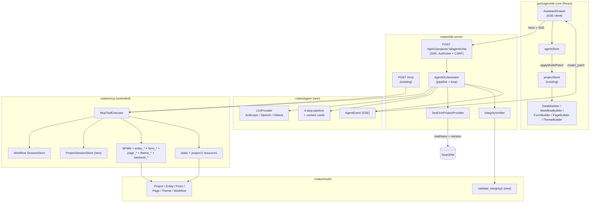

# Agentic App Generation Plan — Embedded MCP Client + Orchestrator

**Status:** Implemented (Phases 22–27); follow-up Phases 29–33 proposed in §15
**Date:** 2026-11-25 (follow-up: 2026-11-25)
**Applies to:** Bonafoid (`crates/mcp`, `crates/model`, `crates/ide-server`, `packages/ide-core`)
**Predecessor:** `docs/MCP-Integration-Plan.md` (Phase 17–21, now implemented in commits `652b0a7` and `57b825e`)
**Roadmap slot:** Milestone 5 — Agentic App Generation, Phases 22–33

---

## 1. Summary

Bonafoid already ships a working MCP server (`crates/mcp`, 23 tools, 7 resources,
stdio + `/mcp`) that lets an external agent author **BPMN workflows**. This plan
turns that into an **in-process agent** that can build a **whole application** —
entities, workflows, forms, pages, themes — from one prompt, streaming every
model change into the live canvas.

Three changes:

1. **Widen the tool surface.** Add project-scoped sessions and `entity_*`,
   `form_*`, `page_*`, `theme_*`, and backend-wiring tools, plus
   `project://{project_id}/...` resources so the agent can discover existing IDs
   before linking anything.
2. **Extract a callable executor.** Turn the tool registry into
   `McpToolExecutor`, shared by `POST /mcp` and a new
   `POST /api/v1/projects/{id}/agent/chat` SSE endpoint. No HTTP call back to
   the server's own `/mcp`.
3. **Stream patches to the UI.** Emit `tool_call` / `model_patch` /
   `validation` / `run_finished` SSE events; a new Zustand `agentStore` applies
   patches to the existing `projectStore`, so entities, BPMN nodes, forms, and
   pages appear live. Finish with a one-click **Build & Preview**.

A verified gap is called out in §8: **`crates/codegen` does not currently emit
workflow routes or depend on `nocode-bpmn`.** The backend tools mutate the model
correctly, but "full-app" workflow execution needs Phase 28 (or an explicit
model-only scope decision).

Four limitations of the shipped implementation are closed in **§15**: no
per-token streaming, no lock (two tabs overwrite each other), no conversation
memory, and no assistant in the Tauri desktop shell. Each is an additive change;
none reopens the architecture above.

---

## 2. Goals and non-goals

### Goals

| # | Goal |
|---|------|
| G1 | A single `McpToolExecutor` used by both `/mcp` and the in-process agent loop. |
| G2 | Project-scoped sessions with revisions, undo/redo, and tenant isolation. |
| G3 | Tools for all five model domains plus backend trigger/service-task wiring. |
| G4 | `project://` resources for full model and cheap ID catalogues. |
| G5 | An async orchestrator (Anthropic / OpenAI / Ollama) with bounded turns and per-step tool allowlists. |
| G6 | A 4-step specialist pipeline (Data → Process/Backend → UI → Verify). |
| G7 | SSE streaming of tool calls and model patches to `packages/ide-core`. |
| G8 | Live canvas updates with no full-page reload, then Build & Preview. |
| G9 | Integrity validation across domains before saving a new revision. |

### Non-goals (v1)

- No autonomous deployment or code generation from the agent (Build & Preview stays a user click).
- No shared or cross-project memory. Phase 31 adds per-conversation memory scoped
  to one user and one project — not a team knowledge base.
- No per-tenant bring-your-own LLM key server-side (server key only; see §12).
  The Phase 32 desktop local agent is the exception: it calls the provider
  directly with a key held in the OS keychain.
- No generated-app plugin host in Phase 28 (plugin service-task binding is model-only).
- No changes to the shipped BPMN tool names (backward compatibility).

---

## 3. Verified current state

Everything below was read from the tree at the start of this plan.

### 3.1 `crates/mcp` (shipped)

| Piece | Reality | Consequence |
|-------|---------|-------------|
| `McpServer { config, sessions: Arc<SessionStore> }` (`src/lib.rs`) | Only workflow sessions | Needs a project-session store |
| `SessionStore` (`src/session.rs`) | `WorkflowSession { workflow, revision, undo, redo }`, keyed by `SessionKey{owner,id}` | Reusable pattern; not project-aware |
| `tools::dispatch` (`src/tools/mod.rs`) | Fixed `const HANDLERS: [Handler; 4]`; sync handlers | New domains need new handler modules + a registry change |
| `ToolDefinition`, `schema_for<T>`, `parse_args<T>` | Already generic via `schemars` | Reuse for every new tool |
| 23 tools | 5 document, 7 graph, 5 quality, 6 definitions | Keep names stable |
| 7 resources | Static `resources::read(uri)` | Project resources need async provider I/O |
| `protocol.rs` | JSON-RPC fallback; sync `dispatch` | Needs an async path for project I/O |
| `persistence.rs` | Raw `TcpStream` HTTP for `save_workflow(target="project")` | The agent must bypass this and write in-process |
| `CallerContext` (`transport/http.rs`) | `owner, user_id, tenant_id, scopes`; `required_scope` | Extend scopes for projects/agent |

### 3.2 `crates/ide-server`

- `AppState.mcp: Arc<nocode_mcp::McpServer>` (`src/server.rs:60`), constructed by `mcp_from_env()`.
- `/mcp` route (`src/mcp.rs`) authenticates with `AuthUser` (Bearer or cookie), derives
  `workflows:read` / `workflows:write` from roles, and calls
  `http::handle_json(&state.mcp, &caller, &body)`.
- `projects::store::{get_project, update_project}` and
  `versioning::store::insert_revision` already provide tenant-scoped load/save and
  append-only history.
- `AuthUser` + `require_csrf` are the existing middleware for browser mutations.

### 3.3 Domain models (`crates/model`)

| Type | Shape relevant to tools |
|------|--------------------------|
| `Project` | `entities: IndexMap<EntityId, Entity>`, `forms`, `workflows`, `pages`, `themes`, `active_theme_id` |
| `Entity` | `name`, `plural_name`, `fields: Vec<EntityField>`, `relations: Vec<EntityRelation>`, `indexes`, `constraints` |
| `EntityField` | `name`, `field_type: EntityFieldType`, `nullable`, `unique`, `default`, `auto_generate`, `validation`, `order` |
| `EntityFieldType` | `String{max_length}`, `Text`, `Integer`, `BigInteger`, `Float`, `Decimal{precision,scale}`, `Boolean`, `Date`, `DateTime`, `Time`, `Timestamp`, `Json`, `Jsonb`, `Uuid`, `Enum{values}`, `Bytes`, `Relation(RelationType)` |
| `RelationType` | `BelongsTo{entity_id,field,on_delete,on_update}`, `HasOne`, `HasMany`, `ManyToMany` |
| `Form` | `name`, `fields: Vec<FormField>`, `layout`, `validation`, `permissions` — **no `entity_id`** |
| `FormField` | `name`, `label`, `field_type: FieldType`, `required`, `validation_rules`, `conditional_visibility`, `ui_props`, `order` |
| `Page` | `name`, `path`, `title`, `layout`, `components: Vec<PageComponent>` (flat), `data_sources`, `actions` |
| `PageComponent` | `component: ComponentType`, `props`, `bindings: Vec<DataBinding>`, `events`, `conditions`, `slots`, `style_overrides` |
| `ComponentType` | ~60 variants; 8 container variants own `children: Vec<ComponentId>` (Container, Grid, Flex, Tabs, Accordion, Card, Modal, Drawer); Popover uses `content` |
| `Theme` | `tokens: DesignTokens { colors: ColorTokens, typography, ... }`; `ColorScale { base, scale: IndexMap<u16,String> }` |

### 3.4 `packages/ide-core`

- `projectStore.ts` already exposes `addEntity`, `addField`, `addForm`, `addFormField`,
  `addPage`, `addPageComponent`, `addPageComponentBinding`, `addWorkflow`,
  `addWorkflowNode`, `setThemeColor`, `setThemeShade`, `saveProject`,
  `previewBuild`, `previewStatus`, `previewRun`.
- `App.tsx` routes; `Layout.tsx` is the shared shell (good place for a global drawer).
- `PlatformApi` uses optional-method gating (`typeof platform.x === 'function'`).
- `apps/ide-web/src/api/client.ts` uses cookie auth + `x-csrf-token` + one 401 refresh.

### 3.5 Codegen (the gap)

`crates/codegen/src/backend.rs::generate_backend` builds its context from
`project`, `entities`, and `forms` only. `templates/backend/routes.rs.hbs` mounts
entity CRUD and form-submit routes. **No template references `workflow`, and
`generate_cargo_toml` does not add `nocode-bpmn`.** Details and options in §8.

---

## 4. Target architecture



---

## 5. Part 1 — Expand `crates/mcp` beyond BPMN

### 5.1 Project sessions

Add a sibling to `SessionStore` with the same revision/undo semantics:

```rust
// crates/mcp/src/session.rs
pub struct ProjectSession {
    pub project: Project,
    pub revision: u64,
    pub undo: Vec<Project>,
    pub redo: Vec<Project>,
}

pub struct ProjectSessionStore {
    sessions: RwLock<HashMap<SessionKey, ProjectSession>>,
    undo_depth: usize,
}

impl ProjectSessionStore {
    pub fn create(&self, owner: &str, project: Project) -> Result<(String, u64), McpError>;
    pub fn with_read<T>(&self, key: &SessionKey, f: impl FnOnce(&ProjectSession) -> Result<T, McpError>) -> Result<T, McpError>;
    pub fn mutate<T>(&self, key: &SessionKey, expected_revision: Option<u64>, f: impl FnOnce(&mut Project) -> Result<T, McpError>) -> Result<(T, u64), McpError>;
    pub fn snapshot(&self, key: &SessionKey) -> Result<Project, McpError>; // for diffing
    pub fn undo(&self, key: &SessionKey) -> Result<u64, McpError>;
    pub fn redo(&self, key: &SessionKey) -> Result<u64, McpError>;
    pub fn discard(&self, key: &SessionKey) -> Result<(), McpError>;
}
```

Keep `SessionStore` for workflow-only sessions so the 23 shipped tools and their
tests are untouched. A workflow session can later be projected onto a project
session, but that is not required for this milestone.

**Cost note.** Each mutation clones the whole `Project` for undo. Projects are
JSON blobs and typical apps are small, so this is acceptable for v1. If it
becomes a problem, switch undo to domain-slice snapshots or JSON Patch without
changing the tool API.

### 5.2 `McpToolExecutor` — the shared dispatcher

This is the centerpiece of the request: one callable Rust struct used by both
`POST /mcp` and the agent endpoint.

```rust
// crates/mcp/src/executor.rs
pub struct McpToolExecutor {
    config: Arc<Config>,
    workflows: Arc<SessionStore>,
    projects: Arc<ProjectSessionStore>,
    provider: Option<Arc<dyn ProjectStateProvider>>,
}

impl McpToolExecutor {
    pub fn list_tools(&self) -> Vec<ToolDefinition>;          // sync, schemars-generated
    pub fn list_resources(&self) -> Vec<ResourceMeta>;        // sync, static entries
    pub fn list_resource_templates(&self) -> Vec<ResourceTemplate>; // project://...

    /// All existing BPMN tools. No I/O, no await.
    pub fn call_sync(&self, caller: &CallerContext, name: &str, args: Value)
        -> Result<Value, McpError>;

    /// Project tools need DB I/O; everything else delegates to call_sync.
    pub async fn call(&self, caller: &CallerContext, name: &str, args: Value)
        -> Result<Value, McpError>;

    pub async fn read_resource(&self, caller: &CallerContext, uri: &str)
        -> Result<ResourceContent, McpError>;
}
```

`ProjectStateProvider` is the only async seam:

```rust
// crates/mcp/src/provider.rs
#[async_trait::async_trait]
pub trait ProjectStateProvider: Send + Sync {
    async fn load_project(&self, tenant_id: &str, user_id: &str, project_id: &str)
        -> Result<Project, McpError>;
    async fn save_project(&self, tenant_id: &str, user_id: &str, project: &Project,
        message: Option<&str>) -> Result<u64, McpError>;   // returns new revision
    async fn list_projects(&self, tenant_id: &str, user_id: &str)
        -> Result<Vec<ProjectSummaryLite>, McpError>;
}
```

`ide-server` implements it with SeaORM:

```rust
// crates/ide-server/src/agent/provider.rs
pub struct SeaOrmProjectProvider { pub db: DatabaseConnection }

#[async_trait::async_trait]
impl ProjectStateProvider for SeaOrmProjectProvider {
    async fn load_project(&self, tenant_id: &str, user_id: &str, project_id: &str) -> Result<Project, McpError> {
        let row = projects::store::get_project(&self.db, tenant_id, user_id, project_id)
            .await.map_err(|e| McpError::Internal(e.to_string()))?
            .ok_or_else(|| McpError::NotFound(project_id.into()))?;
        serde_json::from_str(&row.data).map_err(|e| McpError::InvalidJson(e.to_string()))
    }
    async fn save_project(&self, tenant_id: &str, user_id: &str, project: &Project, message: Option<&str>) -> Result<u64, McpError> {
        projects::store::update_project(&self.db, tenant_id, user_id, project)
            .await.map_err(|e| McpError::ProjectSave(e.to_string()))?;
        versioning::store::insert_revision(&self.db, tenant_id, project, message)
            .await.map_err(|e| McpError::ProjectSave(e.to_string()))
    }
    // list_projects ...
}
```

Wiring:

- `McpServer` holds `executor: Arc<McpToolExecutor>` instead of a bare `sessions`.
  Keep `McpServer::new(config)` (no provider) for the stdio binary and tests.
- Add `McpServer::with_provider(config, provider)` for `ide-server`.
- `protocol::dispatch` gains an async sibling (`dispatch_async`) used by `/mcp`;
  the sync `dispatch` stays for stdio and existing tests.
- `ide-server/src/mcp.rs` calls `state.mcp.dispatch_async(...)`.
- `ide-server/src/agent/*` calls `state.mcp.executor().call(...)` directly.

The stdio binary gets an optional `HttpProjectProvider` built on the existing
`persistence::http_json`, so `project_*` tools also work outside the server. If
no provider and no token are configured, `project_*` returns a typed
`McpError::Forbidden("project tools require an IDE server connection")`.

### 5.3 Tool catalogue (new tools)

Naming convention: the shipped BPMN tools keep their names. New domain tools use
`<domain>_<verb>` as requested.

#### Project session tools (4)

| Tool | Parameters | Internal API |
|------|------------|--------------|
| `project_open` | `project_id`, `view?` | `provider.load_project` → `ProjectSessionStore::create`; returns `session_id`, `revision`, summary |
| `project_get` | `session_id`, `view: "summary" \| "full"`, `domain?` | `ProjectSessionStore::with_read`; summary returns IDs/names only |
| `project_save` | `session_id`, `expected_revision?`, `message?` | `provider.save_project` (DB update + append revision) |
| `project_close` | `session_id` | `ProjectSessionStore::discard` |

#### Database tools (3)

| Tool | Parameters | Internal API |
|------|------------|--------------|
| `entity_create` | `session_id`, `name`, `plural_name?`, `description?`, `fields?: FieldSpec[]` | `Entity::new`, push to `project.entities`; returns `entity_id` |
| `entity_add_field` | `session_id`, `entity_id`, `name`, `field_type` (tag + config), `nullable?`, `unique?`, `default?`, `auto_generate?`, `validation?`, `order?` | `EntityField`; `order` defaults to `fields.len()`; returns `field_id` |
| `entity_add_relation` | `session_id`, `from_entity_id`, `to_entity_id`, `relation_type`, `name?`, `from_field?`, `to_field?`, `on_delete?`, `on_update?`, `also_add_field?` | Creates `EntityRelation` in `Entity.relations`; when `also_add_field` (default true) also adds an `EntityFieldType::Relation` field so the UI field list shows it |

`FieldSpec` for `entity_create` is the same shape as `entity_add_field` minus
`entity_id`, so the agent can create an entity and its fields in one call.

#### UI tools (5)

| Tool | Parameters | Internal API |
|------|------------|--------------|
| `form_create` | `session_id`, `name`, `entity_id?`, `description?`, `fields?: FormFieldSpec[]` | `Form::new`; `entity_id` stored in the new `Form.entity_id` (§5.5); returns `form_id` |
| `form_add_field` | `session_id`, `form_id`, `name`, `label`, `field_type`, `required?`, `default_value?`, `validation_rules?`, `ui_props?`, `order?` | `FormField`; `order` defaults to `fields.len()`; returns `field_id` |
| `page_create` | `session_id`, `name`, `path?`, `title?`, `layout?` | `Page::new`; `path` defaults to `/` + slug; returns `page_id` |
| `page_add_component` | `session_id`, `page_id`, `component_type`, `parent_id?`, `slot?`, `props?`, `bindings?`, `events?` | Pushes to `Page.components`; if `parent_id`, appends the new `ComponentId` to the parent's `children` (8 container variants) or `slots[slot]` |
| `theme_update` | `session_id`, `theme_id?`, `role?` (`primary`…`neutral`), `base?`, `shades?`, `font_family?` | Mutates `Theme.tokens.colors[role]` / `typography`; returns changed tokens |

`page_add_component` is the subtle one: `Page.components` is a **flat**
`Vec<PageComponent>`, and nesting lives inside `ComponentType` container
variants. The tool must do both operations atomically:

```rust
fn add_component(page: &mut Page, spec: ComponentSpec, parent: Option<ComponentId>, slot: Option<String>)
    -> Result<ComponentId, McpError> {
    let id = ComponentId::new();
    if let Some(parent_id) = parent {
        let parent = page.components.iter_mut().find(|c| c.id == parent_id)
            .ok_or_else(|| McpError::ComponentNotFound(parent_id.to_string()))?;
        if let Some(slot) = slot {
            parent.slots.entry(slot).or_default().push(id.clone());
        } else {
            match &mut parent.component {
                ComponentType::Container { children }
                | ComponentType::Grid { children, .. }
                | ComponentType::Flex { children, .. }
                | ComponentType::Tabs { children, .. }
                | ComponentType::Accordion { children, .. }
                | ComponentType::Card { children, .. }
                | ComponentType::Modal { children, .. }
                | ComponentType::Drawer { children, .. } => children.push(id.clone()),
                ComponentType::Popover { content, .. } => content.push(id.clone()),
                _ => return Err(McpError::InvalidParam {
                    name: "parent_id",
                    detail: "parent does not accept children".into(),
                }),
            }
        }
    }
    page.components.push(PageComponent { id: id.clone(), component: build_component(spec)?, .. });
    Ok(id)
}
```

#### Backend wiring tools (2)

| Tool | Parameters | Internal API |
|------|------------|--------------|
| `workflow_set_start_trigger` | `session_id`, `workflow_id`, `node_id` (must be `StartEvent`), `trigger: {kind: "webhook"\|"schedule"\|"signal"\|"message", path?, cron?, signal_ref?, message_ref?}` | Mutates `StartEventType` and records a `trigger` descriptor in `NodeConfig.properties["trigger"]` |
| `workflow_bind_service_task` | `session_id`, `workflow_id`, `node_id` (must be `ServiceTask`), `target: {kind: "entity_crud"\|"http"\|"plugin"\|"function", entity_id?, operation?, url?, method?, plugin_id?, function_name?, input_mapping?, output_mapping?}` | Sets `ServiceTaskImplementation::{Http, Function, Plugin, External}`; `entity_crud` maps to an `Http` call against the generated `/api/v1/{entity}` routes |

Optional convenience: `workflow_scaffold_crud` — creates a StartEvent →
ServiceTask (CRUD op) → EndEvent workflow for one entity in one call. This is
useful for Step 2 of the pipeline and reduces tool-call count.

#### Secondary tools (deferred, nice-to-have)

`entity_update_field`, `entity_remove_field`, `form_update_field`,
`page_update_component`, `page_remove_component`, `theme_add_theme`. These are
not needed for the first end-to-end demo; add them once the core path is green.

### 5.4 Project-wide resources

Static resources stay as they are (7). Add:

| URI | Content | Resolution |
|-----|---------|------------|
| `project://{project_id}/model` | Full project JSON | Provider load, tenant-scoped |
| `project://{project_id}/entities` | `[{id, name, fields:[{id,name,type}]}]` | Summary only, cheap |
| `project://{project_id}/forms` | `[{id, name, entity_id, field_count}]` | Summary |
| `project://{project_id}/workflows` | `[{id, name, node_count, trigger}]` | Summary |
| `project://{project_id}/pages` | `[{id, name, path, component_count}]` | Summary |
| `project://{project_id}/themes` | `[{id, name, active}]` | Summary |
| `project://{project_id}/catalog` | One object with all IDs + names across domains | **The cheapest way for the agent to resolve references** |
| `project://schema/entity` | JSON Schema for `Entity` | `schemars::schema_for!(Entity)` |
| `project://schema/form` | JSON Schema for `Form` | `schemars::schema_for!(Form)` |
| `project://schema/page` | JSON Schema for `Page` | `schemars::schema_for!(Page)` |
| `project://schema/theme` | JSON Schema for `Theme` | `schemars::schema_for!(Theme)` |

The current protocol has `resources/list` and `resources/read` but no
`resources/templates/list`. Add it so clients can discover `project://{id}/...`
without a hard-coded list. `resources/read` matches the template, extracts
`project_id`, loads the project through the provider, and returns a summary or
full model.

### 5.5 One small model addition

`Form` has no `entity_id`, but the request explicitly wants forms bound to an
entity. Add an additive, backward-compatible field:

```rust
// crates/model/src/form.rs
pub struct Form {
    // ...
    /// The entity this form submits to. Optional so existing project JSON
    /// (and forms not yet bound) still deserializes.
    #[serde(default)]
    pub entity_id: Option<crate::entity::EntityId>,
    // ...
}
```

Then run `cargo run -p xtask -- types` to regenerate
`packages/ide-core/src/types/model.schema.json` and `model.generated.ts`. This
is the only schema change in the milestone; it is additive and defaults to
`None`.

Alternative if the team wants zero model changes: bind by field name
(`FormField.name` matching `EntityField.name`) and store the target entity in
`Form.validation` or a new `Page.data_sources` entry. This is weaker (no
referential integrity) and is not recommended.

### 5.6 Cross-domain integrity

Add `crates/model/src/integrity.rs`:

```rust
pub struct IntegrityIssue {
    pub severity: Severity,       // reuse bpmn::engine::Severity or a local enum
    pub domain: String,           // "entities" | "forms" | "pages" | "workflows" | "themes"
    pub object_id: Option<String>,
    pub message: String,
}

pub fn validate_integrity(project: &Project) -> Vec<IntegrityIssue>;
```

Checks:

- `EntityRelation.to_entity` exists; `from_field`/`to_field` belong to the right entities.
- `Form.entity_id` (when set) exists; form field names referenced by page bindings resolve.
- `PageComponent::Form { form_id }` exists; `Table/List/DetailView.data_source` resolves to a `Page.data_sources` entry.
- `Page.path` values are unique.
- `CallActivity.called_workflow_id` and `SubProcess.workflow_id` exist.
- `ServiceTask` `External { connector_id }` / `Plugin { plugin_id }` resolve (plugins from `project.plugins`; connectors may need a provider callback — return a warning if unknown).
- Every workflow passes `BpmnEngine::validate` (call it per workflow).
- `active_theme_id` exists when set.

This function is used by Step 4 of the pipeline and by `project_save` (optional
strict mode). It is also useful to codegen later.

---

## 6. Part 2 — In-process agent loop

### 6.1 New workspace crate `crates/agent`

Why a new crate rather than a module in `crates/ide`: `crates/ide` is the
framework-agnostic core shared with the Tauri desktop shell and has no HTTP/LLM
dependencies. Adding `reqwest` and provider clients there would bloat the
desktop build and blur the layering. Dependency direction stays acyclic:

```
model <- bpmn <- ide <- mcp <- agent <- ide-server
```

```
crates/agent/
├── Cargo.toml
├── src/
│   ├── lib.rs
│   ├── error.rs
│   ├── config.rs          # provider, model, limits (env)
│   ├── events.rs          # AgentEvent (SSE contract)
│   ├── context.rs         # compact context cards (IDs only)
│   ├── orchestrator.rs    # single-loop ReAct
│   ├── pipeline.rs        # 4-step specialist pipeline
│   ├── prompts.rs         # system prompts per step
│   ├── limits.rs          # turns, tool calls, tokens, wall clock
│   └── llm/
│       ├── mod.rs         # LlmProvider trait, ChatRequest/ChatResponse
│       ├── anthropic.rs
│       ├── openai.rs
│       └── ollama.rs
└── tests/
    ├── orchestrator_mock.rs
    └── pipeline_mock.rs
```

Add `reqwest = { version = "0.12", default-features = false, features = ["json", "rustls-tls", "stream"] }`,
`async-trait`, `tokio`, `serde`, `serde_json`, `thiserror`, `tracing`, and
`futures-util` (for SSE stream assembly).

### 6.2 LLM provider abstraction

```rust
#[async_trait::async_trait]
pub trait LlmProvider: Send + Sync {
    fn name(&self) -> &'static str;
    async fn complete(&self, request: ChatRequest) -> Result<ChatResponse, AgentError>;

    /// Added in Phase 29 (§15.1). The default body emits the whole text as one
    /// delta, so this stays backward-compatible with non-streaming providers;
    /// the body is omitted here for brevity — see §15.1.1.
    async fn stream(
        &self,
        request: ChatRequest,
        sink: &mut (dyn DeltaSink + Send),
    ) -> Result<ChatResponse, AgentError>;
}

pub struct ChatRequest {
    pub system: String,
    pub messages: Vec<ChatMessage>,   // user / assistant / tool-result
    pub tools: Vec<ToolSchema>,       // already filtered to the step allowlist
    pub max_tokens: u32,
    pub temperature: f32,
}

pub struct ChatResponse {
    pub text: Option<String>,
    pub tool_calls: Vec<ToolCall>,    // normalized across providers
    pub usage: Usage,
    pub stop_reason: StopReason,
}
```

Provider notes:

- **Anthropic** — `POST /v1/messages`, `x-api-key`, `anthropic-version: 2023-06-01`;
  tools are `{name, description, input_schema}`; tool calls arrive as `tool_use` blocks.
- **OpenAI** — `POST /v1/chat/completions`; tools are
  `{type:"function", function:{name, description, parameters}}`; calls arrive in
  `choices[0].message.tool_calls`.
- **Ollama** — `POST /api/chat` with `tools`; normalize the same way.

Normalization is the only provider-specific code; the orchestrator sees one
`ChatResponse` shape.

### 6.3 Orchestrator loop

```rust
pub async fn run(
    provider: &dyn LlmProvider,
    executor: &McpToolExecutor,
    caller: &CallerContext,
    session: SessionKey,
    prompt: &str,
    mode: Mode,
    events: Sender<AgentEvent>,
    limits: Limits,
) -> Result<RunReport, AgentError> {
    let mut messages = vec![ChatMessage::user(prompt)];
    for turn in 0..limits.max_turns {
        let tools = executor.list_tools_filtered(allowlist_for(step));
        let response = provider.complete(ChatRequest { system, messages: messages.clone(), tools, .. }).await?;
        if response.tool_calls.is_empty() { break; }

        for call in response.tool_calls {
            if !allowlist.contains(&call.name) {
                messages.push(tool_error(call.id, "tool not allowed in this step"));
                continue;
            }
            let before = executor.snapshot(&caller.session_key(&session.id))?;
            let result = executor.call(caller, &call.name, call.args).await?;
            let after = executor.snapshot(&caller.session_key(&session.id))?;
            for patch in diff_domains(&before, &after) {
                events.send(AgentEvent::ModelPatch { domain: patch.domain, value: patch.value, revision }).await?;
            }
            events.send(AgentEvent::ToolCall { .. });
            events.send(AgentEvent::ToolResult { .. });
            messages.push(ChatMessage::tool_result(call.id, result));
        }
    }
    Ok(report)
}
```

Key properties:

- **Bounded**: `max_turns` (default 12), `max_tool_calls` (default 60), wall-clock
  limit (default 5 min), token budget.
- **Allowlisted**: the model never sees tools outside the current step, so it
  cannot, for example, create a page before entities exist.
- **Patched**: the orchestrator snapshots the project before/after each call and
  emits **domain-slice** patches (`entities`, `forms`, `pages`, `themes`,
  `workflows`). This is simpler than JSON Patch and smaller than a full project.
- **Validated**: tool arguments are already schema-checked by `parse_args<T>` in
  the executor.

### 6.4 SSE endpoint

`POST /api/v1/projects/{id}/agent/chat`

```json
{
  "message": "Build an expense approval app",
  "mode": "pipeline",
  "provider": "anthropic",
  "model": "claude-sonnet-4-5"
}
```

Handler outline (`crates/ide-server/src/agent/handlers.rs`):

```rust
pub async fn chat(
    State(state): State<AppState>,
    user: AuthUser,
    headers: HeaderMap,
    Path(project_id): Path<String>,
    Json(body): Json<AgentChatRequest>,
) -> Result<Response, ApiError> {
    require_csrf(&headers)?;
    let project = projects::store::get_project(&state.db, &user.tenant_id, &user.id, &project_id)
        .await?.ok_or(ApiError::NotFound)?;
    let (tx, rx) = mpsc::channel(64);
    tokio::spawn(run_agent(state, user, project, body, tx));
    let stream = ReceiverStream::new(rx).map(|event| Ok(Event::default().event(event.kind()).json_data(event)));
    Ok(Sse::new(stream).keep_alive(KeepAlive::seconds(15)).into_response())
}
```

Headers: `Content-Type: text/event-stream`, `Cache-Control: no-cache`,
`Connection: keep-alive`, `X-Accel-Buffering: no` (so reverse proxies do not
buffer). On client disconnect, the `ReceiverStream` drops, the sender closes,
and the orchestrator's next `send` fails, cancelling the run.

SSE event contract (`crates/agent/src/events.rs`):

| Event | Payload | Purpose |
|-------|---------|---------|
| `run_started` | `{run_id, mode, provider, model}` | Open the drawer timeline |
| `step_started` | `{step: "data"\|"process"\|"ui"\|"verify", title}` | Pipeline progress |
| `agent_thought` | `{text}` | Optional narration (only if provider returns text before tools) |
| `agent_delta` | `{text, step, seq}` | Phase 29 — coalesced text, appended to the live bubble (§15.1.4) |
| `tool_call` | `{tool, args, step}` | Show "adding entity Expense…" |
| `tool_result` | `{tool, ok, summary, duration_ms}` | Mark the call done or failed |
| `model_patch` | `{domain, value, revision}` | Apply to the canvas immediately |
| `validation` | `{valid, issues: [{domain, object_id, message}]}` | Step 4 result |
| `project_updated` | `{project, revision}` | Full snapshot at milestones / on completion |
| `conflict` | `{objects, current_revision}` | Phase 30 — the save was rebased or blocked (§15.2.3) |
| `run_finished` | `{status, usage, revision, error?}` | Enable Build & Preview |
| `error` | `{message, recoverable}` | Show a retry affordance |

`model_patch.value` is the **whole domain map** (e.g. all entities), not a
JSON Patch. This keeps the frontend apply trivial and avoids a new patch
dependency. For very large projects, switch to JSON Patch in a later phase
without changing the event name.

As shipped in Milestone 5 this contract is frame-per-tool-call, so the drawer is
silent while the model is generating. Phase 29 adds `agent_delta` and Phase 30
adds `conflict` (§15); both are additive, so an older client that ignores
unknown event names keeps working unchanged.

### 6.5 Four-step specialist pipeline

`mode: "pipeline"` runs four bounded loops against the **same** project session:

| Step | System prompt scope | Allowed tools | Output |
|------|---------------------|---------------|--------|
| 1. Data | "You model the database. Create entities, fields, relations." | `entity_*`, `project_get` | `entities` |
| 2. Process & Backend | "You model the process. Use the entity IDs below; never invent IDs." | existing BPMN tools, `workflow_set_start_trigger`, `workflow_bind_service_task`, `project_get` | `workflows` |
| 3. UI | "You build forms and pages bound to the IDs below." | `form_*`, `page_*`, `theme_*`, `project_get` | `forms`, `pages`, `themes` |
| 4. Verify | "You only fix reported integrity issues." | same tools as the failing domain, `project_get` | fixes, then save |

Between steps, build a **context card** from the session (never from the LLM):

```json
{
  "entities": [{ "id": "...", "name": "Expense", "fields": [{ "id": "...", "name": "amount", "type": "Decimal" }] }],
  "workflows": [{ "id": "...", "name": "Expense Approval", "trigger": "webhook:/hooks/expense" }],
  "forms": [{ "id": "...", "name": "Expense Form", "entity_id": "..." }],
  "pages": [{ "id": "...", "name": "Expenses", "path": "/expenses" }]
}
```

This is the single most important anti-hallucination measure: Step 3 receives
real IDs from Step 1/2, not guessed ones.

Step 4 runs `validate_integrity` + `BpmnEngine::validate`. If there are errors,
it gets up to two repair turns restricted to the failing domain; if it still
fails, `run_finished` reports the issues and does **not** save. On success, the
orchestrator calls `project_save` itself (not as an LLM tool) with a message
like `AI: build expense approval app`.

`mode: "auto"` runs one generalist loop with all tools; use it for small edits
("add a rejected end event to the approval workflow").

### 6.6 Versioning

`project_save` uses the existing append-only chain:

1. `projects::store::update_project` writes the new JSON.
2. `versioning::store::insert_revision` appends a revision whose `parent_id` is
   the latest revision (the schema has a unique index on `parent_id`; the
   existing helper handles the "latest only" rule).

The agent's run id is stored in the revision message and in a new
`agent_runs` audit table (§9).

> **Superseded by §15.2.** As shipped, `project_save` could pass
> `expected_revision: None`, which the provider resolved by reading the current
> row and writing against it — a guard computed from the row it is about to
> overwrite. Two tabs therefore produced last-writer-wins. Phase 30 makes
> `expected_revision` mandatory and adds a per-project lease; read §15.2 before
> changing any save path.

---

## 7. Part 3 — Live canvas updates in `packages/ide-core`

### 7.1 SSE client

`EventSource` cannot POST or send CSRF headers, so use `fetch` + a stream reader:

```ts
// apps/ide-web/src/api/agent.ts
export async function streamAgentChat(
  projectId: string,
  body: AgentChatRequest,
  onEvent: (event: AgentEvent) => void,
  signal: AbortSignal,
): Promise<void> {
  const response = await fetch(`/api/v1/projects/${projectId}/agent/chat`, {
    method: 'POST',
    credentials: 'include',
    headers: { 'content-type': 'application/json', 'x-csrf-token': getCsrfToken() },
    body: JSON.stringify(body),
    signal,
  });
  if (!response.ok || !response.body) throw new Error(await response.text());

  const reader = response.body.getReader();
  const decoder = new TextDecoder();
  let buffer = '';
  while (true) {
    const { done, value } = await reader.read();
    if (done) break;
    buffer += decoder.decode(value, { stream: true });
    let boundary = buffer.indexOf('\n\n');
    while (boundary !== -1) {
      const frame = buffer.slice(0, boundary);
      buffer = buffer.slice(boundary + 2);
      onEvent(parseSseFrame(frame));
      boundary = buffer.indexOf('\n\n');
    }
  }
}
```

The parser must tolerate frames split across chunks (test this explicitly).

### 7.2 `agentStore` and patch application

```ts
// packages/ide-core/src/stores/agentStore.ts
interface AgentState {
  messages: ChatMessage[];
  timeline: AgentEvent[];
  running: boolean;
  runId: string | null;
  send(projectId: string, text: string): Promise<void>;
  cancel(): void;
}
```

On `model_patch`, call a new `projectStore` action:

```ts
// projectStore.ts
applyModelPatch: (domain: ModelDomain, value: unknown, revision: number) =>
  set((state) => {
    if (revision <= state.remoteRevision) return state; // ignore stale frames
    const project = { ...state.project } as Project;
    if (domain === 'entities') project.entities = value as Project['entities'];
    if (domain === 'forms') project.forms = value as Project['forms'];
    if (domain === 'pages') project.pages = value as Project['pages'];
    if (domain === 'themes') project.themes = value as Project['themes'];
    if (domain === 'workflows') project.workflows = value as Project['workflows'];
    return { project, remoteRevision: revision, dirty: true };
  }),
```

Because every canvas (`DataModeler`, `WorkflowBuilder`, `FormBuilder`,
`PageBuilder`, `ThemeBuilder`) reads from `projectStore`, replacing a domain map
re-renders it immediately. No page reload, no per-page wiring.

Concurrency guard: if the user has unsaved local edits (`dirty` and a newer
local revision), show a banner ("The assistant changed this project — review and
merge") instead of silently overwriting. For v1, block the assistant while
`dirty` and prompt the user to save first; this is the simplest correct rule.

This is a *UX* guard only. The authoritative guard is server-side: a per-project
lease plus a mandatory `expected_revision` on every save (§15.2). A client rule
cannot stop a second tab, so do not treat the `dirty` check as the concurrency
control.

### 7.3 Assistant drawer

- New `packages/ide-core/src/components/AssistantDrawer.tsx`, mounted in
  `Layout.tsx` next to `<Outlet />` so it is available on every canvas.
- Collapsible right-hand panel with:
  - message input and run button,
  - timeline of `step_started` / `tool_call` / `tool_result`,
  - a compact "what changed" list from `model_patch` domains,
  - validation issues with links to the offending object,
  - **Build & Preview** button after `run_finished`.
- Gate on a capability probe, not on the presence of one method. As shipped,
  the drawer checks `typeof platform.agentChat === 'function'`, and the Tauri
  host implements no agent method at all — so desktop users never see the
  assistant. Phase 32 (§15.4) replaces this with
  `platform.agentCapabilities()` (`local` / `remote` / `preview`) and adds a
  local in-process agent to the desktop shell; until then the gate is correct
  but the outcome is a missing feature, not a hidden one.

### 7.4 Build & Preview

Reuse the existing preview flow in `projectStore`:

1. `previewBuild(projectId, 'all')` → `POST /api/v1/projects/{id}/preview/build`.
2. Poll `previewStatus(buildId)` until `ready` / `failed`.
3. `previewRun(buildId)` → `POST .../preview/run`.
4. Open `/preview/{buildId}/` in a new tab (or navigate to `/preview`).

No new server endpoint is required; the drawer only orchestrates existing calls.
If the host lacks the toolchain, the existing honest error is surfaced in the
drawer.

---

## 8. The codegen gap (read before scoping)

The request states that `crates/codegen` "automatically compiles Entity +
Workflow into the Rust/Axum backend routes and handlers." **That is only half
true today.** Verified in the tree:

- `crates/codegen/src/backend.rs::generate_backend` builds its Handlebars
  context from `project`, `entities`, and `forms` only. `workflows` is never
  passed to a template.
- `crates/codegen/src/templates/backend/routes.rs.hbs` mounts entity CRUD and
  form-submit routes; there is no workflow route.
- `generate_cargo_toml` does not add `nocode-bpmn`, so a generated app cannot
  execute a workflow.
- Workflows are used only by `view::workflow_view` / `workflows_view` (available
  for future templates) and by tests that parse sample `.bpmn` files.

Consequences:

1. The backend tools in §5.3 mutate the model correctly and produce a coherent
   design. That part is safe and useful.
2. "Full-app generation" from one prompt will produce working entities, forms,
   pages, themes, and a CRUD backend, **but the generated app will not expose
   workflow endpoints** until Phase 28 lands.
3. The Build & Preview button will show the generated UI and CRUD, and the
   workflow will be visible/executable only in the IDE's BPMN engine.

### Phase 28 (decision-gated): emit workflow runtime

If the end-to-end promise includes workflow execution in the generated app:

- Pass `view::workflows_view(project)` into the backend template context.
- Add `templates/backend/workflow.rs.hbs` and a `workflows` section in
  `routes.rs.hbs`:
  - `POST /api/v1/workflows/:slug/start` (webhook trigger),
  - `GET /api/v1/workflows/:slug/instances/:id`,
  - `POST /api/v1/workflows/:slug/instances/:id/tasks/:taskId/complete`.
- Embed each workflow JSON with `include_str!` (or a generated `workflows.rs`).
- Add `nocode-bpmn` to the generated `Cargo.toml`.
- Map `ServiceTaskImplementation::Http` to the generated entity routes;
  `Function` to a generated function registry; `Plugin` requires the wasmtime
  host in the generated app (out of scope for v1 — model-only).

If Phase 28 is deferred, state clearly in the UI and docs that generated apps
ship CRUD + UI, and workflows run in the IDE. Do not claim otherwise.

---

## 9. Security, tenancy, and cost

### Scopes

Extend `mcp.rs::scopes_for` and `http::required_scope`:

| Scope | Grants |
|-------|--------|
| `workflows:read` | Existing BPMN read tools |
| `workflows:write` | Existing BPMN mutations |
| `project:read` | `project_open/get`, `project://` resources |
| `project:write` | `entity_*`, `form_*`, `page_*`, `theme_*`, backend tools, `project_save` |
| `agent:run` | `POST /agent/chat` |

Role mapping: tenant admins/owners and super admins get all scopes; members get
read + `agent:run` if the plan allows it; explicit role strings can grant write.

### Controls

- **CSRF** on `POST /agent/chat` (browser cookie request) via `require_csrf`.
- **Tenant isolation**: every provider call takes `tenant_id` + `user_id`; a
  project from another tenant is a 404, never a 403 leak.
- **Tool allowlist per step**; the LLM cannot call `project_save` in pipeline
  mode (the orchestrator saves after verification).
- **Schema validation** on every tool argument (`parse_args<T>` + `deny_unknown_fields`).
- **Prompt injection**: the user message is data, not instructions; system
  prompts state that tool output and project content are untrusted. Never put
  secrets or other tenants' data in a prompt.
- **Secrets**: LLM keys are server-side env only. They are never returned to the
  client and never written to the audit log. The desktop local agent (§15.4)
  holds its key in the OS keychain and sends it only to the provider.
- **Concurrency**: one writer per project via a lease (409 before the stream
  opens) and a mandatory `expected_revision` on every save (§15.2).
- **Conversation data**: transcripts are user data — redacted before insert,
  scoped to one user and project, cascade-deleted with the project, and included
  in export/account deletion (§15.3.6).
- **Cost**: `AgentLimits { max_turns, max_tool_calls, max_tokens, max_wall_clock }`
  plus a per-tenant daily run cap. Reuse the billing `usage_meters` table if the
  plan needs to charge for runs.
- **Audit**: new append-only `agent_runs` table
  (`id, tenant_id, user_id, project_id, provider, model, prompt_hash,
  tool_calls, tokens_in, tokens_out, status, started_at, finished_at, error`).
  Extend the existing JSON-lines MCP audit with `agent_run_started` /
  `agent_run_finished`.

---

## 10. Phasing

Continues the repo convention. Milestone 1–4 are complete; this is **Milestone 5**.

### Phase 22 — Executor extraction (refactor only)

- `crates/mcp/src/executor.rs`, `provider.rs`; `ProjectSessionStore` in `session.rs`.
- `McpServer` wraps `Arc<McpToolExecutor>`; keep `new()` and add `with_provider()`.
- `protocol.rs` gains `dispatch_async`; `/mcp` uses it; stdio keeps `dispatch`.
- No new tools.

**Gate:** all 23 existing tools and protocol tests pass; `/mcp` and the stdio
binary behave exactly as before.

### Phase 23 — Project sessions, provider, resources

- `project_open/get/save/close`; `ProjectStateProvider` + `SeaOrmProjectProvider`.
- `project://` resources + `resources/templates/list`.
- `HttpProjectProvider` for the stdio binary (optional).

**Gate:** tenant-scoped load/save; cross-tenant 404; templates listed; a project
round-trips through `project_open` → `project_save` with a new revision.

### Phase 24 — Domain tools + integrity

- `entity_create/add_field/add_relation`, `form_create/add_field`,
  `page_create/add_component`, `theme_update`,
  `workflow_set_start_trigger`, `workflow_bind_service_task`.
- `Form.entity_id`; `crates/model/src/integrity.rs`; `xtask types` regen.

**Gate:** an "expense app" model built entirely through tools;
`validate_integrity` clean; all schemas discoverable.

### Phase 25 — Agent runtime + SSE endpoint

- `crates/agent` with provider trait and Anthropic/OpenAI/Ollama clients.
- Single-loop orchestrator, limits, event contract.
- `POST /api/v1/projects/{id}/agent/chat` with SSE, auth, CSRF.

**Gate:** a mock provider builds a 3-entity app; the SSE sequence is asserted;
auth/CSRF/tenant tests pass.

### Phase 26 — Pipeline + verification + versioning

- 4-step pipeline, context cards, repair loop.
- Orchestrator-owned `project_save` → append revision; `agent_runs` audit.

**Gate:** "Build an expense approval app" end-to-end with a scripted provider;
integrity clean; revision appended; issues block the save.

### Phase 27 — Frontend assistant

- `agentStore`, SSE client, `applyModelPatch`, `AssistantDrawer`, Build & Preview.
- `PlatformApi.agentChat` (web only).

**Gate:** vitest for the SSE parser and patch application; manual demo shows
entities/nodes/forms/pages appearing live; Build & Preview works.

### Phase 28 — Codegen workflow emission (decision-gated)

- Workflows in the backend context; `workflow.rs.hbs`; routes; `nocode-bpmn` dep.
- `Http`/`Function` service tasks wired; `Plugin` documented as unsupported.

**Gate:** generated app exposes a start route; `cargo check` passes; a curl
starts an instance.

### Phases 29–33 (follow-up milestone)

Phases 22–27 shipped; Phase 28 is deferred. The follow-up milestone adds five
phases, specified in §15.5:

| Phase | Scope |
|-------|-------|
| 29 | Token streaming (`agent_delta`, coalescing) |
| 30 | Project lease, mandatory `expected_revision`, conflict rebase |
| 31 | Conversation memory |
| 32 | Desktop local agent + capability probe |
| 33 | DB-backed lease for multi-instance (optional) |

---

## 11. Testing and acceptance

### Automated

| Area | Test |
|------|------|
| Tools | One test per new tool, success + each error path (unknown entity, bad field type, parent cannot accept children) |
| Sessions | Revision conflicts, undo/redo, tenant isolation |
| Resources | `project://` summaries match full model; cross-tenant 404 |
| Integrity | Fixture with a dangling relation, missing form, duplicate path, invalid workflow |
| Orchestrator | Mock `LlmProvider` replaying scripted tool calls; assert turn limit and allowlist rejection |
| Pipeline | Scripted 4-step run; assert context cards contain real IDs and no hallucinated ones |
| SSE | `tower::ServiceExt` reads the body stream; assert ordered events and a terminal `run_finished` |
| Frontend | vitest for `parseSseFrame` (split chunks), `applyModelPatch` (stale revision ignored), `agentStore` transitions |
| Golden | Normalized "expense app" project JSON from a tool-only build; re-load and compare |

### Acceptance criteria

1. `POST /mcp` and `POST /agent/chat` share the exact same `McpToolExecutor`;
   no HTTP call from the server to itself.
2. An agent can build entities, a workflow, a form, a page, and a theme from one
   prompt, with every change visible live in the corresponding canvas.
3. The pipeline never invents IDs: Step 3 receives the IDs created in Steps 1–2.
4. Verification blocks the save when integrity or BPMN validation fails, and the
   drawer shows the issues.
5. A successful run appends exactly one revision with an `AI:` message.
6. Build & Preview works from the drawer using the existing preview endpoints.
7. Cross-tenant access is impossible through tools, resources, or the SSE endpoint.
8. All existing cargo/npm gates stay green; `xtask types` is regenerated for
   `Form.entity_id`.
9. Streaming, locking, memory and desktop acceptance items 9–12 are defined in
   §15.6 and apply to Phases 29–32.

### Environment caveat

On this machine, Cargo build scripts are blocked by an application-control
policy (`os error 4551`) and `node_modules` is absent. Run the gates on an
unblocked machine; locally limit verification to `cargo fmt --check` and static
review, and record that in the phase notes (same constraint as the previous
milestone).

---

## 12. Risks and mitigations

| Risk | Mitigation |
|------|------------|
| Codegen does not emit workflow routes (verified) | Phase 28, or explicitly scope v1 to model + UI + CRUD and say so in the UI/docs |
| Async refactor of the shipped MCP dispatcher | Keep the sync fast path; add `dispatch_async` only for project I/O; preserve all existing tests |
| Project clone per edit is expensive | Accept for v1; move undo to domain slices/JSON Patch later without changing the API |
| LLM invents IDs | Context cards + per-step allowlists + schema validation + repair loop |
| Context bloat | `project_get(view="summary")`, `project://.../catalog`, never send full project to the LLM |
| SSE buffering behind proxies | `X-Accel-Buffering: no`, 15s keep-alive, chunked `text/event-stream` |
| Runaway cost | Turn/tool/token/wall-clock limits + per-tenant daily cap |
| Human edits during a run | Block the assistant while `dirty`; `expected_revision` is mandatory in Phase 30 (as shipped it was optional and could be `None` — see §15.2) |
| Tauri host has no server | Phase 32: local in-process agent + capability probe (§15.4). As shipped, the gate hid the drawer entirely |
| Silent generation (no token stream) | Phase 29: coalesced `agent_delta` (§15.1) |
| Two tabs overwrite each other | Phase 30: per-project lease + three-way rebase, 409 before the stream (§15.2) |
| Follow-up prompts lose context | Phase 31: persisted conversations with compaction; the project stays the source of truth (§15.3) |
| Provider API drift | One normalized `ChatResponse`; provider code isolated under `llm/` |
| `Form.entity_id` schema change | Additive `#[serde(default)]`; regenerate TS types; existing JSON still parses |

---

## 13. Open decisions

1. **Crate location** — new `crates/agent` (recommended) vs. a module in `crates/ide`.
2. **Form binding** — add `Form.entity_id` (recommended) vs. name-based binding with no model change.
3. **Patch format** — domain-slice maps (recommended v1) vs. RFC 6902 JSON Patch.
4. **Codegen** — ship Phase 28 in this milestone, or scope v1 to model + UI + CRUD and state that workflow execution stays in the IDE.
5. **LLM keys** — server-side only (recommended) vs. per-tenant BYO key.
6. **Session durability** — in-memory only (recommended) vs. persist project sessions across restarts.
7. **Default mode** — `pipeline` for "build an app" prompts and `auto` for edits (recommended), or always `auto`.
8. **Scope of backend tools** — `Http`/`Function` service tasks only in v1 (recommended) vs. also generated-app plugin execution.

Decisions 1–8 are closed; the implementation record in §14 records what shipped.
The follow-up milestone adds decisions 9–14 (streaming granularity, conflict
policy, lease backend, memory storage, desktop mode, desktop key storage) in
§15.8.

## 14. Implementation record

Milestone 5 is implemented for Phases 22–27. Phase 28 is deferred (see below).
This section records what was built, what was decided, and what could not be
verified in this environment.

### Decisions taken

| # | Decision | What shipped |
|---|----------|--------------|
| 1 | Crate location | New `crates/agent` (`nocode-agent`). `nocode-ide-server` depends on it; nothing else does. |
| 2 | Form binding | `Form.entity_id: Option<EntityId>` with `#[serde(default)]`, so existing project documents still load. Schema JSON and both TS copies updated. |
| 3 | Patch format | Domain-slice maps. `model_patch.value` is the whole `entities`/`forms`/… map. |
| 4 | Codegen | Phase 28 deferred: `workflow_scaffold_crud` creates executable workflows, but `crates/codegen` still does not emit a runtime for them. The assistant says so rather than pretending. |
| 5 | LLM keys | Server-side only. `AgentConfig`'s `Debug` prints `<redacted>`; the key is in no response and no audit row. |
| 6 | Session durability | In-memory. A server restart drops open sessions; the saved project is unaffected. |
| 7 | Default mode | `pipeline` when the client omits `mode`; `auto` is opt-in. |
| 8 | Backend tool scope | `Http` service tasks and start triggers only. Plugin and external-task binding stay out. |

### Where things live

| Concern | Path |
|---------|------|
| Provider clients | `crates/agent/src/llm/{anthropic,openai,ollama,http}.rs` |
| Run loop, budgets, diffing | `crates/agent/src/orchestrator.rs` |
| Prompts, allowlists, guardrails | `crates/agent/src/prompts.rs` |
| Event contract | `crates/agent/src/events.rs` |
| Shared tool surface | `crates/mcp/src/executor.rs` |
| Project session store | `crates/mcp/src/session.rs` |
| Project tools | `crates/mcp/src/tools/project.rs` |
| Domain tools | `crates/mcp/src/tools/domain.rs` |
| Backend tools | `crates/mcp/src/tools/backend.rs` |
| Whole-project validation | `crates/model/src/integrity.rs` + `crates/mcp/src/integrity.rs` |
| Storage adapter | `crates/ide-server/src/agent/provider.rs` |
| SSE endpoint | `crates/ide-server/src/agent/mod.rs` |
| Audit table | `crates/ide-server/src/agent/{schema,store}.rs` |
| Drawer + reducer | `packages/ide-core/src/{stores/agentStore.ts,components/Agent/AssistantDrawer.tsx}` |
| SSE decoder | `packages/ide-core/src/utils/sse.ts` |
| Web transport | `apps/ide-web/src/api/client.ts` (`agentApi.chat`) |

### Deviations from the plan, and why

1. **`session_id` is server-owned.** The plan had every domain tool take a
   session id. The model never learns one, so advertising it in the schema
   would only invite a guess. The orchestrator strips `session_id` from the
   project tools' schemas and injects the real id on the way out. This is also
   a safety property: a session id that arrived in tool output cannot redirect
   an edit.
2. **`revision` means the database revision.** `model_patch`,
   `project_updated` and `run_finished` all carry the row version the client
   holds, not a per-run edit counter, so it stays comparable with
   `project.revision`. It advances once, when the run saves.
3. **The pipeline emits one `validation` event.** An earlier draft emitted one
   after step 3 and another in `finish()`; the client would have rendered two.
4. **A refused tool call is streamed.** `tool_call` + `tool_result { ok: false }`
   rather than a silent `continue`, so the drawer shows the attempt.
5. **`agent_runs` is written at start and completed at the end.** One insert
   only at the end would leave a crashed run with no trace.
6. **`AgentRuntime` lives in `AppState`.** Reading the environment per request
   would let a test and a request disagree about whether the feature is on, and
   would make the SSE path untestable.

### Verification

Run and passing in this environment:

- `cargo fmt --all` (clean)
- `npx vitest run` in `packages/ide-core` — 196 tests, including the new
  `agentStore` (9) and SSE decoder (10)
- `npx tsc --noEmit` in `packages/ide-core` and `apps/ide-web`
- `npx eslint src` in both
- `npm run build:web` (Vite production build)
- `node packages/ide-core/scripts/gen-model-types.mjs --check` (schema and
  generated types agree)

**Not runnable here:** `cargo check`, `cargo test` and `cargo clippy` for any
crate. An Application Control policy blocks Cargo build-script executables
(`os error 4551`), so the workspace cannot be compiled in this sandbox. This is
the same constraint recorded for Milestone 4. The Rust changes were therefore
verified by `cargo fmt --all` (which parses every file), by `cargo metadata`
resolving the new crate into `Cargo.lock`, and by review. **They have not been
type-checked**, and the first CI run must be treated as the real compile gate.

### Phase 28 — deferred, deliberately

`crates/codegen` generates a CRUD backend from entities, forms and pages, but
not from workflows: a generated project has no runtime that executes the BPMN
graph the assistant creates. Shipping `workflow_scaffold_crud` as "the backend
works" would be a false claim.

The deferral is visible rather than hidden: the Process step binds `Http`
service tasks pointing at the generated REST routes, which is what the codegen
*does* produce, and no prompt claims that a gateway branch will execute at
runtime. Closing the gap needs a codegen phase of its own (emit a state machine
per workflow, or a generic BPMN interpreter in the generated app); it is
tracked as Phase 28 and gated on that decision.

---

## 15. Follow-up milestone — closing four limitations

Milestone 5 ships a working assistant, but four properties of the shipped
implementation are weaker than the design above implies. Each is a real user
experience defect, not a polish item:

| # | Limitation | Verified root cause | Fix | Phase |
|---|-----------|---------------------|-----|-------|
| 1 | No per-token streaming; one frame per tool call/step | `LlmProvider` exposes only `complete()`; the SSE contract has no delta event | Add `stream()` with a coalescing delta sink and an `agent_delta` event | 29 |
| 2 | No lock; two tabs race and the second save wins | `save_project(expected_revision: None)` reads the current row and writes against it | Mandatory expected revision + per-project lease + three-way rebase | 30 |
| 3 | No conversation memory; each run re-reads the project, not the transcript | `agent_runs` deliberately stores no messages; the orchestrator seeds one user turn | Persisted conversations + compaction, with the project still the source of truth | 31 |
| 4 | Desktop shell has no agent (`agentChat` absent → drawer hides) | `apps/ide-tauri/src/platform/tauri.ts` implements no agent method; the gate is `typeof agentChat` | Local in-process agent over a Tauri `Channel`, plus a capability probe | 32 |

The four fixes are independent and can ship in any order. Phase 30 is the only
one with a data-safety dimension and should not slip past the first multi-user
deployment.

### 15.1 Per-token streaming

**Current behaviour.** `LlmProvider::complete()` (`crates/agent/src/llm/mod.rs:89`)
returns only after the whole response body has been read and parsed. The
orchestrator emits `tool_call` / `tool_result` / `model_patch`, so between the
user pressing Run and the first tool call the drawer is completely silent. On a
pipeline run whose first step writes a large `entity_create` argument, that gap
is routinely 10–30 seconds.

**Design principle.** Streaming is a *display* concern, never a control-flow
concern. Tool execution stays transactional: a tool call runs only after its
arguments are complete and parse. Deltas never trigger work.

#### 15.1.1 Provider trait

Add a streaming method with a default implementation so mocks and
non-streaming providers keep compiling:

```rust
// crates/agent/src/llm/mod.rs
pub trait DeltaSink {
    fn text(&mut self, delta: &str);
    fn thinking(&mut self, _delta: &str) {}
    /// True once the client is gone; providers should stop reading.
    fn closed(&self) -> bool { false }
}

#[async_trait::async_trait]
pub trait LlmProvider: Send + Sync {
    fn name(&self) -> &'static str;
    async fn complete(&self, request: ChatRequest) -> Result<ChatResponse, AgentError>;

    /// Streaming is an optimisation, not a requirement. The default emits the
    /// finished text as a single delta, which is exactly the pre-Phase-29
    /// behaviour.
    async fn stream(
        &self,
        request: ChatRequest,
        sink: &mut (dyn DeltaSink + Send),
    ) -> Result<ChatResponse, AgentError> {
        let response = self.complete(request).await?;
        if let Some(text) = &response.text {
            sink.text(text);
        }
        Ok(response)
    }
}
```

Implement `stream` as the **single parse path** in each provider and have
`complete` delegate to it with a `NullSink`. Two parsers would drift; one
parser plus a no-op sink cannot.

#### 15.1.2 Wire formats

| Provider | Request | Text deltas | Tool-call deltas |
|----------|---------|-------------|------------------|
| Anthropic | `"stream": true` on `POST /v1/messages` | `content_block_delta.delta.text` (`text_delta`), `thinking_delta` for extended thinking | `input_json_delta.partial_json` per `content_block_start` of type `tool_use`; accumulate by block index, parse at `content_block_stop` |
| OpenAI | `"stream": true`, `stream_options: {"include_usage": true}` | `choices[0].delta.content` | `choices[0].delta.tool_calls[i].function.arguments` fragments keyed by `index`; id/name arrive once on the first fragment |
| Ollama | `"stream": true` on `POST /api/chat` (NDJSON) | `message.content` per line | `message.tool_calls` arrives whole; no fragment assembly |

Two parser rules that are easy to get wrong and must be unit-tested:

1. **Accumulate strings, not bytes.** OpenAI may split an argument fragment
   mid-codepoint; appending `&str` slices is safe, `Vec<u8>` + `from_utf8` at
   the end is not.
2. **Never parse partial JSON.** A `tool_use` block's input is only valid at
   `content_block_stop`; parsing `partial_json` early produces a spurious
   `InvalidJson` and, worse, could execute a tool with truncated arguments.

#### 15.1.3 Coalescing — required, not optional

One SSE frame per token would push roughly 40–80 frames per second into a
`mpsc::channel(64)`. The channel fills, `send().await` blocks the run loop, and
the provider stops being polled — streaming would make runs *slower*. Coalesce
in `crates/agent/src/events.rs`:

```rust
pub struct DeltaCoalescer {
    buf: String,
    last_flush: Instant,
    seq: u64,
}

impl DeltaCoalescer {
    const MAX_CHARS: usize = 48;
    const MAX_DELAY: Duration = Duration::from_millis(40);

    pub fn push(&mut self, delta: &str) -> Option<AgentEvent> { /* flush on size or age */ }
    pub fn flush(&mut self) -> Option<AgentEvent> { /* called before any non-delta event */ }
}
```

Rules:

- Flush when the buffer reaches 48 characters, or 40 ms have elapsed, or a
  non-delta event is about to be sent (so ordering is never text-after-tool).
- Cap the per-run delta budget at ~20 frames/s. A model that emits 500 tokens
  produces ~10 frames, not 500.
- `agent_delta` carries a monotonic `seq` per run so a client can drop
  duplicates; it is not a resume protocol.

#### 15.1.4 Event and client

Add one event to the contract (§6.4 table):

| Event | Payload | Purpose |
|-------|---------|---------|
| `agent_delta` | `{text, step, seq}` | Append to the in-progress assistant bubble |

In `agentStore`, keep the partial text in a **separate** field:

```ts
streaming: string;              // appended by agent_delta, capped at 8 KB
appendDelta(text: string): void;
```

Do not append deltas to `entries` — an array push per token re-renders the whole
timeline and, at 60 tokens/s, drops frames on a laptop. `tool_call`,
`step_started` and `run_finished` flush `streaming` into a frozen entry and clear
it. Cap `streaming` at 8 KB with a trailing ellipsis so a runaway generation
cannot grow the store without bound.

**Cancellation.** `DeltaSink::closed()` is checked every N deltas (N=8). When the
client disconnects, the mpsc send fails, the sink reports closed, and the
provider drops the HTTP body — the run stops within one network read instead of
finishing a response nobody will read. The audit row is marked `cancelled`.

**Configuration.** `AGENT_STREAM_DELTAS` (default `true`). The event is
additive: a client that ignores it behaves exactly as before, which is why this
can ship without a protocol version bump.

#### 15.1.5 Tests

- Mock provider emits 120 deltas → at most 4 `agent_delta` frames, in order,
  and the final `ChatResponse.tool_calls` executed **exactly once**.
- Anthropic fixture: a `tool_use` input split across three `input_json_delta`
  chunks parses to the expected object.
- OpenAI fixture: an argument fragment split mid-emoji still parses.
- Disconnect test: drop the receiver after the first delta → the run ends in
  under 1 s and the audit row is `cancelled`.
- Regression: `AGENT_STREAM_DELTAS=false` produces byte-identical events to
  Milestone 5 apart from the absent deltas.

---

### 15.2 Project lock and revision-safe saves

**Current behaviour — the exact failure.** Three facts combine:

1. `SeaOrmProjectProvider::save_project` (`crates/ide-server/src/agent/provider.rs:97`)
   treats `expected_revision: None` as *"read the current row, then write
   against it"*. The UPDATE is guarded, but the guard was computed from the row
   it is about to overwrite, so **a save can never fail on staleness**.
2. `project_open` creates a fresh `ProjectSession` per call
   (`crates/ide-server/src/agent/mod.rs:134`). Two tabs produce two sessions
   over one row, each holding its own snapshot.
3. Nothing serialises two runs on the same project.

Sequence with tabs A and B both opened at revision 5:

```
A: save(None) → reads 5 → UPDATE ... revision=5 → row 6   (A's edits)
B: save(None) → reads 6 → UPDATE ... revision=6 → row 7   (B's snapshot: A's edits lost)
A: save(None) → reads 7 → UPDATE ... revision=7 → row 8   (A re-clobbers B)
```

The observable symptom the user reports — "second save wins, first gets
`stale_revision`" — happens when one path *does* pass an explicit revision (the
human `PUT /projects/{id}` handler does). Then the agent's unguarded write wins
and the human's guarded write fails. Either way, work is silently lost.

#### 15.2.1 Invariant 1 — no unguarded write

Change the provider signature so the escape hatch cannot be expressed:

```rust
async fn save_project(
    &self,
    tenant_id: &str,
    user_id: &str,
    project: &Project,
    expected_revision: u64,        // was Option<u64>
    message: Option<&str>,
) -> Result<u64, McpError>;
```

Delete the `None` branch entirely. `ProjectSession` records both
`base_revision` (the row version at `project_open`) and `saved_revision` (the
version this session last wrote). `project_save` defaults `expected_revision` to
`saved_revision`, falling back to `base_revision`. The tool's optional parameter
stays, but it is now an override for stricter callers, never a way to opt out of
concurrency control.

#### 15.2.2 Invariant 2 — one writer per project

Acquire a lease **before** `project_open` in the chat handler, so contention is
reported before an SSE stream exists:

```rust
// crates/mcp/src/lease.rs
pub struct ProjectLease {
    pub project_id: ProjectId,
    pub token: Uuid,
    pub expires_at: Instant,
}

#[async_trait::async_trait]
pub trait LeaseStore: Send + Sync {
    async fn try_acquire(&self, tenant: &str, user: &str, project: &ProjectId,
        ttl: Duration) -> Result<ProjectLease, LeaseError>;
    async fn heartbeat(&self, lease: &ProjectLease) -> Result<(), LeaseError>;
    async fn release(&self, lease: ProjectLease);
}
```

- **v1: `MemoryLeaseStore`** — a `DashMap<ProjectId, Lease>` with compare-and-set
  on `expires_at`. Correct for the current single-process deployment and
  testable with a fake clock.
- **Multi-instance: `project_leases` table** (Phase 33) —
  `INSERT ... ON CONFLICT(project_id) DO UPDATE SET ... WHERE expires_at < :now`.
  The conditional update is the atomic test-and-set; SQLite serialises writers,
  so two processes cannot both win.
- TTL 90 s, heartbeat every 30 s, hard cap 10 min aligned with the wall-clock
  budget. A crashed run's lease expires by itself; a `Drop` impl releases it
  immediately on panic or early return so a project cannot be wedged.
- Lease scope is the **run**, not the session: the session is keyed by the lease
  token, so a session cannot outlive its right to write.

Contention returns **409 before the stream opens**:

```json
{ "code": "project_locked",
  "holder": { "run_id": "…", "started_at": "…" },
  "expires_at": "…" }
```

The drawer renders "Another tab is generating this project" with a Retry and the
remaining TTL. It must not open a stream that will immediately fail — a dead
stream looks like a broken product, a 409 looks like a rule.

#### 15.2.3 Invariant 3 — conflict is recoverable

`StaleRevision { expected, current }` at save time must not discard the run. The
model is a set of id-keyed objects, so a **per-object three-way merge** is both
sufficient and simple — this is not text merging:

1. Load the current project from the provider; keep the run's final snapshot as
   *theirs* and the run's start snapshot as *base*.
2. For every object id the run touched: if `base[id] == db[id]`, apply
   `theirs[id]` (nobody else changed it). If the id is new and absent from the
   DB, insert it. If `base[id] != db[id]` **and** `theirs[id] != base[id]`, both
   sides changed it → add to the conflict set.
3. Deleted objects: delete only if still equal to `base`.
4. Re-run `validate_integrity` + `BpmnEngine::validate` on the rebased project.
5. No conflicts and valid → save with `expected_revision = current`, then emit
   `project_updated` and `run_finished { status: "ok", rebased: true }`.
6. Conflicts or invalid → emit `conflict { objects: [...], current_revision }`,
   keep the session open and dirty, `run_finished { status: "conflict",
   saved: false }`. The drawer lists the objects with **Keep mine** / **Keep
   theirs** per object and a single **Apply** that retries the save.

The rebase runs at most twice (one retry). A second `StaleRevision` after a
successful rebase means a third writer is active; fail with `conflict` rather
than looping.

**Human path.** `PUT /projects/{id}` already takes `revision`
(`crates/ide-server/src/projects/handlers.rs:67`), so it is safe. The frontend
must map its 409 to "This project changed elsewhere — reload", not a generic
toast, and the 409 body should echo `expected_revision` and `current_revision`.

#### 15.2.4 Tests

- Two concurrent `project_save` with the same base → exactly one `ok`, one
  `StaleRevision`, and the DB has exactly one new revision.
- Lease: second acquire returns `Locked`; after TTL it succeeds; after `Drop` it
  succeeds immediately; a panic in the run still releases.
- Rebase disjoint: A edits entity X, B edits entity Y → both present, one
  revision, `rebased: true`.
- Rebase conflict: both edit X → `conflict`, no write, revision unchanged.
- Rebase invalid: merged project fails integrity → `conflict`, no write.
- Handler: a held lease returns 409 with `project_locked` and **no**
  `text/event-stream` body.

---

### 15.3 Conversation memory

**Current behaviour.** `crates/ide-server/src/agent/schema.rs` states it plainly:
the model's messages and tool arguments are *deliberately not stored*. The
orchestrator starts every run with `messages = vec![user(prompt)]`, and
`agentStore` keeps the drawer's history in memory only. The agent's sole
continuity is the project JSON — which carries **state**, not **intent**. A
follow-up like "now make the threshold 1000" cannot resolve *the threshold*,
because the previous turn's reasoning is gone. Reloading the page loses even the
visible chat.

#### 15.3.1 Storage

```sql
CREATE TABLE IF NOT EXISTS agent_conversations (
    id          TEXT PRIMARY KEY,
    tenant_id   TEXT NOT NULL,
    user_id     TEXT NOT NULL,
    project_id  TEXT NOT NULL,
    title       TEXT NOT NULL,
    summary     TEXT,
    created_at  TEXT NOT NULL,
    updated_at  TEXT NOT NULL
);
CREATE INDEX idx_agent_conversations_project
    ON agent_conversations(tenant_id, project_id, updated_at);

CREATE TABLE IF NOT EXISTS agent_messages (
    id              TEXT PRIMARY KEY,
    conversation_id TEXT NOT NULL,
    seq             INTEGER NOT NULL,
    role            TEXT NOT NULL,   -- user | assistant | tool
    content         TEXT NOT NULL,   -- normalized ChatMessage JSON
    created_at      TEXT NOT NULL
);
CREATE UNIQUE INDEX idx_agent_messages_seq
    ON agent_messages(conversation_id, seq);
```

Store the **normalized** `ChatMessage`, never the provider's raw payload: raw
payloads differ per vendor and would pin the table to a provider version. A
tool result over 4 KB is stored as `{ok, summary, ids}` — the model needs ids
and success, not the whole domain map, which it can re-read from the session.

`agent_runs` gains `conversation_id`, so an audit row can be traced to its turn.

#### 15.3.2 Context assembly

```
system(step)
+ conversation.summary                  (only when older turns were compacted)
+ last 24 messages, token-capped at 8k
+ CURRENT PROJECT card                 (fresh: project_get summary)
+ user prompt
```

The rule, stated once and enforced in code review: **the transcript supplies
intent; the session supplies truth.** Project JSON is never rehydrated from the
transcript, because it may predate another tab's save or this run's own rebase.
If the transcript says "the threshold is 500" and the project says 750, the
project wins and the system prompt says so.

#### 15.3.3 Compaction

- Trigger at 40 stored messages or 12k transcript tokens.
- Summarize the oldest turns into `agent_conversations.summary` with a cheap,
  `temperature: 0`, 400-token completion: decisions taken, names chosen,
  rejected options.
- Keep the last 12 messages verbatim.
- If summarisation fails (provider down, rate limit), fall back to a
  deterministic digest — domains created/renamed this conversation, object ids
  touched — and continue. **Memory must never fail a run.**

#### 15.3.4 API

| Method | Path | Purpose |
|--------|------|---------|
| `POST` | `/api/v1/projects/{id}/agent/chat` | Accepts optional `conversation_id`; `run_started` returns the id (created if absent) |
| `GET` | `/api/v1/projects/{id}/agent/conversations` | List for the drawer's history menu |
| `GET` | `/api/v1/projects/{id}/agent/conversations/{cid}` | Messages, for restore after reload |
| `PATCH` | `…/conversations/{cid}` | Rename; title defaults to the first prompt, truncated to 60 chars |
| `DELETE` | `…/conversations/{cid}` | Delete a conversation |

The drawer restores the last conversation for the project on mount, so a reload
no longer loses the thread.

#### 15.3.5 Pipeline interaction

Memory applies **between runs**, not between the four steps — those already share
one project session. In pipeline mode, Step 1's prompt gains a line derived from
the session, not the transcript:

> The project already contains entities: Expense (id …), Approval (id …).
> Extend this model; do not recreate existing entities.

#### 15.3.6 Retention and privacy

- Conversations cascade-delete with the project and expire after 90 days.
- Redact before insert: drop keys matching
  `(?i)secret|token|password|api_?key|authorization` from tool arguments.
- Conversation content is user data: project export and account deletion must
  include it. Add this to the export test rather than leaving it implicit.

#### 15.3.7 Tests

- Two-turn run: turn 2's request contains turn 1's messages; the mock asserts
  the user's "make the threshold 1000" resolves against turn 1's context.
- A project edited between turns: the context card reflects the **new** value,
  proving the transcript did not override the session.
- Compaction: 41 messages → one summary call, last 12 kept, run succeeds.
- Summariser failure → deterministic digest, run still succeeds.
- Redaction: a tool argument containing `api_key` is stored without it.
- Restore: `GET …/conversations/{cid}` returns the messages the drawer needs.

---

### 15.4 Desktop agent (Tauri)

**Current behaviour.** `PlatformApi.agentChat` is optional
(`packages/ide-core/src/platform/types.ts:822`), and
`apps/ide-tauri/src/platform/tauri.ts` implements 25 local-file methods with no
agent among them. `agentSupported()` is literally
`typeof getPlatform().agentChat === 'function'`, so on desktop the drawer is
never rendered. A desktop user has no assistant at all — the feature exists only
in the web build.

Two modes, and the recommendation is local-first.

#### 15.4.1 Mode A — local in-process agent (default, recommended)

The desktop app already links `nocode-ide` and `nocode-mcp`; `crates/agent`
depends only on `nocode-model` and `nocode-mcp`, so it compiles into the Tauri
binary without pulling in `ide-server`. Tauri v2 is in use
(`@tauri-apps/api ^2`), so `tauri::ipc::Channel` is available for ordered,
auto-cleaned event delivery.

```rust
// apps/ide-tauri/src-tauri/src/agent.rs
#[tauri::command]
async fn agent_chat(
    state: tauri::State<'_, AgentState>,
    project_json: String,          // the working copy the canvas is showing
    request: AgentChatRequest,
    on_event: tauri::ipc::Channel<AgentEvent>,
) -> Result<RunReport, String>;
```

- Builds an `McpToolExecutor` over a `LocalProjectProvider`: reads and writes the
  same working copy and the same on-disk file the canvas uses, so a tool call and
  a manual edit cannot diverge. No HTTP, no auth, no CSRF; the only network call
  is to the LLM.
- Reuses `DeltaCoalescer` (§15.1.3) and sends one `Channel` message per
  coalesced frame, so the desktop drawer behaves identically to web.
- Key storage: OS keychain (`keyring`) or `tauri-plugin-stronghold`. Never
  `localStorage`, never the project file, never a log line. Settings gains
  provider / model / key / **Test connection**.
- Concurrency: there is no DB revision locally, so the lease is a process-local
  `Mutex<PathBuf>` and the conflict test is a content hash captured at run
  start. If the file changed during the run, stop and show the same
  Keep mine / Keep theirs choice as §15.2.3 — do not silently overwrite a file
  the user edited in another editor.
- `project_save` writes the file; the drawer's **Build & Preview** stays hidden
  because the desktop host has no preview service (`preview` capability false).

#### 15.4.2 Mode B — remote agent (optional, for teams)

Settings gains **Connect to server** (URL + personal access token). This is the
only mode that also unlocks server-side Build & Preview.

- Implement `agentChat` in `tauri.ts` with the shared SSE helper (extract the
  reader from `apps/ide-web/src/api/client.ts` into
  `packages/ide-core/src/utils/sse.ts` so both shells share one parser) using
  `Authorization: Bearer` — the server's `AuthUser` already accepts it, so no
  cookie or CSRF flow is needed.
- **State the sync contract explicitly.** The server agent edits server state;
  the desktop edits a local file. Remote mode therefore needs a mirror:
  1. On first use, upload the local project (`POST /projects`, or
     `PUT /projects/{id}` with `expected_revision`).
  2. Run the agent against the server project.
  3. Pull `GET /projects/{id}` and write it back to the local file **only if**
     the local file's hash is unchanged since upload. Otherwise present a diff
     and let the user choose; never auto-merge two stores in v1.
- Document that the server copy becomes the source of truth while remote mode is
  active; leaving remote mode does not delete it.

#### 15.4.3 Capability probe replaces the boolean gate

`typeof platform.agentChat` is the wrong test: local mode does not implement
`agentChat` at all (it uses a Tauri command), so the old gate would hide a
working feature.

```ts
// packages/ide-core/src/platform/types.ts
agentCapabilities?(): Promise<{
  local: boolean;      // desktop with a configured key
  remote: boolean;     // web, or desktop with a server
  providers: string[];
  preview: boolean;
}>;
```

- `agentSupported()` becomes `hasAgent()`, which awaits the probe once per
  session and caches the result.
- The drawer renders when `local || remote`; Build & Preview renders only when
  `preview`.
- Neither → show a disabled entry in the toolbar: "Enable the assistant in
  Settings → AI", rather than silently omitting the feature.

#### 15.4.4 Tests

- `hasAgent()` is true with `{local:true}`, `{remote:true}`, and false for `{}`.
- Drawer mounts in the desktop shell against a mocked Tauri command; events
  arrive in order; cancel stops the run.
- Keychain round-trip: set, read, clear; the key appears in no `Channel` event
  and no log.
- File-changed guard: mutate the project file mid-run → the run stops with a
  conflict, file bytes unchanged.
- Remote mode: upload → run → pull writes the file; a local edit during the run
  produces a diff instead of a write.

---

### 15.5 Phases

| Phase | Scope | Gate |
|-------|-------|------|
| 29 | Streaming: `DeltaSink`/`stream()` in all three providers, `DeltaCoalescer`, `agent_delta`, drawer buffer | 120-delta mock ≤ 4 frames; tool calls exactly once; disconnect ends the run < 1 s |
| 30 | Lease, mandatory `expected_revision`, three-way rebase, `conflict` event, 409 path | Concurrent-save, TTL, Drop, disjoint-merge and conflict tests all green |
| 31 | Conversations: tables, context assembly, compaction, CRUD endpoints, drawer restore | Two-turn memory, redaction, compaction fallback, restore-after-reload |
| 32 | Desktop local agent + capability probe (+ optional remote mirror) | Manual `cargo tauri dev` run; keychain; identical drawer; file-changed guard |
| 33 (optional) | `project_leases` table for multi-instance deployments | Two server processes, one lease, no double write |

Phase 30 must land before any deployment where two people (or two tabs) can
open the same project.

#### 15.5.1 Implementation status

| Phase | State | Where |
|-------|-------|-------|
| 29 | **Landed.** `DeltaSink`/`stream()` in all three providers, `complete` delegates through a `NullSink`, `LineReader` over the hyper body, `DeltaCoalescer` (48 chars / 40 ms, one run-scoped `seq`), `agent_delta`, `AGENT_STREAM_DELTAS`, 8 KB drawer buffer | `crates/agent/src/llm/*`, `crates/agent/src/events.rs`, `agentStore.ts`, `AssistantDrawer.tsx` |
| 30 | **Landed.** Mandatory `expected_revision`, `LeaseStore`/`LeaseGuard`, `409 project_locked` before the stream, three-way per-object `rebase`, `conflict` event, `rebased` flag, `McpError::name()` codes | `crates/mcp/src/lease.rs`, `crates/agent/src/rebase.rs`, `crates/ide-server/src/agent/` |
| 31 | **Landed.** `agent_conversations` / `agent_messages` tables, `Memory` (summary + last N turns) assembled per run, compaction at 40 messages / 12k tokens keeping 12, deterministic-digest fallback when the provider cannot summarise, tool-argument redaction, 4 KB tool-result compaction, list/get/rename/delete routes, drawer restore + history menu | `crates/ide-server/src/agent/conversation.rs`, `crates/agent/src/memory.rs`, `crates/ide-server/src/agent/schema.rs`, `agentStore.ts`, `AssistantDrawer.tsx` |
| 32 | **Landed.** In-process `agent_chat` over `tauri::ipc::Channel`, `LocalProjectProvider` (write-then-rename, hash-guarded), `agent_capabilities` probe, `hasAgent()`, settings panel with provider/model/base URL/key/Test connection, key sealed in the existing `CredentialVault` | `apps/ide-tauri/src-tauri/src/agent.rs`, `apps/ide-tauri/src/platform/tauri.ts`, `packages/ide-core/src/components/Agent/AgentSettingsPanel.tsx` |
| 33 | Optional; unchanged | — |

Four deliberate deviations, all narrower than the plan:

1. **Conflict resolution is per-run, not per-object, in the drawer.** §15.2.3
   step 6 asks for *Keep mine* / *Keep theirs* on each conflicting object. That
   needs the agent's final snapshot to merge against, and the run's session is
   discarded when the run ends (§15.2.2: a session must not outlive the lease).
   Without a persisted snapshot a per-object choice has nothing to select from,
   and a client-side merge would have to guess which differing objects are the
   other writer's — which is exactly the data loss this phase removes. The
   drawer therefore offers **Try again** (re-runs against the freshly read
   project) and **Use the server's version** (reloads it). Per-object resolution
   was deferred to Phase 31; Phase 31 landed the message store but **not** the
   run's final snapshot, so the drawer still resolves per run. Persisting that
   snapshot is the prerequisite, and is the next step if per-object choice is
   wanted.
2. **`seq` is run-scoped rather than step-scoped.** The plan says monotonic per
   run; creating a sink per pipeline step would restart it. The counter is an
   `Arc<AtomicU64>` owned by the `Runner`.
3. **Memory is stored as normalized rows, not provider transcripts** (decision
   12). `agent_messages` keeps `role` / `text` / `tool` / `args` / `call_id`, so
   a restore can render the same timeline the user watched and a compaction can
   rewrite history without a provider-specific shape leaking into the schema.
   The one thing lost is the exact wire form of a tool call, which no replay
   path needs: a follow-up re-reads the project instead of re-sending it.
4. **The desktop key is sealed with the existing `CredentialVault`, not an OS
   keychain** (decision 14, narrowed). `crates/agent` and this app do not depend
   on `keyring`, and the deploy integrations already keep their tokens in a
   ChaCha20-Poly1305 blob whose key file lives in the app-data directory. A
   second secret store would be a second thing to get wrong for no observable
   gain: the contract — set, read, clear, never in an event, never in a log —
   is identical, and the seam is two functions (`AgentState::init` and
   `AgentState::config`).

**Not covered by an automated test**, stated plainly so nobody assumes
otherwise:

- The `cargo tauri dev` smoke run from the Phase 32 gate. It needs a GUI session
  and a live provider key, neither of which exists in the environment this was
  built in. What *is* verified is everything that run would exercise below the
  window: the command compiles and is registered, `LocalProjectProvider`'s
  save/refuse/merge cycle is unit-tested, and the key round-trip is unit-tested.
- The drawer component itself. This repo has no React testing library, so the
  drawer's behaviour is covered where it lives — `agentStore` (23 tests) — and
  the capability gate is covered by `hasAgent()`/`readCapabilities()` tests.
  What is untested is JSX: which buttons render for which capability set.

**Compile gate.** Phases 29–32 are now verified by actually compiling and
testing on a machine where `cargo check` and `cargo test` work, so the earlier
note about an Application Control policy blocking build scripts no longer
applies. Current state: `cargo test --workspace` green (571 tests, 0 failed,
including 15 agent pipeline tests and 224 `ide-server` tests); `cargo test
--lib` green in `apps/ide-tauri` (12 tests — it is outside the workspace and
has its own lock file); `tsc` clean for `ide-core`, `ide-web` and `ide-tauri`;
`eslint` clean on the changed files; 210 `vitest` tests green; `npm run build`
green for both frontends. The four remaining `cargo` warnings (`unused import:
delete`, `unused variable: other`, two ignored `axum::Json`) are pre-existing
and in files this phase did not touch.

### 15.6 Acceptance additions

9. Text appears in the drawer while the model is generating, at no more than
   ~20 frames/s, and the timeline order is never text-after-tool.
10. Two tabs on one project cannot both save: the second gets 409 (lease) or a
    `conflict` event, and no revision is written without a matching
    `expected_revision`.
11. A follow-up prompt resolves references from the previous turn without
    restating them, and survives a page reload.
12. The desktop build shows the assistant with a local key and needs no server.

### 15.7 Risks added

| Risk | Mitigation |
|------|------------|
| Delta frames flood the channel and stall the run | Coalesce at 48 chars / 40 ms; cap ~20 frames/s; `mpsc` capacity 256 for the agent channel |
| Streaming parser drift between providers | One parse path (`stream`), `complete` delegates with a `NullSink`; fixture per provider |
| Lease held by a dead run | 90 s TTL + 30 s heartbeat + `Drop` release; 409 shows the expiry |
| Rebase silently drops a concurrent edit | Per-object three-way merge; any same-object change becomes a `conflict`, never an overwrite |
| Conversation store leaks secrets or grows unbounded | Redaction filter, 4 KB tool-result summary, 90-day retention, cascade delete |
| Desktop key exposure | OS keychain only; redacted `Debug`; never in events, logs, or the project file |
| Remote mode splits local and server state | Explicit upload/pull with a hash guard; diff instead of auto-merge |

### 15.8 Decisions needed

9. **Streaming granularity** — coalesced deltas (recommended) vs. raw per-token.
10. **Conflict policy** — auto-rebase disjoint objects with a conflict UI for
    overlaps (recommended) vs. fail closed on any stale revision.
11. **Lease backend** — in-memory for v1 (recommended) vs. DB table now.
12. **Memory storage** — normalized messages + summary (recommended) vs. full
    provider transcripts.
13. **Desktop mode** — local agent (recommended) vs. remote-only mirror.
14. **Desktop key storage** — OS keychain (recommended) vs. server-proxied keys.

Settled by the Phase 29–32 implementation: **9** (coalesced deltas), **10**
(auto-rebase disjoint objects, conflict UI for overlaps), **11** (in-memory
lease for v1), **12** (normalized messages + summary), **13** (local agent —
remote mirroring is deferred, and `agentCapabilities().remote` is `false` on
desktop so the drawer never offers a mode the build cannot run) and **14**
(OS keychain, **narrowed** to the existing sealed vault; see deviation 4 in
§15.5.1). Nothing in §15.8 is open.
