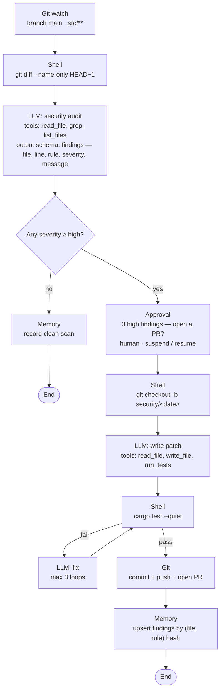
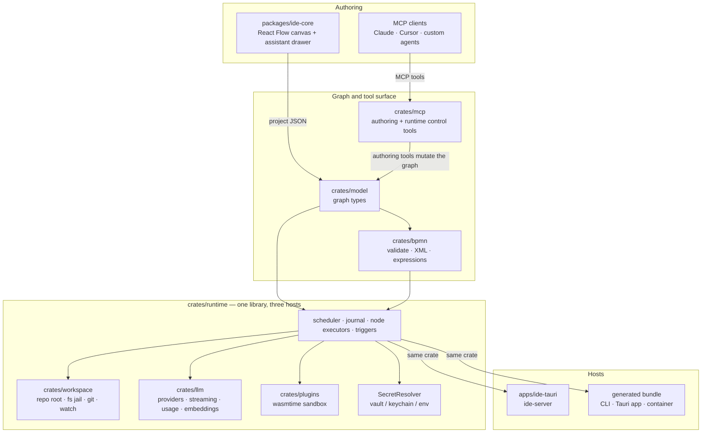
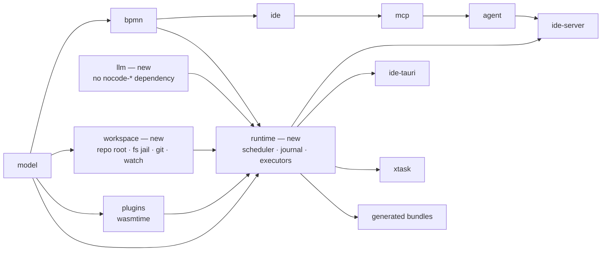
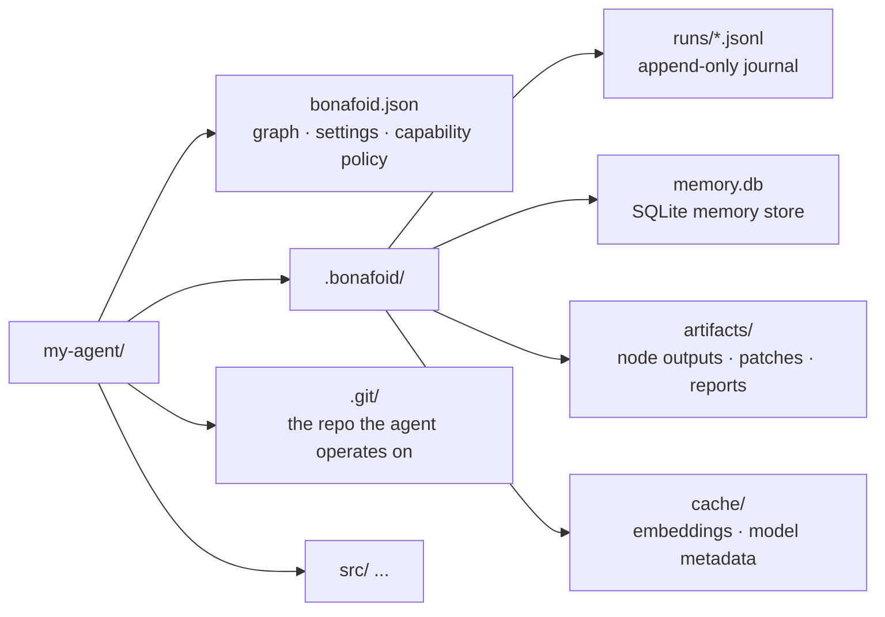
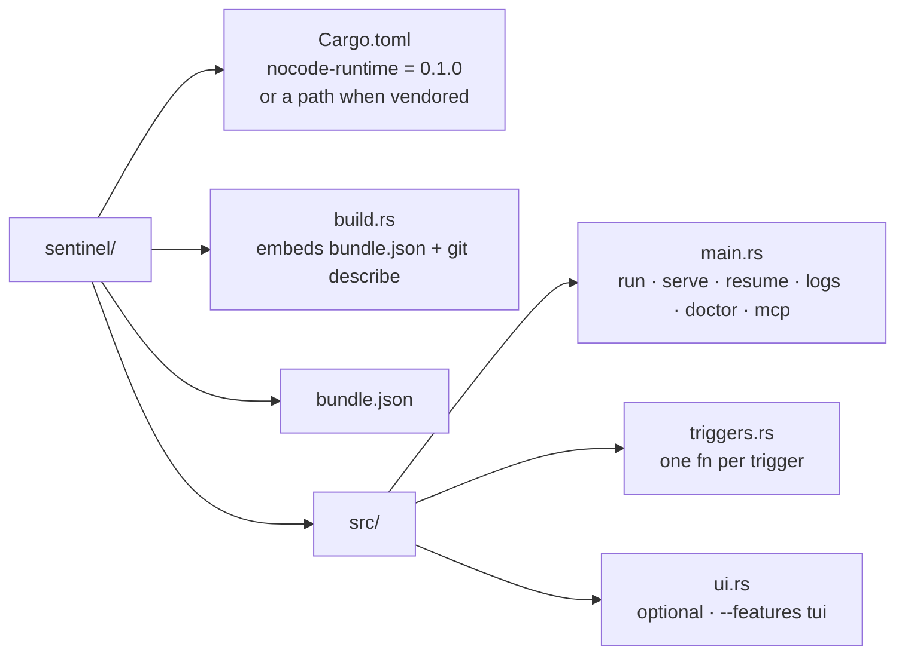
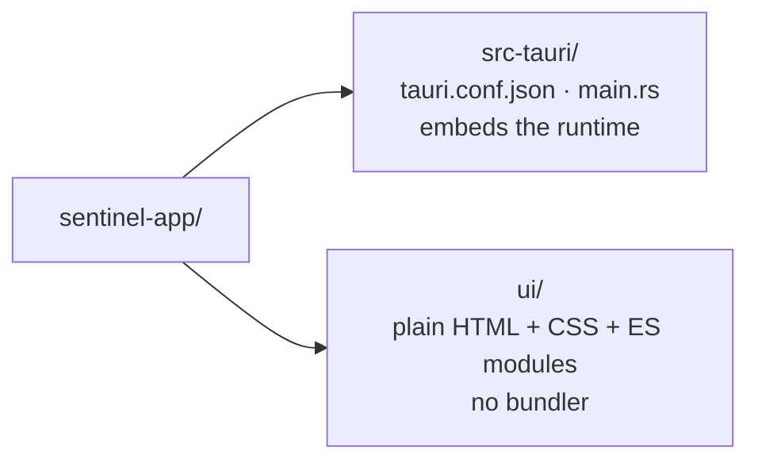
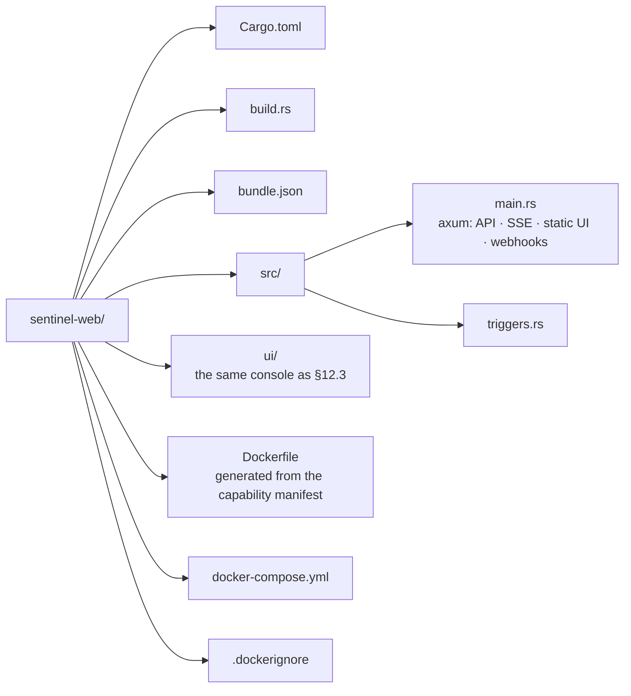

# Local-First Agentic Workflow Builder — Plan

**Status:** Proposed
**Date:** 2026-11-26
**Applies to:** Bonafoid (`crates/model`, `crates/bpmn`, `crates/agent`, `crates/mcp`,
`crates/codegen`, `packages/ide-core`, `apps/ide-tauri`)
**Predecessors:** `docs/MCP-Integration-Plan.md` (M4), `docs/Agentic-App-Generation-Plan.md` (M5)
**Roadmap slot:** Milestone 6 — Agentic Workflow Builder, Phases 34–43
**Working name:** AWB (Agentic Workflow Builder). Branding is an open decision (§19).

---

## 1. Summary

Bonafoid today is a visual **application** builder: you model entities, forms,
pages, themes and BPMN processes, and it generates a Rust/Axum + Leptos
codebase. Its BPMN "engine" walks a graph and records history; service and
script tasks are **no-ops** (`crates/bpmn/src/engine.rs::execute_node` pushes a
`service_task_executed` event and follows the outgoing edge). Its assistant can
**design** a workflow but cannot **run** one.

This plan turns that into a **local-first agentic workflow builder**: a node
canvas where a developer wires together local LLMs, shell/file/git tools,
SQLite memory and human approvals into an autonomous agent — then compiles the
graph into one of three artifacts:

- a **CLI binary** for cron, git hooks and CI,
- a **standalone Tauri app** for a developer's machine,
- a **web application in a Docker container** for a server or a team host,
  with the same graph, the same runtime and the same policy.

All three run without the IDE and without a Bonafoid account; the container is
a deployment target for the compiled workflow, not a hosted service.

The gap it fills is specific. Visual agent builders exist (n8n, Flowise,
LangFlow) but they are hosted services or Python servers; local coding agents
exist (CodingAgent, Aider, Cline) but they are chat loops, not inspectable
graphs. Nothing in the current ecosystem lets you *see* the graph, *run* it
locally, and *ship* it as one binary — or as one container image that is the
binary plus exactly the programs the graph is allowed to run (§12.4).

Three things make Bonafoid the right base rather than a rewrite:

1. **The canvas already exists.** React Flow 11, a typed `Workflow` model with
   `NodeConfig`, positions, undo/redo, and a project format that round-trips.
2. **The model layer is schema-first.** Every type derives `schemars::JsonSchema`,
   so node inspectors, MCP tool schemas and the generated TS types come from one
   definition (`xtask types`).
3. **The compile pipeline already emits Tauri.** `crates/codegen` generates a
   Tauri 2 shell today; adding a workflow-runtime target is a new template set,
   not a new build system.

The work is not small. It is four new subsystems — a graph model extension, an
async runtime with a crash-safe journal, a capability sandbox for shell/file/git,
and a bundler — plus the canvas work to make them legible. §16 phases it so each
step ships something usable.

---

## 2. What is being merged (and what is not)

The request names two products. Their state differs, and the plan must be honest
about which one is in this repository.

| | Bonafoid | CodingAgent |
|---|---|---|
| What it is | Visual modeler + codegen + web/desktop IDE | Local coding workspace: repo-bound chat, provider keys, file/shell tools |
| In this repo | Yes — all of it | **No source tree.** Only a migration trace: `crates/ide-server/src/agent/schema.rs` adds `agent_api_keys.source_id` and documents it as "traceable to the legacy `codingagent.db` import" |
| What it contributes | Canvas, graph model, codegen, plugins, providers | The workspace concept (a repo root, not a single JSON file), the tool habits of a coding agent, and the provider-key UX |
| What it lacks | Execution, tools, a run loop over files | Visual authoring, graph semantics, packaging |

So the merge is **not** "copy CodingAgent into this workspace". It is:

1. Bonafoid grows the capability layer CodingAgent already had (shell, file,
   git, repo binding) — §8.
2. CodingAgent's workspace becomes a first-class concept in the project model,
   so a graph is bound to a directory rather than to an abstract project — §6.5.
3. The provider catalog and key vault that already landed from CodingAgent
   (`crates/agent/src/llm/catalog.rs`, 21 platforms; `agent_api_keys` with a
   sealed credential) become the LLM node's runtime — §9.1.
4. Both surfaces — the IDE assistant and a running node — call **one** tool
   registry. That is the property that makes this a merge rather than two
   products sharing a repo — §8.1.

**Assumption stated plainly:** the CodingAgent UI and its exact tool set are not
in this tree. This plan specifies the *seam* (`WorkspaceProvider`, `Tool`
trait, capability manifest) so CodingAgent's implementation can plug in without
this plan guessing its internals.

---

## 3. Verified current state

Everything below was read from the tree, not assumed.

### 3.1 What already works and is reusable

| Capability | Where | Why it matters here |
|---|---|---|
| Token-based graph walk | `crates/bpmn/src/engine.rs` | Parallel/inclusive/exclusive gateways, subprocess, call activity, multi-instance already have semantics |
| BPMN 2.0 XML round-trip | `crates/bpmn/src/xml.rs` | Export/import is the interoperability story; new nodes must map cleanly |
| Expression evaluator | `crates/bpmn/src/expr.rs` | Comparisons, boolean ops, variables — enough for branch conditions |
| 16 node types + `NodeConfig` | `crates/model/src/workflow.rs` | `properties: IndexMap<String, Value>` is an existing escape hatch; `boundary_events`, `multi_instance` exist |
| LLM providers + streaming | `crates/agent/src/llm/` | 21-platform catalog, `stream()` as the single parse path, `DeltaCoalescer` |
| Three-way merge + lease | `crates/agent/src/rebase.rs`, `crates/mcp/src/session.rs` | A run can be resumed/merged safely; reused for run state |
| wasmtime plugin host | `crates/plugins/` | Permissions, memory limits, logs/events, entry points — a ready tool sandbox |
| Process-group isolation | `crates/ide-server/src/preview/mod.rs` | `isolate_process_group` + `taskkill` precedent for killing a shell child tree |
| Tauri 2 shell generation | `crates/codegen/src/targets.rs` | Desktop target exists; `main.rs` is a plain `tauri::Builder` |
| React Flow canvas | `packages/ide-core/src/pages/WorkflowBuilder.tsx` | Palette, node components, properties modal, run summary |
| Sealed credential vault | `crates/deploy` (`CredentialVault`, ChaCha20-Poly1305) | Reused by the desktop agent already; the only secret store in the tree |
| Container conventions | `Dockerfile`, `Dockerfile.preview`, `docker-compose.yml`, `.github/workflows/docker.yml` | Multi-stage, cache mounts, non-root, `/data` volume, `SIGTERM`, `/health` + `/ready`, asserted boot — the generated web target copies this shape (§12.4) |

### 3.2 The five gaps that define this project

**G1 — The engine does not execute anything.** `execute_node` handles
`ServiceTask` by pushing a history event with a description and continuing. No
HTTP call, no function call, no plugin call, no I/O, no async. `ScriptTask`
records the script text. The engine is a **simulator**, and the SRS is accurate:
BPMN execution is "Partial".

**G2 — There are no tools.** All 41 MCP tools in `crates/mcp/src/tools/`
are project-modeling (`entity_*`, `page_*`, `workflow_*`, `project_*`).
There is no file read/write, no shell, no git, no SQLite query. A coding agent
without those is a diagram editor.

**G3 — No node taxonomy for agents.** The 16 `WorkflowNodeType` variants are
BPMN 2.0. None represents "call a model", "run a command", "write memory",
"wait for a human", or "watch this repo".

**G4 — Codegen emits apps, not agents.** `crates/codegen` produces
backend/frontend/database/docker/k8s/PWA/Tauri for a CRUD app. There is no CLI
target, and `generate_backend` never passes `workflows` to a template
(documented as Phase 28, still deferred). A generated project has no runtime
that can execute a graph.

**G5 — No workspace binding.** The desktop opens one `project.json`
(`IdeService::new_project` / `load_project`). There is no repo root, no file
watch, no git awareness. `git2`, `notify` and a pty crate are **not** in the
dependency tree; the only git is `crates/deploy/src/git.rs`, which shells out.

Two smaller facts that shape decisions:

- `crates/agent` depends on `nocode-mcp`, which depends on `nocode-ide`, which
  depends on `nocode-codegen`. A generated CLI that links the full agent would
  also link Handlebars and the codegen templates. §5.2 splits the provider layer
  out for this reason.
- `WorkflowNodeType` is matched exhaustively in `engine.rs`, `xml.rs`,
  `workflowModel.ts` and the MCP node catalogue. Adding a variant is a
  compile-time checklist — useful, but it must be done once, deliberately.

---

## 4. Product definition

### 4.1 One sentence

A developer opens a folder, sees a canvas, wires a trigger to a model to a
shell command to a SQLite memory, runs it on their machine, watches every node,
and ships it as `./sentinel` or a tray app.

### 4.2 Primary journey — "repo sentinel"

The example from the request, specified end to end, because a plan that cannot
walk one real workflow is a feature list:



What the canvas must show while this runs: the active node pulsing, the model's
text streaming into a panel, the shell's stdout tailing, the approval card with
the diff, and a per-node cost/duration row. What the compiled artifact must do:
run the same graph from cron or a git hook with no IDE open.

### 4.3 What "compile" means

`bonafoid build --target cli` produces a single binary that contains:

- the graph (JSON, embedded with `include_str!`),
- the runtime (a pinned `nocode-runtime` dependency, or vendored source),
- the capability policy (allowlists, approvals, secret **names** only),
- a CLI: `run`, `serve`, `resume`, `logs`, `doctor`, `mcp`.

`--target app` produces a Tauri 2 bundle with a minimal static UI: runs list,
live trace, approval prompts, settings for keys. No Node toolchain is required
to build the generated app (see §12.3).

`--target web` produces the same runtime behind an Axum server plus a static
run console, a generated `Dockerfile` and a `docker-compose.yml`. The image is
built from the capability manifest, so it contains exactly the programs the
graph is allowed to run and nothing else (see §12.4). This is the target for a
server, a home lab, or a team that wants one URL instead of one laptop.

---

## 5. Target architecture

### 5.1 Layers



The important property: **the runtime is a library, not a service.** The IDE
runs it in-process for "Run"; the generated binary runs it in-process forever;
the container runs the same binary behind an Axum server. There is no "runtime
server" to deploy, and no network hop between the canvas
and the executor.

### 5.2 New crates and dependency direction



`runtime` deliberately depends on **neither** `mcp` nor `ide`, so a generated
binary does not link Handlebars, the codegen templates or the project tools.

| Crate | Responsibility | Depends on |
|---|---|---|
| `crates/llm` (**new**, extracted from `crates/agent/src/llm`) | Provider catalog, request/response normalization, streaming, usage, embeddings | `serde`, hyper/rustls — no `nocode-*` crate |
| `crates/workspace` (**new**) | Repo root binding, path jail, file ops, git (shell-out), file watch, shell policy | `serde`, `notify`, `tokio` |
| `crates/runtime` (**new**) | Scheduler, `NodeExecutor` registry, journal, triggers, memory store, budgets | `model`, `bpmn`, `llm`, `workspace`, `plugins` |

`crates/agent` keeps its job (build a Bonafoid *project* through MCP tools) and
re-exports `llm`. This keeps a generated CLI from linking Handlebars and the
codegen templates, and it gives CodingAgent a provider layer it can use without
the project tools.

**Why not extend `crates/bpmn` into an async executor.** The existing engine is
synchronous, infallible at the node level, has no cancellation, no I/O and no
persistence. Making it async would change `start`/`complete_task` signatures,
break the NAPI bridge and the existing frontend fixtures, and couple
validation to execution. Keeping `crates/bpmn` as *the graph algebra*
(validation, XML, topology, expression evaluation) and putting execution in
`crates/runtime` means the simulator keeps working for previews and the MCP
`simulate_workflow` tool, while the real executor is free to be async.

### 5.3 One graph, not two

The alternative is a separate `AgentGraph` model with its own canvas. That is
the wrong trade:

- two canvases, two palettes, two serializers, two validation passes;
- the MCP tool surface would need a parallel set of 10+ authoring tools;
- a user with "a workflow and an agent" gets two objects that cannot call each
  other;
- codegen would need two inputs.

Instead, extend the **existing** graph with one node variant and one config
field (§6.1). The cost is a BPMN export mapping that is lossy for agent nodes,
which is acceptable because BPMN 2.0 has no vocabulary for "call a model" — the
mapping uses a vendor extension so a round-trip through Bonafoid is lossless
even though a round-trip through another BPMN tool is not.

### 5.4 Local-first storage

A project is a **workspace directory**, not a single file:



`bonafoid.json` stays the existing `Project` JSON so the web IDE, the desktop
app and the CLI all read the same document. `.bonafoid/` is derived state:
deleting it loses history and memory, never the graph.

Local-first rules:

- **No network required** except the model call. Ollama/LM Studio cover the
  offline case; the provider catalog already includes `ollama`.
- **No account required.** The desktop already opens local projects without one.
- **Runs are replayable** from the journal without the model (mock mode).
- **The server is optional**: team authoring, shared memory, hosted preview.

---

## 6. Part 1 — Graph model

### 6.1 The additive change

One new variant and one new optional field. Nothing else in the 16 existing
types moves, so every existing project JSON still parses and every BPMN test
still passes.

```rust
// crates/model/src/workflow.rs
pub enum WorkflowNodeType {
    // ... 16 existing variants unchanged ...

    /// A node executed by `crates/runtime` rather than the BPMN simulator.
    /// Its payload lives in `NodeConfig::agent`.
    AgentTask,
}

pub struct NodeConfig {
    // ... existing fields unchanged ...

    /// Present iff `node_type` is `AgentTask`. `#[serde(default)]` keeps every
    /// existing document valid.
    #[serde(default, skip_serializing_if = "Option::is_none")]
    pub agent: Option<AgentNodeConfig>,
}

#[derive(Debug, Clone, Serialize, Deserialize, JsonSchema, PartialEq)]
// Adjacently tagged rather than internally tagged: `{"kind":"llm","config":{…}}`
// keeps every payload a self-contained object, which schemars renders as a clean
// `oneOf` and the inspector can switch on without flattening surprises.
#[serde(tag = "kind", content = "config", rename_all = "snake_case")]
pub enum AgentNodeConfig {
    Llm(LlmNode),
    Shell(ShellNode),
    File(FileNode),
    Git(GitNode),
    Http(HttpNode),
    Sqlite(SqliteNode),
    Memory(MemoryNode),
    Approval(ApprovalNode),
    Subflow(SubflowNode),
}
```

Two invariants, enforced in `crates/model` (not in the UI):

- `AgentTask` **requires** `config.agent = Some(_)`; any other type requires
  `None`. A validator error, not a panic.
- `AgentNodeConfig` variants carry **only** what the executor needs. Anything
  that is a secret is a *name*, never a value (§8.5).

The runtime keys its executor registry by a plain unit enum, derived from the
tagged config so the two cannot drift:

```rust
#[derive(Debug, Clone, Copy, PartialEq, Eq, Hash)]
pub enum AgentNodeKind {
    Llm, Shell, File, Git, Http, Sqlite, Memory, Approval, Subflow,
}

impl AgentNodeConfig {
    pub fn kind(&self) -> AgentNodeKind {
        match self {
            Self::Llm(_) => AgentNodeKind::Llm,
            // ... one arm per variant ...
            Self::Subflow(_) => AgentNodeKind::Subflow,
        }
    }
}
```

### 6.2 Node catalogue

Nine kinds, each with a typed config, declared capabilities, and a dry-run
mode. This is the vocabulary the canvas, the MCP tools and the inspector all
read from one place.

| Kind | Config (essential fields) | Capabilities | Output |
|---|---|---|---|
| `llm` | `provider`, `model`, `system`, `prompt` (template), `tools[]`, `output_schema?`, `temperature`, `max_tokens`, `stream` | `net:llm`, `tools:<names>` | `{ text, json?, usage, tool_calls[] }` |
| `shell` | `program`, `args[]`, `cwd`, `env{}`, `timeout_ms`, `mode: argv\|shell`, `stdin?` | `shell:exec:<program>` | `{ code, stdout, stderr, duration_ms }` |
| `file` | `op: read\|write\|append\|patch\|list\|delete`, `path`, `content?`, `glob?` | `fs:read` / `fs:write` | `{ path, bytes, content? }` |
| `git` | `op: status\|diff\|commit\|branch\|push\|pr\|log`, `args`, `message?` | `git:read` / `git:write` / `net:git` | `{ output, sha?, pr_url? }` |
| `http` | `url`, `method`, `headers`, `body`, `timeout_ms`, `expect` | `net:http:<host>` | `{ status, headers, body }` |
| `sqlite` | `path`, `query`, `params[]`, `mode: read\|write` | `db:sqlite:<path>` | `{ rows, rows_affected }` |
| `memory` | `store`, `op: get\|put\|search\|append\|delete`, `namespace`, `key?`, `query?`, `top_k?`, `ttl?` | `memory:read` / `memory:write` | `{ entries[], matches[] }` |
| `approval` | `title`, `body` (template), `timeout`, `on_timeout: fail\|skip` | — (human) | `{ approved, by, note }` |
| `subflow` | `workflow_id`, `input_mapping`, `output_mapping` | inherited | subflow outputs |

Control flow is **not** a new node kind. Gateways, parallel joins, loops
(back-edges) and multi-instance already exist in the BPMN model and the engine
already implements them. Adding a `Loop` node would duplicate semantics the
graph already has.

### 6.3 Ports and typed variables

`NodeConfig.inputs` / `outputs` already exist as `NodeInput` / `NodeOutput`.
Agent nodes use them as **typed ports**:

```json
"inputs":  { "files": { "type": "array", "schema": {"items": {"type": "string"}} } },
"outputs": { "findings": { "type": "array", "schema": { "$ref": "#/defs/finding" } } }
```

Edges carry a mapping, not just a line:

```json
{ "source": "n2", "target": "n3", "mapping": { "files": "input.files" } }
```

Interpolation in prompts and args uses `${...}` over the node's scope:
`${input.files}`, `${vars.branch}`, `${nodes.audit.json.findings}`, `${secret:OPENAI_API_KEY}`.
This is a small, documented grammar (§7.6) — **not** a general-purpose language.
Anything more complex belongs in a shell node or a wasm plugin.

### 6.4 BPMN 2.0 round-trip

`crates/bpmn/src/xml.rs` maps `AgentTask` to a `bpmn:serviceTask` with a
vendor extension:

```xml
<bpmn:serviceTask id="n3" name="Security audit"
    bonafoid:kind="llm" bonafoid:config="eyJwcm92aWRlciI6...">
  <bpmn:extensionElements>
    <bonafoid:agentNode kind="llm" config="..."/>
  </bpmn:extensionElements>
</bpmn:serviceTask>
```

Export is lossless for Bonafoid; import of a foreign BPMN file yields a plain
`ServiceTask` with no `agent` config, which the validator flags as
"unconfigured agent node" rather than silently producing a no-op. That is the
honest behaviour: a BPMN tool that does not know what an LLM is cannot invent
one.

### 6.5 Workspace binding

`Project` gains one optional field:

```rust
pub struct Project {
    // ... existing ...
    #[serde(default)]
    pub workspace: Option<WorkspaceBinding>,
}

pub struct WorkspaceBinding {
    /// Absolute path on the authoring machine. Never synced to a server.
    pub root: String,
    /// Globs the runtime may touch. Empty means "the whole root".
    pub include: Vec<String>,
    pub exclude: Vec<String>,
    /// Shell policy: programs allowed without a per-node approval.
    pub allowed_programs: Vec<String>,
}
```

Why on `Project` and not in a sidecar: a graph without its workspace is
unrunnable, and the canvas needs the root to show file pickers and diffs. Why
`root` is never synced: a path is machine-specific, and a server-side path is a
lie. On the web IDE the binding is absent and file/shell nodes are disabled with
an explanation, not a broken run.

---

## 7. Part 2 — Runtime

### 7.1 Execution model

The runtime is an **async token scheduler** over the same graph the simulator
walks, with three differences: nodes are async and fallible, state is journalled
before and after every side effect, and the run can be cancelled at any await
point.

```rust
// crates/runtime/src/runner.rs
pub struct GraphRunner {
    registry: Arc<ExecutorRegistry>,
    journal: Arc<dyn Journal>,
    limits: RunLimits,
    clock: Arc<dyn Clock>,
}

impl GraphRunner {
    pub async fn run(&self, graph: &Workflow, input: RunInput, cx: &RunContext)
        -> Result<RunOutcome, RunError>;

    /// Rebuild state from a journal and continue. A node with an intent record
    /// but no outcome is `Unknown` and is handled by §7.4.
    pub async fn resume(&self, journal: RunJournal, cx: &RunContext)
        -> Result<RunOutcome, RunError>;
}
```

State machine per token: `Ready → Running → (Waiting | Done | Failed)`. The
scheduler loop:

1. Collect `Ready` tokens, up to `max_parallel` (default 4, per-run setting).
2. For each, write an **intent** record, then `tokio::spawn` the executor with a
   child `CancellationToken` and a timeout.
3. Await the first completion (not all), apply its output to the scope, write
   the **outcome** record, advance outgoing edges.
4. `Waiting` is used by `approval` and by `receive`-style triggers; the run
   suspends and the journal is flushed.
5. Loop until no live tokens, or a budget/cancel/error stops it.

Join semantics: a parallel gateway with N incoming edges waits for N tokens.
Counting is keyed by `(gateway_id, run_id)` in the run state, not by token
identity, so a loop back through the gateway does not deadlock.

### 7.2 Node executors

```rust
// crates/runtime/src/executor.rs
#[async_trait::async_trait]
pub trait NodeExecutor: Send + Sync {
    fn kind(&self) -> AgentNodeKind;
    /// Schema for the inspector and for MCP authoring tools.
    fn config_schema(&self) -> serde_json::Value;
    /// Capabilities this node will exercise, derived from its config.
    fn capabilities(&self, node: &WorkflowNode) -> Vec<Capability>;
    /// Cheap, side-effect-free check used by the canvas "Validate" button.
    fn dry_run(&self, node: &WorkflowNode, cx: &RunContext) -> Result<(), NodeError>;
    async fn execute(&self, node: &WorkflowNode, cx: &NodeContext)
        -> Result<NodeOutput, NodeError>;
}
```

`ExecutorRegistry` is a `HashMap<AgentNodeKind, Arc<dyn NodeExecutor>>` built by
the host. The IDE registers the full set; a compiled bundle registers the same
set (it links the same crate), so authoring and runtime cannot drift.

`NodeError` carries a machine-readable `code` (`permission_denied`,
`timeout`, `nonzero_exit`, `invalid_config`, `cancelled`, …) so the canvas can
branch on the code rather than on prose — the same lesson as
`McpError::StaleRevision` in M5.

### 7.3 Journal — the only durable state

One JSONL file per run, append-only, fsync on intent:

```json
{"seq":1,"ts":"...","type":"run_started","graph_hash":"...","input":{...}}
{"seq":2,"ts":"...","type":"node_intent","node":"n3","attempt":1,"input_hash":"..."}
{"seq":3,"ts":"...","type":"node_outcome","node":"n3","status":"ok","output":{...},"usage":{"tokens":812}}
{"seq":4,"ts":"...","type":"node_outcome","node":"n4","status":"error","code":"nonzero_exit","stderr":"..."}
{"seq":5,"ts":"...","type":"run_finished","status":"failed"}
```

Rules:

- **Intent before effect.** A side effect that happened without an intent record
  is a bug, not a crash artifact.
- **Outcome after effect.** A crash between intent and outcome leaves the node
  `Unknown` on resume.
- **No secrets, no full model output.** Outputs are truncated to a per-node cap
  (default 64 KB) with the artifact path recorded; secrets are redacted by name.
- The journal is the checkpoint. There is no second snapshot format to drift.

### 7.4 Resume and idempotency

On resume:

| Journal state for a node | Action |
|---|---|
| outcome `ok` | Reuse the recorded output; do not re-run |
| outcome `error`, retries left | Re-run |
| intent only (`Unknown`) and `idempotent: true` | Re-run |
| intent only and `idempotent: false` (default for `shell`, `git`, `http` with non-GET) | **Stop** and surface "needs attention": the side effect may have happened |
| `approval` waiting | Re-present the card |

`idempotent` is a per-node flag the author sets, defaulted by kind: `llm`,
`file:read`, `memory:get`, `sqlite:read` are true; `shell`, `git:commit`,
`git:push`, `http` non-GET, `file:write` are false. This is the only place the
runtime refuses to guess, and it refuses loudly.

### 7.5 Budgets, retries, timeouts

```rust
pub struct RunLimits {
    pub max_steps: usize,        // default 500
    pub max_wall_clock: Duration,// default 30 min
    pub max_parallel: usize,     // default 4
    pub max_tokens: u64,         // default 500_000
    pub max_cost_usd: f64,       // default 5.00
    pub max_tool_calls: usize,   // default 200
}
```

Retries reuse the existing `RetryConfig` shape (initial/max interval,
multiplier, max attempts, retryable codes). Retry only on `code` in the
retryable set (`timeout`, `rate_limited`, `5xx`, `nonzero_exit` when the node
opts in). A permission error never retries.

Timeouts are per node (`timeout_ms`) and per run. A timed-out shell node kills
its **process group**, reusing the `isolate_process_group` approach already in
`preview/mod.rs` (which must move to `crates/workspace` to be shared).

### 7.6 Interpolation grammar

Deliberately small:

```
${input.<key>}              node input port
${vars.<name>}              run variables
${nodes.<node_id>.<path>}   a previous node's output, dotted path
${env.<NAME>}               environment variable (allowlisted)
${secret:<NAME>}            resolved at execution, never journalled
${now}, ${run_id}, ${workspace}
```

No arithmetic, no function calls, no conditionals. If a workflow needs logic,
it uses a gateway or a shell node. This keeps the evaluator auditable and
prevents prompt templates from becoming a programming language with no debugger.

### 7.7 Cancellation

One `CancellationToken` tree per run. Cancel propagates to every running node;
each executor must be cancellation-safe at its awaits. `shell` kills the
process group; `llm` drops the response body (the existing `DeltaSink::closed`
pattern); `http` drops the connection. The run writes `run_finished{status:
"cancelled"}` and the journal stays resumable.

---

## 8. Part 3 — Capabilities and sandbox

### 8.1 One tool registry, two callers

This is the merge's load-bearing idea. A capability is defined once and
callable by:

1. the **IDE assistant** through MCP (`POST /mcp` or in-process
   `McpToolExecutor`), and
2. a **node** at runtime.

```rust
// crates/runtime/src/tool.rs
#[async_trait::async_trait]
pub trait Tool: Send + Sync {
    fn name(&self) -> &str;
    fn schema(&self) -> serde_json::Value;
    fn capabilities(&self) -> Vec<Capability>;
    async fn invoke(&self, args: Value, cx: &ToolContext)
        -> Result<ToolOutput, ToolError>;
}
```

Adapters:

| Adapter | Backs | Notes |
|---|---|---|
| `ProjectTools` | the 41 existing MCP tools | Wraps `McpToolExecutor`; used by the assistant and by an `llm` node that must edit the Bonafoid project itself |
| `WorkspaceTools` | read/write/list/patch/grep | Path-jailed to the workspace root |
| `ShellTool` | exec | §8.2 |
| `GitTool` | status/diff/commit/push/pr | Shell-out to `git`, never `git2` (one code path, one credential story) |
| `HttpTool` | request | Host allowlist, no redirects to a different host by default |
| `SqliteTool` | query/exec | Statement allowlist, read-only by default |
| `MemoryTool` | memory ops | §9.3 |
| `PluginTool` | wasm plugin call | Existing `PluginHost`, unchanged |
| `McpTool` | call an external MCP server | Optional, Phase 44 |

The assistant gains file/shell/git tools **through the same registry**, gated by
the same policy. That is what lets a user say "add a shell node that runs
`cargo test`" and have the assistant create a node whose permission the user
can see before running.

### 8.2 Shell — the dangerous capability

Shell execution is the reason this plan has a security section. The design is
restrictive by default and explicit at every step.

**Execution form.** Default `mode: "argv"`: `program` + `args[]` are passed
directly to `Command`, never through a shell, so `;`, `|`, `$()` and quotes are
literal. `mode: "shell"` requires a string command and is **always** gated by an
approval, even if the program is allowlisted.

**Policy.**

```rust
pub struct ShellPolicy {
    /// Programs runnable without a fresh approval. Resolved through PATH and
    /// compared by canonical path, not by name.
    pub allowed_programs: Vec<String>,
    /// Always refused, even if approved (defence against a swapped config).
    pub denied_programs: Vec<String>,   // e.g. curl, wget, nc, ssh, scp
    pub allow_network: bool,            // default false
    pub max_output_bytes: usize,        // default 1 MiB
    pub max_runtime: Duration,          // default 10 min
}
```

**Enforcement, in order:**

1. Canonicalise `program`; reject if outside the allowlist or inside the deny
   list. A bare name is resolved once and the resolved path is what is checked.
2. Canonicalise `cwd`; it must be inside the workspace root (symlinks resolved
   first, then checked — not the other way round).
3. Scrub the environment: keep `PATH`, `HOME`, `TMPDIR`, locale, and the
   variables the node declares. Everything else — `AWS_*`, `*_TOKEN`, `*_KEY`,
   `SSH_AUTH_SOCK` — is dropped unless the node's capability list names it.
4. Run with a timeout and a process group; kill the group on timeout or cancel.
5. Capture stdout/stderr with a byte cap; the overflow goes to an artifact file
   and the output records a truncated flag.
6. Record `program`, `argv`, `cwd`, exit code and duration in the journal — but
   redact any argument that came from `${secret:...}`.

**Approval binding.** An approval is stored as
`{node_id, config_hash, approved_at, approved_by}`. If the node's config
changes, the hash changes and the approval is void. Without this, "approve
`cargo test`" becomes "approve anything" the moment a model rewrites the node.

### 8.3 File, git, http, sqlite

| Tool | Policy |
|---|---|
| `file` | Path must resolve inside `workspace.include` and outside `exclude`. Writes are atomic (temp + rename). `delete` requires `fs:write` **and** an approval unless the path is under `.bonafoid/artifacts/`. |
| `git` | Read ops free. `commit`/`push`/`pr` require `git:write`. Force-push and `reset --hard` are denied outright, not policy-gated — there is no workflow that needs them. Credentials come from the existing deploy vault, never from argv. |
| `http` | Host allowlist per node. No cross-host redirects by default. Response body capped. `GET` only needs `net:http:<host>`; other methods need an approval if the host is not in the project allowlist. |
| `sqlite` | Default read-only connection (`SQLITE_OPEN_READ_ONLY`). Writes need `db:sqlite:<path>` plus an approval. `ATTACH`, `PRAGMA` writes and `load_extension` are refused. |

### 8.4 Capability manifest and approval flow

A project declares the maximum it may ever use; a node declares what it uses;
the effective set is the intersection.

```json
// bonafoid.json
"capabilities": {
  "allow": ["fs:read", "fs:write", "shell:exec:cargo", "shell:exec:git",
            "net:llm", "net:http:api.github.com", "git:write", "memory:read",
            "memory:write", "db:sqlite:.bonafoid/memory.db"],
  "deny": ["shell:exec:curl", "shell:exec:ssh"]
}
```

Flow: authoring → `dry_run` lists the capabilities a node needs → the canvas
shows them as chips on the node → the first run requests approval for anything
not already granted → the grant is stored in `bonafoid.json` with a hash →
**Run** proceeds. A compiled binary reads the same file, so "it ran in the IDE"
and "it runs on the server" mean the same thing. A bundle built with
`--no-approvals` is refused at build time if any node needs one (used for CI
where a human cannot answer).

### 8.5 Secrets

- Resolution is a trait (`SecretResolver`), not a dependency: the IDE adapter
  uses the existing `CredentialVault`; a compiled CLI uses env vars then the OS
  keychain; a Tauri app uses the vault.
- `${secret:NAME}` resolves at execution. The value never enters the journal,
  the SSE stream, a log line, or an artifact.
- `doctor` reports **names and presence**, never values.
- A secret used in a `shell` argument is passed via env, not argv, so it does
  not appear in `ps`.

---

## 9. Part 4 — LLM and memory nodes

### 9.1 `llm` node

Reuses `crates/llm` (extracted from `crates/agent`): the same 21-platform
catalog, the same `stream()` single-parse-path, the same `DeltaCoalescer`, the
same usage accounting. Differences from the IDE assistant:

- The **tool set is the node's**, not a step allowlist. A node that declares
  `read_file`, `grep` gets exactly those.
- **Structured output** is enforced: if `output_schema` is set, the response is
  validated and one repair turn is allowed, then the node fails with
  `invalid_output`. The graph branches on a typed value, not on prose.
- **Streaming is surfaced** to the canvas (`node_delta` event) and, in a
  compiled app, to the run log. In a CLI it is off by default (cron noise).
- **Cost is attributed** per node: `usage { tokens_in, tokens_out, cost_usd }`
  computed from the catalog's per-model price when present.

Local models: `ollama` and `ollama-cloud` are already in the catalog. The plan
adds `lmstudio` as a catalog entry (OpenAI-compatible, `localhost:1234`), so
"local LLM" is a first-class choice rather than a custom base URL. No model
weights are shipped.

### 9.2 Tool-calling loop

The node runs the same bounded loop as `crates/agent::orchestrator`, with
node-scoped limits (`max_turns` default 8, `max_tool_calls` default 24). Tool
results are summarized above 4 KB (the existing `compact_tool_result`). The loop
is **not** the assistant loop: no project save, no pipeline, no step
allowlists — a node's job is one bounded piece of work.

### 9.3 `memory` node

A per-workspace SQLite store, not a vector database service.

```sql
CREATE TABLE memory_entries (
    id          TEXT PRIMARY KEY,
    namespace   TEXT NOT NULL,
    key         TEXT,
    content     TEXT NOT NULL,
    metadata    TEXT,
    embedding   BLOB,          -- f32 little-endian, 768/1536 dims
    created_at  TEXT NOT NULL,
    expires_at  TEXT
);
CREATE UNIQUE INDEX memory_key ON memory_entries(namespace, key);
CREATE VIRTUAL TABLE memory_fts USING fts5(content, namespace UNINDEXED);
```

Operations: `put`, `get`, `append`, `delete`, `search` (FTS5 + `bm25`),
`search_vector` (cosine in Rust over the candidate set; no extension to
install). Embeddings come from the `llm` crate's `embed` capability; a provider
without embeddings degrades to FTS5 with a warning on the node.

Namespaces: `workflow:<id>`, `agent:<name>`, `global`. TTL pruning runs at
startup and on write, bounded to 1 000 rows per pass. The store is a single
file so a user can inspect it with any SQLite browser — local-first means the
data is *theirs*.

Why not a vector DB: it is a second daemon, a second backup story and a second
failure mode. FTS5 plus brute-force cosine is correct for the sizes a local
workflow produces (tens of thousands of entries) and can be swapped behind the
`MemoryStore` trait later.

---

## 10. Part 5 — Triggers and daemon

### 10.1 Trigger kinds

A trigger is a `StartEvent` with a typed `event_type`, extended with new
variants rather than a new node type:

| Trigger | Model | Implementation |
|---|---|---|
| Manual | existing `StartEventType::None` | Run button, CLI `run` |
| Schedule | new `StartEventType::Schedule { cron, tz }` | `tokio` timer + cron parser |
| File watch | new `StartEventType::Watch { globs, debounce_ms }` | `notify` crate, debounced |
| Git | new `StartEventType::Git { ref, paths, poll_secs }` | Poll `git rev-parse` + `git diff --name-only`; `notify` on `.git` is unreliable across worktrees |
| Webhook | new `StartEventType::Webhook { path, secret_name }` | Local Axum on `127.0.0.1`, bearer token, body as input |
| MCP call | new `StartEventType::Mcp { tool_name }` | The compiled binary's `mcp` subcommand exposes the workflow as a tool |

`StartEventType` is already an enum with 8 variants and a `#[serde(rename_all)]`
tag, so this is additive and BPMN-exportable (`bpmn:timerEventDefinition`,
`bpmn:messageEventDefinition`).

### 10.2 Daemon

`bonafoid run --serve` (and `./sentinel serve` in a compiled bundle):

- One process, one SQLite queue (`runs` table: id, trigger, status, queued_at).
- Trigger listeners feed the queue; workers pull with `max_concurrent_runs`
  (default 1 per workflow, 2 global on a laptop).
- Graceful shutdown: stop accepting triggers, cancel running runs, flush
  journals, exit non-zero if a run was mid-flight.
- `--once` runs every trigger's initial evaluation and exits (CI mode).
- A PID/lock file in `.bonafoid/` prevents two daemons on one workspace.

Why a queue and not "spawn on event": a git push can touch 200 files; without
coalescing the agent starts 200 runs. The queue dedupes by
`(workflow, trigger, payload_hash)` within a window (default 30 s).

### 10.3 Scheduling semantics

- Cron is evaluated in the workspace's configured timezone (default local),
  with DST handled by the cron crate, not by hand.
- A missed schedule (laptop asleep) runs **once** on wake, not N times. Recorded
  as `catch_up: true` in the run.
- Overlapping runs of the same workflow are refused (`skipped: already_running`)
  unless the trigger sets `allow_overlap`.

---

## 11. Part 6 — Canvas

### 11.1 Palette and node components

`packages/ide-core/src/utils/workflowModel.ts` already has `NODE_PALETTE` with
4 categories. Add 5 categories and 9 items; each gets a `ReactNode` component
with:

- an icon and a colour per kind (the palette already carries `color`),
- **input/output handles labelled by port**, not a single top/bottom pair,
- a capability badge row (`shell`, `fs:write`, `net`) so a dangerous node looks
  dangerous before it runs,
- a status ring: idle / running / ok / failed / waiting / skipped.

React Flow's custom `nodeTypes` map is already used for `ProcessNode`; the new
components slot in without changing the canvas shell.

### 11.2 Inspector from JSON Schema

`schemars` already produces a schema for every model type. The inspector renders
a form from `AgentNodeConfig`'s schema plus the executor's `config_schema()`,
with three hand-written widgets:

- **Prompt template** — a textarea with `${}` autocomplete over the node's
  scope (ports, `nodes.*`, `secret:*` names).
- **File/folder picker** — rooted at the workspace, respects `include`/`exclude`.
- **Command editor** — argv rows (program + args), a "use a shell" switch that
  visibly escalates the approval requirement.

No new form library: the repo already renders model forms by hand
(`DataModeler`, `FormBuilder`), and a schema-driven form is a small component
with `string|number|boolean|enum|array` cases.

### 11.3 Run and trace panel

A right-hand panel (or bottom dock) with:

- **Live trace**: one row per node — status, duration, tokens, cost, and an
  expandable body with stdout, model text, or JSON output.
- **Canvas sync**: node status is driven by `node_started` / `node_finished`
  (and `approval_required`), so the graph itself is the progress bar.
- **Diff view**: file/git nodes show a unified diff of what they changed, with
  the artifact path as the source.
- **Approval card**: the node's rendered `body`, the pending diff, Approve /
  Reject / Approve-and-remember.
- **Stop** and **Resume** (from the journal) buttons.

Events reuse the SSE discipline from M5: typed, ordered, coalesced, with a
terminal event. Transport differs per host (SSE on web, Tauri `Channel` on
desktop, stdout JSONL in the CLI).

### 11.4 Debugging

| Feature | How |
|---|---|
| Step mode | Scheduler pauses after each node; next/continue from the panel |
| Breakpoint | Per-node flag; the scheduler suspends before executing it |
| Mock mode | `llm` nodes return a recorded or canned response, so the graph can be tested without spending tokens |
| Replay | Re-run from a journal, reusing `ok` outcomes (§7.4) |
| Fixtures | A run's input can be saved as a fixture and used by `bonafoid test` |

Mock mode is the feature that makes agent workflows testable at all, and it is
cheap: the journal already contains every node's input and output.

### 11.5 Authoring with the assistant

The existing drawer gains a mode: "build this workflow". It uses the new MCP
authoring tools (§13), so the model creates nodes and edges rather than
emitting JSON. The same rule as M4 applies — the model never emits raw graph
JSON, because layout and IDs break.

---

## 12. Part 7 — Compile

### 12.1 Bundle format

```json
{
  "schema_version": 1,
  "runtime_version": "0.1.0",
  "graph": { "...": "the Workflow JSON" },
  "capabilities": { "allow": [], "deny": [] },
  "workspace": { "include": [], "exclude": [], "allowed_programs": [] },
  "memory": { "schema_version": 1 },
  "build": { "created_at": "...", "bonafoid": "0.1.0", "target": "cli" }
}
```

No secrets, no absolute paths, no model keys. `bonafoid build` refuses to emit
a bundle that contains a `secret` **value** (it only ever contains names).
`build.target` is one of `cli`, `app` or `web`; the graph, capabilities and
workspace policy are identical across the three, so a bundle can be rebuilt for
another target without touching the workflow.

### 12.2 CLI target

Generated layout:



`main.rs` is ~150 lines and entirely generated. The graph is data, so changing
the workflow does not change the code shape — only `bundle.json`. That keeps
regeneration diff-free and makes `cargo build` cache-friendly.

`mcp` subcommand: serves the workflow as an MCP tool over stdio, so an agent
(Claude Desktop, Cursor) can invoke a compiled workflow. This closes the loop
between "visual authoring" and "agentic use".

### 12.3 Tauri app target



The UI is deliberately **not** React: a generated app should build with
`cargo tauri build` alone, with no `npm install`, no Vite, no second lockfile.
Three screens: Runs, Run detail (live trace), Settings (keys, schedule).
`tauri.conf.json` uses `frontendDist: "../ui"` and the runtime is driven through
`#[tauri::command]` calls plus a `Channel` for events — the same pattern the IDE
desktop already uses.

If a team wants the full canvas in the compiled app, that is a different target
(`--target ide`) and out of scope here.

### 12.4 Web target and container image

The third target runs the same graph behind an HTTP server, packaged as a
container. It exists because "local-first" describes where the **authoring**
happens, not where a workflow must run: a repo sentinel is more useful on the
machine that holds the repo, and a team wants one URL rather than five laptops.



**Server surface.** Small and deliberately boring; every route is a thin
adapter over `GraphRunner`, exactly as the IDE's SSE handler is.

| Method | Path | Purpose |
|---|---|---|
| `GET` | `/health` | Liveness only. No database, no workspace. |
| `GET` | `/ready` | Opens `memory.db`, checks the workspace, reports trigger state. |
| `GET` | `/api/runs` | Recent runs (id, trigger, status, started, cost). |
| `POST` | `/api/runs` | Start a run with `{input}`; returns `run_id`. |
| `GET` | `/api/runs/{id}` | Status, node states, usage. |
| `GET` | `/api/runs/{id}/events` | SSE trace (`run_started`, `node_started`, `node_delta`, `node_finished`, `approval_required`, `run_finished`). |
| `POST` | `/api/runs/{id}/cancel` | Cancel; the journal stays resumable. |
| `POST` | `/api/runs/{id}/resume` | Resume from the journal. |
| `POST` | `/api/runs/{id}/approvals/{node}` | `{approved, note}` — unblocks a suspended `approval` node. |
| `POST` | `/hooks/{path}` | Webhook trigger; body becomes the run input. |
| `GET` | `/` | The static run console. |

**Authentication and scope.** Single operator, not multi-tenant. One bearer
token from `BONAFOID_TOKEN`, compared in constant time; approval and cancel
endpoints require the same token. If the token is unset the server **refuses to
bind** anything but `127.0.0.1` — a container that publishes a port without a
token fails at startup rather than exposing a shell-capable agent. There are no
accounts, no roles and no per-user isolation: that is the IDE server's job
(§15), and pretending a single token is tenancy would be worse than saying so.

**The image is the policy.** `workspace.allowed_programs` is the same list the
shell executor enforces; the generated `Dockerfile` turns it into packages. A
program with no mapping is a **build error naming it**, not a runtime surprise:

| Allowed program | Package installed |
|---|---|
| `git` | `git` (emitted only when the graph has a `git` node) |
| `cargo`, `rustc` | `rust` toolchain (adds ~1 GB; opt in with `--with-toolchain rust`) |
| `node`, `npm` | `nodejs`, `npm` |
| `python3`, `pip3` | `python3`, `python3-pip` |
| `rg` | `ripgrep` |
| `jq` | `jq` |
| `bash`, `sh`, `grep`, `sed`, `awk`, `find` | already in `debian:bookworm-slim` |
| anything else | build error + `--with-pkg name=apt-package` |

The consequence is worth stating: a tampered `bundle.json` cannot execute a
program that is not in the image, because the binary is not there. The image is
a second, independent enforcement of the same policy — the repo's
`Dockerfile.preview` already makes this trade for the compiler, and this target
makes it explicit per workflow. The baseline (`ca-certificates`, `util-linux`,
coreutils) is the floor, not a grant: none of it is on the shell allowlist
unless the graph asks for it.

```dockerfile
# syntax=docker/dockerfile:1
FROM rust:bookworm AS build
WORKDIR /src
COPY . .
RUN --mount=type=cache,target=/usr/local/cargo/registry,sharing=locked \
    --mount=type=cache,target=/src/target,sharing=locked \
    cargo build --release && install -m 0755 target/release/sentinel /out

FROM debian:bookworm-slim
# Baseline: TLS roots for the model call, util-linux for setpriv.
RUN set -eux; \
    apt-get update; \
    apt-get install -y --no-install-recommends ca-certificates util-linux; \
    rm -rf /var/lib/apt/lists/*; \
    useradd --system --uid 10001 --create-home --home-dir /app sentinel; \
    mkdir -p /data /workspace; \
    chown -R 10001:10001 /app /data /workspace

# Emitted only when the graph has a git node (same shape for every mapped
# program; the generator appends one line per allowed program).
RUN apt-get update \
 && apt-get install -y --no-install-recommends git \
 && rm -rf /var/lib/apt/lists/*

COPY --from=build /out/sentinel /usr/local/bin/sentinel
COPY docker-entrypoint.sh /usr/local/bin/docker-entrypoint.sh
RUN chmod 0755 /usr/local/bin/docker-entrypoint.sh
WORKDIR /app

ENV HOST=0.0.0.0 PORT=8080 BONAFOID_DATA=/data BONAFOID_WORKSPACE=/workspace \
    PUID=10001 PGID=10001
VOLUME ["/data", "/workspace"]
EXPOSE 8080
STOPSIGNAL SIGTERM

# Exec form, and a subcommand rather than curl: the image installs no HTTP
# client just to answer its own healthcheck. Note that HEALTHCHECK bypasses the
# entrypoint, so this runs as the image user (root) — `health` only opens a
# loopback socket and writes nothing, which is why that is acceptable.
HEALTHCHECK --interval=30s --timeout=5s --start-period=10s --retries=3 \
    CMD ["/usr/local/bin/sentinel", "health"]

ENTRYPOINT ["/usr/local/bin/docker-entrypoint.sh"]
CMD ["serve"]
```

**Volume ownership.** A bind-mounted repo is owned by the host user, a named
volume by the image user — running as either one alone breaks the other. The
generated entrypoint starts as root only long enough to align the two, then
drops privileges:

```sh
#!/bin/sh
set -eu
uid="${PUID:-10001}"; gid="${PGID:-10001}"
if [ "$(id -u)" = "0" ]; then
  # Only when the ids differ: an unconditional `chown -R` on a large repo is
  # the difference between a one-second start and a thirty-second one.
  [ "$(stat -c %u /data)" = "$uid" ]      || chown -R "$uid:$gid" /data
  [ "$(stat -c %u /workspace)" = "$uid" ] || chown -R "$uid:$gid" /workspace
  exec setpriv --reuid="$uid" --regid="$gid" --clear-groups "$@"
fi
exec "$@"
```

`--no-chown` (an image build flag) omits the entrypoint entirely for
deployments that pre-provision ownership, such as Kubernetes with an
`fsGroup`.

**Compose.** The root filesystem is read-only; the two volumes are the only
writable paths. `PUID`/`PGID` come from the host, so files the agent writes into
the repo belong to the person who ran `docker compose up` — the friction that
makes people give up on containerised agents. `.env` must define
`BONAFOID_TOKEN` and the provider key: the server refuses to bind `0.0.0.0`
without a token, so a misconfigured `up` fails at once instead of serving an
unauthenticated shell.

```yaml
services:
  sentinel:
    build: .
    image: sentinel:latest
    restart: unless-stopped
    ports: ["8080:8080"]
    env_file: [.env]
    environment:
      HOST: 0.0.0.0
      PORT: "8080"
      BONAFOID_DATA: /data
      BONAFOID_WORKSPACE: /workspace
      PUID: "${UID:-1000}"
      PGID: "${GID:-1000}"
    volumes:
      - sentinel-data:/data        # runs, memory.db, artifacts
      - ./repo:/workspace          # the repository the graph operates on
    read_only: true
    tmpfs: ["/tmp"]
    security_opt: ["no-new-privileges:true"]
    pids_limit: 256
    healthcheck:
      test: ["CMD", "/usr/local/bin/sentinel", "health"]
      interval: 30s
      timeout: 5s
      retries: 3
volumes:
  sentinel-data:
```

**Secrets.** `env_file` (git-ignored) or Docker secrets. The resolver checks
`NAME_FILE` before `NAME`, so `/run/secrets/openai_api_key` works without the
value ever appearing in `docker inspect`. Secrets are never `ENV` in the
Dockerfile — that would bake them into a layer. `doctor` prints names and
presence only.

**Triggers inside a container.** Cron and webhook triggers are the natural fit.
Two container-specific facts the generated config encodes:

- `inotify` is unreliable across bind mounts on Docker Desktop (macOS/Windows)
  and inside some overlay setups, so `watch` and `git` triggers default to
  **polling** when `BONAFOID_CONTAINER=1`, with `--watch-mode inotify` to opt
  out on Linux.
- A webhook trigger must be reachable: the generated compose publishes `8080`
  and the webhook path includes the trigger's random suffix, so a bare
  `/hooks/audit` is not guessable from the graph file alone.

**Build.** `bonafoid build --target web` writes the crate and the container
files; `--image sentinel:latest` runs `docker build` when Docker is available
and prints the command when it is not. `--print-dockerfile` emits the file
without building, for review. Multi-arch (`--platform linux/amd64,linux/arm64`)
requires buildx and is opt-in; the default builds for the host.

### 12.5 Build pipeline

`bonafoid build --target cli|app|web [--out DIR] [--vendor] [--release]
[--image TAG] [--with-pkg name=pkg] [--with-toolchain rust]`:

1. Validate the graph (`crates/bpmn` + agent-node rules). Refuse on error.
2. Resolve capabilities; refuse if a node needs an approval and
   `--no-approvals` was passed.
3. Emit the bundle and the generated crate (`crates/codegen` new module
   `bundle.rs`, templates under `templates/bundle/`). For `web`, also emit the
   `Dockerfile`, `docker-compose.yml` and `.dockerignore`, mapping
   `allowed_programs` to packages (§12.4) and failing on an unmapped program.
4. `--vendor`: copy `crates/runtime`, `crates/workspace`, `crates/llm`,
   `crates/model`, `crates/bpmn` and `crates/plugins` source into
   `vendor/` and rewrite `Cargo.toml` to path deps. This is the offline /
   reproducible build path; without it the bundle pins a published version.
5. `cargo build --release` (or `cargo tauri build`, or `docker build` with
   `--image`), streamed to the canvas.
6. Report the artifact path, size, and the bundle hash. For `web`, also report
   the image digest so a deployment can pin it.

Cross-compilation is explicitly out of scope for v1 (the toolchain matrix is a
project of its own); the plan builds for the host.

### 12.6 Runtime versioning

The generated `Cargo.toml` pins `=0.1.x`. A bundle records
`runtime_version`; the runtime refuses to execute a bundle whose
`schema_version` is newer than it understands, with a message naming the
upgrade. This is the same discipline as a database migration: refuse, do not
guess.

---

## 13. Part 8 — MCP authoring and control

New tools, following the M4/M5 conventions (server-owned IDs, typed args,
resources for grounding):

| Tool | Purpose |
|---|---|
| `agent_node_add` | `workflow_id`, `kind`, `config`, `after_node?` — creates the node and an edge |
| `agent_node_update` | Patch a node's config by id |
| `agent_edge_connect` | Typed port mapping between two nodes |
| `agent_policy_set` | Set the project's capability allow/deny lists |
| `run_start` | Start a run with input; returns `run_id` |
| `run_status` | Status, node states, cost so far |
| `run_tail` | Last N journal events (for an agent watching a run) |
| `run_cancel` | Cancel a run |
| `run_resume` | Resume from a journal |

Resources: `project://{id}/agent-catalog` (node kinds + config schemas, generated
from `ExecutorRegistry`), `project://{id}/runs` (recent runs),
`run://{id}/journal`.

The catalog resource is the anti-hallucination measure from M4 applied to a new
domain: the model reads the schema instead of guessing a config shape.

---

## 14. Security model

### 14.1 Threat table

| Threat | Vector | Mitigation |
|---|---|---|
| Prompt injection → shell | Repo content or tool output tells the model to run a command | Shell needs an explicit capability + approval bound to a config hash; model output never becomes argv without the node's declared program |
| Secret exfiltration | `${secret:X}` interpolated into a URL or stdout | Secrets resolved at execution, redacted in journal/log/events; `http` host allowlist; `deny` list blocks `curl`/`nc` |
| Malicious imported project | A shared `bonafoid.json` with `shell: exec bash -c ...` | Capabilities are intersected with the user's project policy; first run requires approval; import shows a capability diff |
| Path traversal | `../../.ssh/id_rsa` in a file node | Canonicalise then check containment; symlinks resolved before the check |
| SSRF | `http` node to `169.254.169.254` or `localhost` admin ports | Host allowlist; link-local and loopback denied by default |
| Destructive git | `push --force`, `reset --hard` | Denied outright, not policy-gated |
| Runaway cost | A loop with an LLM node | Token/cost budget per run; per-node `max_turns`; loop iteration cap |
| Zombie processes | A shell node spawning children | Process group + kill tree on timeout/cancel/shutdown |
| Malicious plugin | A wasm plugin with host access | Existing `PluginHost` policy and memory limits; no new host functions added for this milestone |
| Bundle tampering | Edited `bundle.json` in a shipped binary | Bundle hash recorded at build and checked at startup; mismatch warns loudly |

### 14.2 Trust boundaries

- **The model is untrusted.** Its output is data. A node's program is authored
  by a human (or approved as such), not chosen by the model at run time.
- **Tool output is untrusted.** It is labelled as data in prompts and never
  auto-executed.
- **The project file is untrusted** when imported. Capability intersection plus
  approval.
- **The workspace is semi-trusted.** Writes are jailed, but a shell node with
  `cargo` can of course do anything `cargo` can — that is why the allowlist is
  per-program and visible on the node.

### 14.3 What this model does not defend against

A shell node running an allowlisted `cargo` executes `build.rs` from the repo,
which is arbitrary code. Local-first tools cannot sandbox a compiler without a
container. The plan's position: be explicit. The approval card says "this runs
`cargo test`, which executes `build.rs`"; the docs say so; the bundle's
`doctor` says so. Pretending otherwise would be worse than the risk.

The container target (§12.4) narrows the blast radius without removing the
problem: the image contains only the allowed programs, so a tampered node cannot
`curl` a secret out, but `build.rs` still runs as the container user with
`/workspace` mounted read-write. The honest claim is "fewer binaries, same
trust in the code under test" — not "sandboxed".

---

## 15. Local-first data and optional sync

| Concern | Local | Server (optional) |
|---|---|---|
| Project | `bonafoid.json` in the workspace | `projects` row (existing) |
| Runs | `.bonafoid/runs/*.jsonl` | `runs` table for team dashboards |
| Memory | `.bonafoid/memory.db` | shared namespace (Phase 44) |
| Secrets | vault / keychain / env | `agent_api_keys` (existing) |
| Approval | `bonafoid.json` | approval audit table |

Sync is **not** a merge of two stores. If a project is server-backed, the
server is authoritative and the local file is a checkout — the same rule M5
established for the desktop agent (`expected_revision` + rebase). A local-only
project never touches the server.

The container target (§12.4) is a **third host**, not a fourth store. It mounts
the same `bonafoid.json` and keeps `runs/` and `memory.db` on a volume, so
"local" and "container" differ only in which machine holds the volume. It is
single-operator by design: one token, no accounts. A team that needs per-user
identity uses the IDE server, not the generated image.

---

## 16. Phasing

Milestone 6. Each phase ends with something a user can run.

### Phase 34 — Graph model and validation

- `AgentTask` + `AgentNodeConfig` in `crates/model`; the nine config structs.
- `NodeConfig.agent` invariant checks; `Project.workspace`.
- BPMN export/import mapping with the `bonafoid:` extension.
- `xtask types` regeneration; palette entries (no executors yet).
- MCP node-catalog resource.

**Gate:** every existing project parses unchanged; BPMN round-trip test for an
agent node; `cargo test --workspace` green; TS types compile.

### Phase 35 — Runtime core

- `crates/runtime`: scheduler, tokens, joins, cancellation, budgets, journal.
- Executors for control-only kinds: `approval`, `subflow`.
- `bonafoid run` in-process from the IDE (no triggers).
- Replay/resume from a journal.

**Gate:** a graph with parallel gateways and an approval suspends and resumes;
a killed process resumes without re-running `ok` nodes; a `Unknown` node with
`idempotent: false` stops the run.

### Phase 36 — Workspace and capabilities

- `crates/workspace`: root binding, path jail, atomic writes, watch, shell
  policy, process-group kill (moved from `preview`).
- Tools: `file`, `shell`, `git`, `http`, `sqlite`.
- Capability manifest, `dry_run`, approval binding by config hash.
- `Tool` registry + adapters; `ProjectTools` wraps `McpToolExecutor`.

**Gate:** path traversal tests; denied-program test; approval invalidated by a
config edit; a shell timeout kills the child tree; `cargo test` runs through a
node in a temp repo.

### Phase 37 — LLM node

- Extract `crates/llm` from `crates/agent`; `agent` re-exports.
- `llm` node: prompt templates, tool loop, structured output, streaming,
  cost accounting; `lmstudio` catalog entry.
- Mock mode (recorded responses).

**Gate:** a two-node graph (shell → llm) runs against a mock provider; a
schema-violating output fails the node after one repair; streaming frames reach
the canvas.

### Phase 38 — Memory node

- `memory.db` schema, FTS5, embeddings, TTL, namespaces.
- `MemoryStore` trait; `MemoryTool` adapter.
- Dedupe example (the sentinel's findings upsert).

**Gate:** put/search/get/delete round-trip; vector search returns the expected
neighbour on a fixture; a provider without embeddings degrades to FTS5.

### Phase 39 — Triggers and daemon

- `StartEventType::{Schedule, Watch, Git, Webhook, Mcp}`.
- `--serve`: queue, coalescing, concurrency, graceful shutdown, lock file.
- Local webhook receiver with a bearer token.

**Gate:** a cron trigger fires once after a simulated sleep gap; 200 changed
files produce one run; two daemons on one workspace refuse to start.

### Phase 40 — Canvas

- Palette categories, typed node components, port handles, capability chips,
  status rings.
- Schema-driven inspector with the three custom widgets.
- Run/trace panel, diff view, approval card, stop/resume.
- Step mode and breakpoints.

**Gate:** build the sentinel graph entirely in the canvas; run it; approve the
PR step; every node's state and output visible without opening a terminal.

### Phase 41 — Compile

- `crates/codegen/src/bundle.rs` + `templates/bundle/`.
- `bonafoid build --target cli|app`, `--vendor`, `--release`.
- Generated CLI (`run|serve|resume|logs|doctor|mcp`) and Tauri app.
- Bundle hash check at startup.

**Gate:** `bonafoid build --target cli` on the sentinel, then run the binary on
a machine with no IDE and no server; `--vendor` builds offline; the Tauri app
shows a run and an approval. The `web` target follows in Phase 42 and reuses
this crate plus the container files.

### Phase 42 — Web target and container

- `--target web`: Axum server (`/api/runs`, SSE trace, approvals, webhooks,
  static console), single-token auth, bind guard.
- Generated `Dockerfile` from `allowed_programs`; `docker-compose.yml` with a
  read-only rootfs, `/data` and `/workspace` volumes, and a `PUID`/`PGID`
  entrypoint that aligns volume ownership before dropping privileges.
- Container mode: polling triggers, `health` subcommand, SIGTERM drain.
- `--image`, `--print-dockerfile`, `--with-pkg`, `--with-toolchain`.

**Gate:** the image builds in CI, runs as `PUID` after the entrypoint, answers `/health` and
`/ready`, runs the sentinel graph with a mock provider to a terminal SSE event,
contains no secret in `docker history` or `docker inspect`, and stops in under
five seconds on SIGTERM. `docker compose up` works from a clean checkout with a
`.env` containing a token.

### Phase 43 — MCP authoring and control

- The nine tools in §13; catalog resource; run resources.
- Assistant "build this workflow" mode in the drawer.

**Gate:** an MCP client builds a 5-node graph from a prompt with no raw JSON;
`run_start`/`run_tail` drive a run to completion.

### Phase 44 — Hardening (optional, parallel)

- Server-side sync for team runs (table + dashboard).
- External MCP servers as tools.
- Signed bundles and signed images; SBOM.
- Cross-compilation spike.

**Gate:** security review checklist signed off; the threat table in §14.1 has a
test per row.

---

## 17. Testing strategy

| Layer | Test |
|---|---|
| Model | Round-trip every `AgentNodeConfig`; invariant tests (AgentTask without config, config on a BPMN node); BPMN export/import golden files |
| Scheduler | Parallel join with 3 branches; loop back-edge; cancel mid-node; budget exhaustion; max_parallel respected |
| Journal | Crash between intent and outcome (simulated by truncating the file); resume reuses `ok`; `Unknown` non-idempotent stops |
| Tools | Per-tool success + each error code; path traversal; denied program; env scrubbing; output cap; process-group kill |
| Policy | Capability intersection; approval hash invalidation; `--no-approvals` build refusal |
| LLM | Mock provider; structured-output repair; tool loop bounds; cost math |
| Memory | FTS5 ranking; vector neighbour; TTL prune; namespace isolation |
| Triggers | Cron catch-up; watch debounce/coalesce; webhook auth; double-daemon lock |
| Codegen | Generated CLI compiles (`cargo check` in a temp dir); bundle has no secret values; hash check fails on tamper |
| Container | Image builds; boots as UID 10001; `/health` and `/ready` answer; a mock run reaches a terminal SSE event; `docker history` and `docker inspect` contain no secret; SIGTERM stops in < 5 s; read-only rootfs writes nothing outside `/data` and `/workspace` |
| Frontend | vitest: schema-driven inspector, trace reducer, approval state machine, palette |
| End-to-end | The sentinel graph against a fixture repo with a planted vulnerability, mock LLM, assert the PR command is the expected argv |

The end-to-end test is the one that matters: it exercises graph → policy →
tools → journal → report without a model or a network.

---

## 18. Risks

| Risk | Mitigation |
|---|---|
| Scope: this is four subsystems | Phases ship independently; 34–36 already give a runnable (if LLM-less) graph |
| Runtime and simulator drift | Both read the same `Workflow`; the simulator stays the validation authority; a test asserts both accept the same graphs |
| `WorkflowNodeType` change ripples | One variant, exhaustive matches force the checklist; a `cargo check` gate on the PR |
| Shell nodes are a security hole | Deny-by-default, argv mode, config-hash approvals, process-group kill, explicit docs on `build.rs` |
| Generated binaries are huge | `crates/llm` extraction removes codegen/handlebars; `--release` + `strip`; measure and publish size in Phase 41 |
| Tauri app build requires WebView2 | Documented prerequisite; CLI is the fallback |
| Container image contains a compiler and becomes 1 GB | The Rust toolchain is opt-in (`--with-toolchain rust`); the default image is binary + git + ca-certificates. Same trade the repo's `Dockerfile.preview` already makes |
| Container triggers miss events on bind mounts | Polling is the default when `BONAFOID_CONTAINER=1`; inotify is opt-in on Linux |
| Bind-mounted repo ends up root-owned | `PUID`/`PGID` + an entrypoint that chowns only when the ids differ, then `setpriv` drops privileges; `--no-chown` for pre-provisioned volumes |
| A single token is mistaken for multi-tenancy | Startup refuses a non-loopback bind without `BONAFOID_TOKEN`; §12.4 states the scope and points teams at the IDE server |
| Journal grows unbounded | Per-run file, 64 KB output cap, `bonafoid prune` (keep N runs / M days) |
| Local models are slow | Streaming, per-node timeout, and a "local" badge with a warning when a model exceeds the timeout twice |
| Users expect BPMN fidelity | Export is documented as lossy for agent nodes; the extension is namespaced |
| CodingAgent internals unknown | Seam is a trait; the plan does not depend on its UI |

---

## 19. Open decisions

1. **Node modelling** — one `AgentTask` variant + `NodeConfig.agent`
   (recommended) vs. nine `WorkflowNodeType` variants vs. a separate
   `AgentGraph` model.
2. **BPMN export** — vendor extension with base64 config (recommended) vs.
   export as an opaque `ServiceTask` with no config.
3. **Runtime crate** — new `crates/runtime` (recommended) vs. async rewrite of
   `crates/bpmn`.
4. **Shell default** — argv-only, shell requires approval (recommended) vs.
   shell-by-default with a warning.
5. **Git** — shell out to `git` (recommended) vs. `git2`.
6. **Memory** — SQLite + FTS5 + brute-force cosine (recommended) vs. a vector
   extension vs. an external service.
7. **Generated app UI** — static HTML/ES modules (recommended) vs. React reuse.
8. **Vendoring** — `--vendor` for hermetic builds (recommended) vs. published
   crate only.
9. **Web target auth** — one bearer token, single operator (recommended) vs.
   embedding the IDE server's account system in the generated image.
10. **Container base** — `debian:bookworm-slim` to match the repo's Dockerfile
    (recommended) vs. distroless vs. Alpine/musl for a smaller image.
11. **Sync** — local-only in v1 (recommended) vs. team sync in Phase 44.
12. **Branding** — "AWB" working name; product name to be decided.

---

## 20. Deliberate exclusions

- **Not a BPM suite.** No boundary events, compensation, or multi-instance
  execution beyond what exists. This is an agent runtime that speaks BPMN, not
  Camunda.
- **Not a hosted agent platform.** The `web` target ships a single-operator
  container, not a multi-tenant runner: one token, no accounts, no per-user
  quotas, no marketplace. Per-user identity remains the IDE server's job.
- **Not an orchestration platform.** No scheduler across machines, no worker
  pool, no queue broker. One container runs its own graph.
- **No Python/JS scripting node.** `ScriptTask` stays a simulator artifact. A
  wasm plugin is the extension point; a second language runtime is a second
  supply chain.
- **No visual debugging of generated Rust.** The generated app is a bundle, not
  a debug target.
- **No cross-compilation.** Build for the host.
- **No model weights.** Local models are whatever Ollama/LM Studio serve.
- **No automatic workflow generation from a prompt in v1.** The assistant can
  author nodes (§13), but "describe a workflow and get a correct graph" is a
  quality problem that needs the node catalog and mock mode to exist first.

---

## 21. First vertical slice

If only one thing is built first, build this:

> A two-node graph — `shell: git diff --name-only` → `llm: summarize` — that
> runs from the IDE, streams the model's text, writes a run journal, and can be
> replayed with the model mocked.

It touches every layer (model, runtime, workspace, llm, canvas, journal) in the
smallest possible way, and it is the shape of the sentinel. Phases 34–37 deliver
it; everything after is breadth, not risk.
