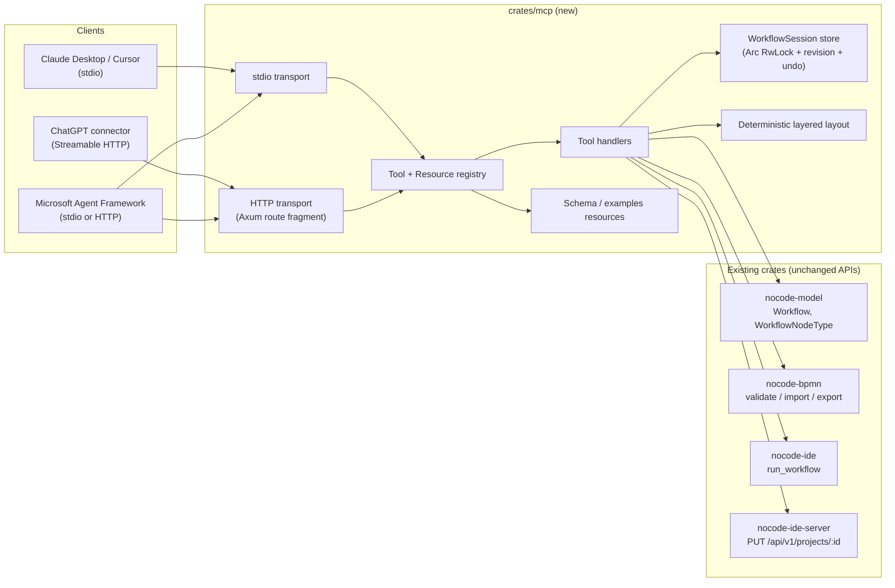

# MCP Integration Plan — Agentic BPMN Workflow Authoring

**Status:** Implemented (Phases 17–21; verification notes in §13)
**Date:** 2026-11-23
**Applies to:** Bonafoid no-code IDE (web IDE + Tauri shell)
**Owner:** Architecture / Platform team
**Related:** `docs/System Architecture Diagrams.md`, `docs/Data Models.md`, `completion-plan.txt` (Milestones 1–3 are complete; this is a new, independent track)

---

## 1. Summary

Add a **Model Context Protocol (MCP) server** that lets any MCP-compatible AI client
(Claude Desktop, ChatGPT with connectors, Cursor, or a custom agent built with the
Microsoft Agent Framework) build and edit Bonafoid BPMN workflows from natural-language
prompts.

The central design decision is that **agents never author a whole BPMN 2.0 XML
document in one shot**. Instead they call small, stateful graph-editing tools
(`add_node`, `connect_nodes`, `auto_layout`, `validate_workflow`, …) against a
workflow session. Coordinates are owned by the server's layout routine, not by the
model, which removes the most common failure mode of LLM-generated BPMN: broken
`bpmndi:BPMNShape` / `dc:Bounds` coordinates and dangling `sourceRef`/`targetRef`
flow references.

MCP **resources** expose the software's own JSON workflow contract, a catalogue of
valid node types, and short, known-good JSON and XML examples so the agent can ground
every tool call in a schema that the product actually accepts.

---

## 2. Goals and non-goals

### Goals

| # | Goal |
|---|------|
| G1 | A runnable MCP server that exposes Bonafoid's existing BPMN/model APIs as typed tools. |
| G2 | Granular, composable tools for graph construction and incremental editing. |
| G3 | Resources carrying the native `Workflow` JSON Schema, node-type catalogue, and valid BPMN 2.0 / JSON examples. |
| G4 | Deterministic auto-layout so agent edits never corrupt diagram coordinates. |
| G5 | Validation and simulation feedback loops the agent can use to self-correct. |
| G6 | Two transports: **stdio** (local desktop clients) and **Streamable HTTP on the existing Axum server** (remote / custom agents). |
| G7 | Save results into a Bonafoid project so the human sees them in the visual Workflow Builder. |
| G8 | Documentation and configuration snippets for Claude, ChatGPT, and Microsoft Agent Framework clients. |

### Non-goals

- No new workflow engine. Reuse `nocode-bpmn` (`BpmnEngine`, `parse_bpmn`, `export_bpmn`) and `nocode-ide::run_workflow`.
- No raw-XML editing tool. XML import/export are interop endpoints, not the authoring path.
- No changes to the React BPMN editor or the generated TypeScript model contract.
- No autonomous deployment/code-generation tools in the first release (tools stay scoped to workflow authoring).

---

## 3. Current state (what the MCP layer wraps)

This plan is grounded in the existing repository; the relevant APIs already exist:

| Concern | Existing code | Reuse for MCP |
|---------|---------------|---------------|
| Domain model | `crates/model/src/workflow.rs` — `Workflow { id, name, nodes: Vec<WorkflowNode>, edges: Vec<WorkflowEdge>, variables, signals, timers, settings, … }`; all types derive `schemars::JsonSchema` | Tool I/O shape; JSON Schema resources |
| Node variants | `WorkflowNodeType` — 16 variants (Start/End events, 8 task types, 4 gateways, SubProcess, CallActivity, Task), each with a `#[serde(tag="type", content="config")]` payload with sensible defaults | `add_node` type catalogue and typed config validation |
| Node position | `NodePosition { x: f64, y: f64 }` lives **on the node** | Server-owned layout; agents may suggest but not require coordinates |
| Structural validation | `BpmnEngine::validate(&Workflow) -> ValidationResult` in `crates/bpmn/src/engine.rs` (one start event, no duplicate IDs, no dangling flows, every non-end node has an outgoing flow, etc.) | `validate_workflow` tool |
| BPMN interop | `nocode_bpmn::xml::{parse_bpmn, export_bpmn}` in `crates/bpmn/src/xml.rs`; exporter already emits `BPMNDI`/`dc:Bounds` from `NodePosition` | `import_bpmn_xml` / `export_bpmn_xml` tools |
| Simulation | `nocode_ide::bpmn::run_workflow(workflow_json, variables, RunOptions) -> RunSummary` in `crates/ide/src/bpmn.rs` | `simulate_workflow` tool |
| Persistence | `Project.workflows: IndexMap<WorkflowId, Workflow>` (`crates/model/src/project.rs`) and `PUT /api/v1/projects/:id` (`crates/ide-server/src/projects/handlers.rs`) | Save into a project; Bearer JWT is accepted by `AuthUser` (`crates/ide-server/src/auth/mod.rs`) |
| Schema toolchain | `xtask types` generates `packages/ide-core/src/types/model.schema.json` from `schemars::schema_for!(nocode_model::Project)`; `schemars 0.8` is a workspace dependency | Reuse for `bpmn://schema/*` resources without hand-writing schemas |
| Web server | Axum 0.7 router in `crates/ide-server/src/server.rs`; `/api/v1/bpmn/*` routes already mounted | Mount Streamable HTTP MCP route here |

There is **no existing MCP code** in the tree (verified by search), so this is a greenfield crate.

---

## 4. Architecture

### 4.1 Shape



### 4.2 Crate layout

Add `crates/mcp` to the workspace `members` in the root `Cargo.toml` and add the SDK
to `[workspace.dependencies]`.

```
crates/mcp/
├── Cargo.toml
├── src/
│   ├── lib.rs              # build_server(), tool/resource registration
│   ├── main.rs             # `nocode-mcp` stdio binary
│   ├── config.rs           # env config, limits, transport selection
│   ├── error.rs            # domain error -> MCP error mapping
│   ├── session.rs          # WorkflowSession, revision, undo stack, store
│   ├── layout.rs           # auto_layout algorithm
│   ├── tools/
│   │   ├── mod.rs
│   │   ├── document.rs     # create/get/load/save/discard
│   │   ├── graph.rs        # add/update/remove node, connect/update/remove edge
│   │   ├── definitions.rs  # variables, signals, timers, settings
│   │   └── quality.rs      # validate, simulate, export
│   ├── resources/
│   │   ├── mod.rs
│   │   ├── schema.rs       # schemars::schema_for!(Workflow)
│   │   ├── catalogue.rs    # node types + required config + defaults
│   │   └── examples.rs     # curated JSON + BPMN XML examples
│   └── transport/
│       ├── mod.rs
│       ├── stdio.rs
│       └── http.rs         # Router<AppState> fragment mounted by ide-server
├── tests/
│   ├── tool_flow.rs        # build -> validate -> export -> re-import
│   └── protocol.rs         # tools/list, resources/read, error shapes
└── examples/
    └── claude_desktop.json
```

### 4.3 SDK decision

Use a Rust MCP SDK (candidate: **`rmcp`**, pinned to a reviewed release, with stdio and
streamable-HTTP server features) so tool/resource schemas are generated from Rust types
and stay aligned with `schemars`. Keep all SDK calls inside `transport/` and `lib.rs`:
the `tools/*` handlers are plain Rust functions over `WorkflowSession`, so an SDK
upgrade — or a fallback to a small hand-rolled JSON-RPC 2.0 layer implementing
`initialize`, `tools/list`, `tools/call`, `resources/list`, `resources/read` — touches
only the transport boundary. A TypeScript SDK server was considered and rejected: it
would have to reach the model through the NAPI bridge or HTTP instead of calling the
internal APIs directly.

---

## 5. MCP surface

### 5.1 Tools

All tools take `session_id: string` (a UUID returned by `create_workflow`). Tools return
**compact results** (affected IDs/objects, not the whole workflow), keeping agent context
small; `get_workflow` is available when a full view is needed. Mutations accept an
optional `expected_revision: number` for optimistic concurrency.

#### Core document tools

| Tool | Key parameters | Maps to |
|------|----------------|---------|
| `create_workflow` | `name`, `description?` | `Workflow::new(name)` |
| `get_workflow` | `session_id`, `view?: "summary" \| "full"` | serde serialize of `Workflow` (summary = node/edge counts + IDs/names/types) |
| `load_workflow` | `workflow_json?` **or** `xml? + name?` | `serde_json::from_str::<Workflow>` / `parse_bpmn` |
| `save_workflow` | `session_id`, `target: "file" \| "project"`, `path?` / `project_id?` | file write (pretty JSON) or `PUT /api/v1/projects/:id` with Bearer JWT / CSRF header |
| `discard_workflow` | `session_id` | session store removal |

#### Graph-editing tools — the primary authoring path

| Tool | Key parameters | Maps to / notes |
|------|----------------|---------------|
| `add_node` | `session_id`, `node_type` (one of the 16 tag names), `name`, `config?` (typed payload, defaults from catalogue), `position?` (optional; omitted = auto), `documentation?` | construct `WorkflowNode` with `NodeId::new()`; returns `node_id`, `position`, `config_defaults_applied` |
| `update_node` | `session_id`, `node_id`, `name?`, `config?`, `position?`, `documentation?` | mutate in place; `config` is merged, not replaced wholesale |
| `remove_node` | `session_id`, `node_id` | remove node **and all incident edges**; returns removed edge IDs |
| `connect_nodes` | `session_id`, `source`, `target`, `label?`, `condition?`, `source_handle?`, `target_handle?` | construct `WorkflowEdge` with `EdgeId::new()`; validates both endpoints exist; returns `edge_id` |
| `update_edge` | `session_id`, `edge_id`, `label?`, `condition?`, `style?` | mutate `WorkflowEdge` (gateway conditions live here) |
| `remove_edge` | `session_id`, `edge_id` | remove single flow |
| `auto_layout` | `session_id`, `direction?: "LR" \| "TB"` (default `LR`), `spacing?` | recomputes every `NodePosition` from the graph topology; returns list of `{node_id, x, y}` |

#### Definition + quality tools

| Tool | Key parameters | Maps to |
|------|----------------|---------|
| `add_variable` / `update_variable` / `remove_variable` | name, type (`String`…`Array`, `Object`), default, scope | `Workflow.variables` |
| `add_signal` / `add_timer` | definition fields | `Workflow.signals` / `Workflow.timers` |
| `set_workflow_settings` | `is_executable`, `history_level`, `timeout`, … | `Workflow.settings` |
| `validate_workflow` | `session_id` | `BpmnEngine::validate` → `{valid, issues: [{severity, node_id?, message}]}` |
| `simulate_workflow` | `session_id`, `variables?`, `auto_complete_tasks?`, `max_rounds?` | `nocode_ide::run_workflow` → `RunSummary` (steps, open tasks, events, status) |
| `export_bpmn_xml` | `session_id` | `export_bpmn` → BPMN 2.0 XML with DI bounds (final artifact only) |
| `undo` / `redo` | `session_id` | session snapshot stack (depth 20) |

Tool descriptions are written as short usage contracts, e.g. for `connect_nodes`:

> Connect two existing nodes in the current workflow. For an exclusive/inclusive
> gateway, put the expression on the **outgoing edge** via `condition` (for example
> `approved == true`), not on the node. Call `auto_layout` after a batch of edits
> before exporting. Prefer several `add_node` + `connect_nodes` calls over supplying
> raw XML.

#### Example multi-call agent flow

```text
create_workflow(name="Invoice approval")
add_node(node_type="StartEvent")                 -> n1
add_node(node_type="UserTask",
         config={"assignee":"manager","candidate_groups":["finance"]})  -> n2
add_node(node_type="ExclusiveGateway")           -> n3
add_node(node_type="EndEvent", name="Approved")  -> n4
add_node(node_type="EndEvent", name="Rejected")  -> n5
connect_nodes(source=n1, target=n2)
connect_nodes(source=n2, target=n3)
connect_nodes(source=n3, target=n4, condition="approved == true", label="yes")
connect_nodes(source=n3, target=n5, label="no")
auto_layout(direction="LR")
validate_workflow()          -> fix any reported issues
simulate_workflow(variables={"approved": true}, auto_complete_tasks=true)
save_workflow(target="project", project_id="…")
```

### 5.2 Resources (agent grounding)

| URI | Content | Source of truth |
|-----|---------|-----------------|
| `bpmn://schema/workflow` | JSON Schema for the native `Workflow` JSON format | `schemars::schema_for!(nocode_model::Workflow)` — generated, cannot drift |
| `bpmn://schema/project` | Full project JSON Schema (shows where `workflows` lives) | reuse `packages/ide-core/src/types/model.schema.json` from `xtask types` |
| `bpmn://catalog/node-types` | For each of the 16 node types: display label, required/optional `config` keys, defaults, and a one-line JSON example | derived from `WorkflowNodeType` + the frontend `NODE_PALETTE` / `buildNodeType` defaults in `packages/ide-core/src/utils/workflowModel.ts` |
| `bpmn://examples/json/minimal` | Smallest valid workflow JSON (start → end) | reuse the `MINIMAL_WORKFLOW` test fixture in `crates/ide/src/bpmn.rs` |
| `bpmn://examples/json/gateway` | Start → UserTask → ExclusiveGateway → two ends, with edge conditions | reuse the `approval_workflow` test fixture |
| `bpmn://examples/xml/minimal` | Minimal valid BPMN 2.0 XML including `bpmndi:BPMNDiagram` and `dc:Bounds` | generated once with `export_bpmn`, checked into `resources/examples/` |
| `bpmn://guide/authoring` | Short guide: preferred tool sequence, why not raw XML, coordinate rules, condition syntax (`crates/bpmn/src/expr.rs`) | hand-written, reviewed alongside tool descriptions |

Resources are **read-only** and MIME-typed (`application/schema+json`, `application/json`,
`application/xml`, `text/markdown`). Tool descriptions link to the relevant resource URI
("valid `node_type` values: see `bpmn://catalog/node-types`"), so clients that eagerly
read resources give the model a correct contract before the first tool call.

### 5.3 Prompts (optional convenience, Phase 21)

Register one prompt, `build_workflow`, with an `requirements` argument. Its template
instructs the agent to: read `bpmn://guide/authoring` → `create_workflow` → add nodes →
connect → `auto_layout` → `validate_workflow` → `simulate_workflow` → `save_workflow`,
and to report validation results to the user rather than silently ignoring them.

---

## 6. Session, state, and layout semantics

**Sessions.** `WorkflowSession { workflow: Workflow, revision: u64, history: Vec<Workflow> }`
behind `Arc<RwLock<HashMap<SessionId, WorkflowSession>>>` for stdio (single process) and
the same store held in Axum `AppState` for HTTP. Every mutation snapshots the previous
workflow (bounded history), increments `revision`, and returns the new revision. An
optional `expected_revision` makes lost updates visible. Sessions are in-memory only;
`save_workflow` is the explicit durability boundary.

**IDs.** The server generates all `WorkflowId`/`NodeId`/`EdgeId` UUIDs. Agents reference
returned IDs; they never invent UUIDs. This removes another class of malformed-model
errors.

**Positions.** `add_node` records an optional *hint* but the default is server-assigned.
`auto_layout` runs a deterministic left-to-right layered placement: topological depth
sets the column (`x = margin + depth * column_width`), nodes in the same layer are
centred vertically (`y`) with configurable spacing, and gateway branches fan out
symmetrically. Layout derives from edges, so deleted/reattached flows cannot leave stale
bounds. The exporter already maps `NodePosition` into `dc:Bounds` (100×80), so valid
coordinates reach `bpmn-js` automatically.

**Validation timing.** Tools allow temporarily incomplete graphs (a node with no
outgoing edge mid-build), so structural validation is **not** run on every mutation;
it is an explicit tool call the agent uses as a feedback loop. `simulate_workflow`
calls `BpmnEngine::start`, which re-validates and refuses invalid workflows.

---

## 7. Transports, security, configuration

### 7.1 stdio (primary for local clients)

`cargo run -p nocode-mcp` (binary `nocode-mcp`) speaks MCP over stdin/stdout over
JSON-RPC 2.0; all logs go to stderr. This is the path Claude Desktop, Cursor, and most
custom agents use. Configured via a client JSON file (see §9).

### 7.2 Streamable HTTP (secondary for remote clients)

`transport/http.rs` exposes an Axum `Router<AppState>` fragment mounted in
`build_router()` in `crates/ide-server/src/server.rs`, e.g. at `/mcp`. It reuses the
existing `AuthUser` extractor, which already accepts `Authorization: Bearer <JWT>`
(`crates/ide-server/src/auth/mod.rs`), so non-browser MCP clients do not need cookie
CSRF flow. Route-level scopes: `workflows:read` for get/validate/simulate/export and
`workflows:write` for mutations — aligned with the existing `ReadWorkflows` /
`WriteWorkflows` permissions in `crates/model/src/project.rs`. If Streamable HTTP is
not supported by the pinned SDK release, ship an SSE + POST-message endpoint behind
the same flag and revisit.

### 7.3 Configuration (env vars)

| Variable | Default | Meaning |
|----------|---------|---------|
| `MCP_TRANSPORT` | `stdio` | `stdio` or `http` (HTTP only meaningful inside `nocode-ide-server`) |
| `MCP_BIND_ADDR` | `127.0.0.1:8090` | Reserved for a standalone HTTP mode; in-process mode uses the server port |
| `MCP_API_BASE_URL` | `http://127.0.0.1:8081` | Base URL for `save_workflow(target="project")` |
| `MCP_API_TOKEN` | — | Bearer JWT used by that call; required for project saves |
| `MCP_MAX_NODES` | `200` | Guardrail per workflow session |
| `MCP_UNDO_DEPTH` | `20` | Snapshot history depth |
| `MCP_AUDIT_LOG` | — | Optional path for a JSON-lines audit log of tool calls |

### 7.4 Security

- Validate every node type/config against the generated schema before mutating; reject
  unknown tags and unknown config keys rather than serialising them into stored JSON.
- Constrain `save_workflow(target="file")` to a configured writable root to avoid path
  traversal when the agent supplies `path`.
- Never interpolate agent-supplied strings into XML directly — all XML goes through
  `export_bpmn`'s escaping.
- Audit log records `{timestamp, session_id, tool, arguments_digest, result_status}`
  (never secrets or full tokens).
- stdio mode runs with the local user's privileges; document that it should not be
  exposed to untrusted clients. HTTP mode inherits existing tenant isolation.

---

## 8. Implementation phases

The roadmap in `completion-plan.txt` ends at Milestone 3 / Phase 16. This work is
**Milestone 4 — Agentic Workflow Authoring, Phases 17–21**, an independent track.

### Phase 17 — Foundation and transport
- Add `crates/mcp` to the workspace; add pinned SDK dependency.
- `config.rs`, `error.rs`, `session.rs` skeleton; `tools/list` and `resources/list` with
  no tools yet; stdio binary that passes a basic MCP handshake.
- **Gate:** a client can connect and list zero tools without protocol errors.

### Phase 18 — Graph-editing tool suite and layout
- Implement document tools and the seven graph tools from §5.1.
- Implement `layout.rs` and `auto_layout`.
- Unit tests: add/connect/remove semantics, unknown endpoint rejection, revision
  conflicts, undo/redo, layout determinism (same graph → identical coordinates).
- **Gate:** a workflow can be built entirely through tool calls and serialises to a
  `Workflow` that `BpmnEngine::validate` accepts.

### Phase 19 — Resources and agent guidance
- Schema resources from `schemars`; node-type catalogue checked against the 16 variants.
- Example resources; `bpmn://guide/authoring`.
- Tool descriptions enriched with resource URIs and valid value lists.
- **Gate:** every resource parses as valid JSON/XML; schema resource matches
  `schemars::schema_for!(Workflow)` byte-for-byte (snapshot test).

### Phase 20 — Validation, simulation, persistence, HTTP transport
- `validate_workflow`, `simulate_workflow`, `export_bpmn_xml` tools.
- `save_workflow` to file and to project via `PUT /api/v1/projects/:id`.
- `transport/http.rs`, mount in `server.rs` behind a feature flag; Bearer auth + scopes.
- **Gate:** golden test — build via tools → export XML → re-import → validate → assert
  node/edge counts, edge conditions, and coordinates preserved.

### Phase 21 — Client onboarding, docs, release
- Configuration examples for Claude Desktop, ChatGPT connector, and Microsoft Agent
  Framework (stdio and HTTP client adapters).
- `docs/mcp-server.md` user guide; README link; CHANGELOG entry.
- Agent evaluation suite: 5–10 natural-language prompts (linear approval, parallel
  signing, timer escalation, service-task notification, loop with gateway) scored on
  `valid == true`, tool-call count, and no raw-XML calls.
- **Gate:** full repo test suite green; agent evaluation ≥ 90% valid workflows.

---

## 9. Client configuration examples (to ship in Phase 21)

**Claude Desktop / Cursor (`claude_desktop_config.json`)**

```json
{
  "mcpServers": {
    "bonafoid": {
      "command": "cargo",
      "args": ["run", "--manifest-path", "<repo>/crates/mcp/Cargo.toml", "-p", "nocode-mcp"],
      "env": { "MCP_TRANSPORT": "stdio" }
    }
  }
}
```

**ChatGPT connector / custom agents:** point at `http://<host>:8081/mcp` with a Bearer
JWT that carries `workflows:read` and `workflows:write`.

**Microsoft Agent Framework:** use its MCP client transport with `StdioClientTransport`
(command above) or `HttpClientTransport` (URL above); register the returned tools as
agent tools. No Bonafoid-specific SDK is required on the .NET side.

---

## 10. Testing and acceptance criteria

### Automated tests
- Unit tests per tool (success + each error path: unknown node type, missing endpoint,
  stale revision, session not found).
- Protocol tests: `tools/list` returns every tool with a JSON Schema; every tool's
  `inputSchema` rejects missing required fields; `resources/read` for every URI.
- Golden round-trip test described in Phase 20.
- HTTP integration test using the existing `test_router()` pattern in `server.rs`:
  unauthenticated `/mcp` → 401; read scope cannot call `add_node`.
- Existing gates: `cargo test --workspace --all-features`, `cargo clippy --workspace
  --all-targets --all-features -- -D warnings`, `cargo fmt --check`, `npm run typecheck`,
  `npm run lint`, `npm test`, `npm run build:web`, `xtask types` drift check.

### Acceptance criteria
1. Any MCP client can discover and call the tools without out-of-band knowledge.
2. An agent can build, validate, simulate, export, and save a 5+ node workflow using
   **only** the granular tools, with zero raw XML generation.
3. Exported BPMN 2.0 XML imports cleanly into `bpmn-js` with non-overlapping, correctly
   grouped shapes after `auto_layout`.
4. Saved workflows appear in the Bonafoid Workflow Builder and survive a project
   reload.
5. Both transports respect their authentication model; no tool can escape the session's
   workflow or the configured file root.

---

## 11. Risks and mitigations

| Risk | Mitigation |
|------|------------|
| MCP SDK API churn / transport feature gaps | Pin version; isolate SDK in `transport/` and registration in `lib.rs`; hand-rolled JSON-RPC fallback documented in §4.3. |
| Agents ignore tools and paste raw XML anyway | No raw-set tool; resource guide + tool descriptions explain why; agent evaluation scores raw-XML calls as failures. |
| Context bloat from full-workflow responses | Compact tool results; `get_workflow(view="summary")` default. |
| Stale coordinates after incremental edits | `auto_layout` is the single owner of positions; agents are instructed to call it after batches; round-trip test guards bounds. |
| Concurrent edits from agent and human via the web IDE | Revision checks; save writes through the project API; UI refresh after save. |
| Build environment blocks Cargo build scripts (known constraint on this machine, `os error 4551`) | Run gates on an unblocked machine; locally limit verification to `cargo fmt --check` and static review, and record this explicitly in the phase gate notes. |
| Tool sprawl overwhelms smaller models | Ship the 14 core tools first; definitions/undo tools are additive and documented separately. |

---

## 12. Open decisions to confirm before Phase 18

1. **Scope granularity** — keep `add_variable`/`add_signal`/`add_timer` as separate tools (recommended) or fold them into one `configure_definitions` tool?
2. **HTTP mount path** — `/mcp` (recommended) or `/api/v1/mcp` to match existing API namespacing.
3. **Project save semantics** — overwrite the whole project JSON via `PUT` (simple, matches current API) versus a dedicated `POST /api/v1/projects/:id/workflows` endpoint that patches only `workflows` (safer for concurrent edits, small server change).
4. **Session expiry** — drop idle sessions after 30 minutes, or keep for the lifetime of the MCP process (simpler for desktop clients)?
5. **SDK final choice** — confirm `rmcp` version and feature set against crates.io at implementation time; the architecture above does not depend on its specific API.

---

## 13. Implementation notes and phase gates (2026-11-23)

Decisions taken during implementation (§12 resolved):

1. **Granularity** — separate definition tools were kept; 23 tools are
   advertised in total. This matches G2 and the recommended option.
2. **HTTP path** — `/mcp`, mounted in `build_router()` in `crates/ide-server`.
3. **Project save** — GET for the current revision then PUT of the whole
   project JSON (current API semantics), with validation of `expected_revision`
   at both the session and project levels.
4. **Session expiry** — process lifetime; `discard_workflow` is the explicit
   release path (simpler for desktop clients).
5. **SDK** — `rmcp 3.11.0` was confirmed to exist on crates.io, but the
   dependency-free JSON-RPC fallback from §4.3 was implemented instead.
   Reason: the build environment blocks every Cargo build script
   (`os error 4551`), so an unverified third-party SDK with a large dependency
   tree was a worse risk than the documented fallback. All SDK calls are
   confined to `protocol.rs` and `transport/*`; tool handlers are plain Rust.
   The HTTP route lives in `crates/ide-server/src/mcp.rs` to avoid a circular
   crate dependency while reusing `AuthUser`.

Phase gates:

- **17–19:** implemented; stdio handshake, tool/resource discovery and
  generated-schema tests are in `crates/mcp/tests/protocol.rs`.
- **20:** implemented; golden build → export → re-import round trip is in
  `crates/mcp/tests/tool_flow.rs`; HTTP auth/scope tests are in
  `crates/ide-server/src/mcp.rs`.
- **21:** implemented; `docs/mcp-server.md`, README/CHANGELOG, client config
  example and five deterministic agent-evaluation flows in
  `crates/mcp/tests/agent_evals.rs` with prompts in `crates/mcp/evals/prompts.json`.

**Verification limitation:** `cargo fmt --all` passes. `cargo check/test`,
`cargo clippy`, npm gates and the xtask drift check could NOT be executed on
this machine because an application-control policy blocks build-script
executables. Those gates must be run on an unblocked machine before release;
do not treat this implementation as compile-verified.

### 13.1 Manual static review (substitute for `cargo check`)

Because the compiler cannot run here, `crates/mcp` and
`crates/ide-server/src/mcp.rs` were reviewed by hand against the real APIs in
`nocode-model`, `nocode-bpmn` and `nocode-ide`. Signature and shape checks
confirmed: `Workflow::new(impl Into<String>)`, `Workflow.updated_at`,
`WorkflowNodeType`'s adjacent `tag = "type", content = "config"` encoding
(unit variants such as `ManualTask` carry **no** `config` key),
`StartEventType`/`HttpMethod`/`TimerType` serde spellings (`"none"`, `"POST"`,
`"duration"`), `ValidationResult::{issues, is_valid}`,
`export_bpmn(&Workflow) -> Result<String>`, `parse_bpmn(&str, &str)`,
`run_workflow(&str, Value, RunOptions) -> Result<RunSummary, String>`,
`Project.workflows: IndexMap<WorkflowId, Workflow>`, `AuthUser`'s
`id/tenant_id/roles` plus `is_tenant_admin()`/`is_super_admin()`, and
`build_router(AppState, &str)`.

Defects found and fixed during that review:

- `tools/graph.rs` called `catalogue()` after importing the *module* rather
  than the function (`use ...::catalogue::{self, ...}`); now
  `catalogue::catalogue()`.
- `tools/graph.rs` compared `&String == &&str` when computing
  `config_defaults_applied`; now `supplied.as_str() == *key`.
- `tools/graph.rs` used `default_node_type(..).unwrap()`; now returns
  `McpError::UnknownNodeType` instead of panicking.
- `ide-server/src/mcp.rs` used `"application/json".parse()` and
  `id.parse()` inside `HeaderMap::insert`, where the target type cannot be
  inferred (`HeaderValue`, `String` and `&str` all satisfy
  `TryInto<HeaderValue>`); now `HeaderValue::from_static` /
  `HeaderValue::try_from`.
- `tests/tool_flow.rs` compared layout coordinates positionally, which would
  break if the BPMN importer reorders elements (ids are regenerated on import);
  it now compares the sorted coordinate sets.
- `persistence.rs`'s chunked-decoding test relied on `Vec<u8> == &[u8; N]`;
  it now compares against `b"...".to_vec()`.

Behavioural assumptions re-verified against `BpmnEngine::validate`: it requires
exactly one start event, an outgoing flow for every non-end node and an
incoming flow for every non-start node, and it does **not** reject cycles.
That is why all five agent-evaluation flows (including the `gateway_loop`
retry edge) are expected to score `valid == true`.

Remaining known risk: anything the compiler would catch that hand review
cannot (trait-bound inference, borrowck on closure captures, `clippy -D
warnings` lints). The `cargo check`/`clippy`/`test` gates in §11 remain
mandatory before release.
