# System Architecture Diagrams

## No-Code Visual Application Development Platform

**Version:** 1.0  
**Date:** October 2026  
**Status:** Draft  

---

## 1. High-Level System Architecture

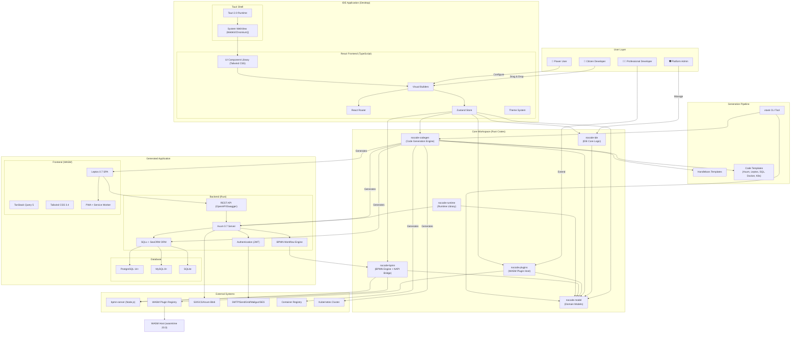

---

## 2. System Context Diagram

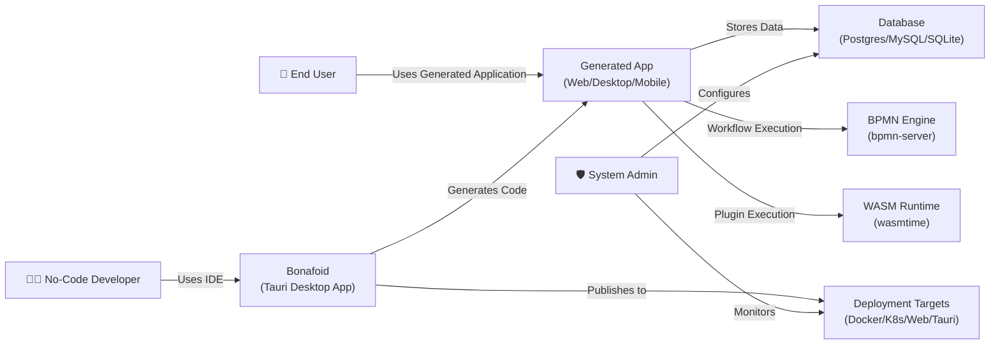

---

## 3. IDE Architecture (Frontend + Tauri)

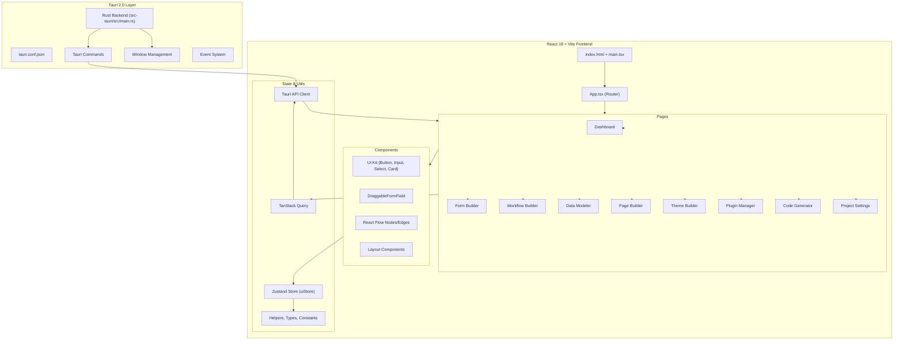

---

## 4. Core Crates Dependency Diagram

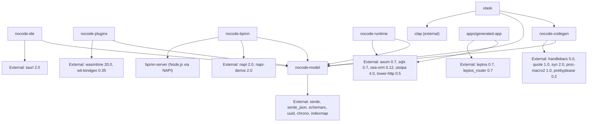

---

## 5. Code Generation Flow

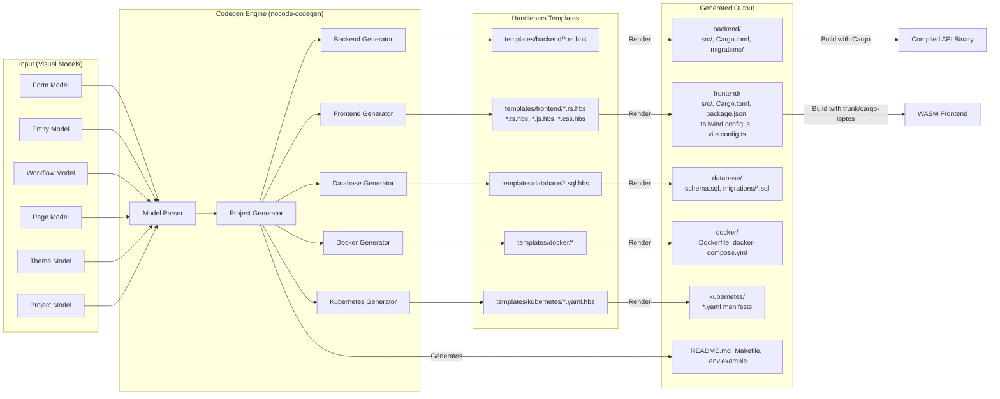

---

## 6. BPMN Workflow Architecture

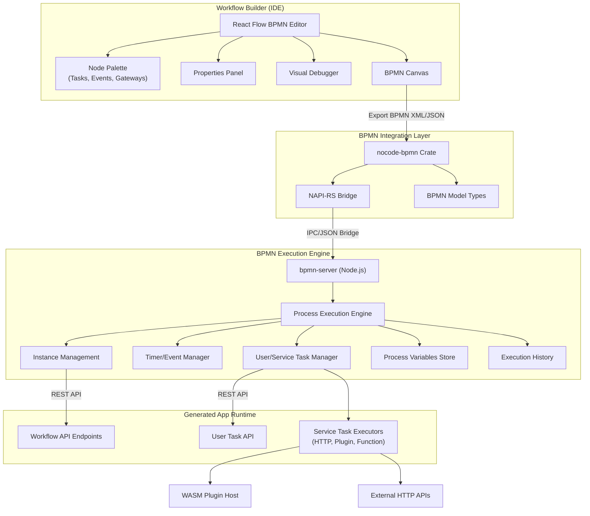

---

## 7. Plugin System Architecture

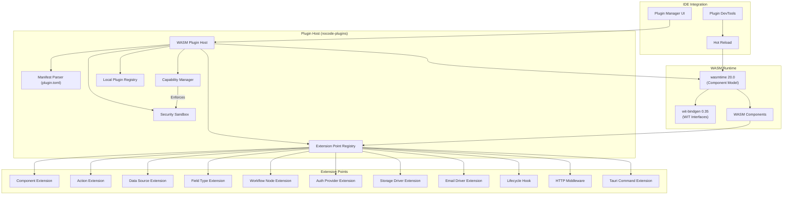

---

## 8. Data Model Architecture

```mermaid
erDiagram
    PROJECT ||--o{ FORM : contains
    PROJECT ||--o{ ENTITY : contains
    PROJECT ||--o{ WORKFLOW : contains
    PROJECT ||--o{ PAGE : contains
    PROJECT ||--o{ THEME : contains
    PROJECT ||--o{ ENVIRONMENT : has
    PROJECT ||--o{ PLUGIN_CONFIG : configures
    
    FORM ||--o{ FORM_FIELD : has
    FORM ||--o{ FORM_SUBMISSION : receives
    
    ENTITY ||--o{ ENTITY_FIELD : has
    ENTITY ||--o{ RELATIONSHIP : relates
    RELATIONSHIP }|--|| ENTITY : targets
    
    WORKFLOW ||--o{ WORKFLOW_NODE : contains
    WORKFLOW ||--o{ WORKFLOW_EDGE : contains
    WORKFLOW ||--|| WORKFLOW_SETTINGS : has
    WORKFLOW_NODE ||--|| WORKFLOW_NODE_TYPE : of_type
    WORKFLOW_NODE ||--o{ WORKFLOW_EDGE : source_target
    
    PAGE ||--o{ PAGE_COMPONENT : has
    PAGE_COMPONENT ||--|| COMPONENT_TYPE : of_type
    PAGE_COMPONENT ||--o{ DATA_BINDING : has
    PAGE_COMPONENT ||--o{ COMPONENT_EVENT : has
    
    THEME ||--|| DESIGN_TOKENS : defines
    THEME ||--|| COMPONENT_THEMING : defines
    THEME ||--|| DARK_MODE_CONFIG : defines
    
    WORKFLOW_INSTANCE ||--|| WORKFLOW : instance_of
    WORKFLOW_INSTANCE ||--o{ TASK_INSTANCE : has
    WORKFLOW_INSTANCE ||--o{ VARIABLE : holds
    WORKFLOW_INSTANCE ||--o{ HISTORIC_ACTIVITY : tracks
    
    USER ||--o{ SESSION : has
    USER ||--o{ ROLE : assigned
    ROLE ||--o{ PERMISSION : grants
```

---

## 9. Deployment Architecture (Multi-Target)

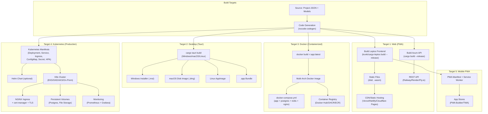

---

## 10. Web IDE Architecture

### 10.1 Platform Split (Desktop vs Web)

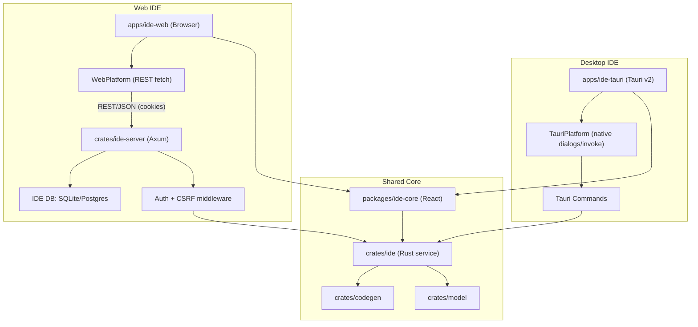

### 10.2 Web IDE High-Level

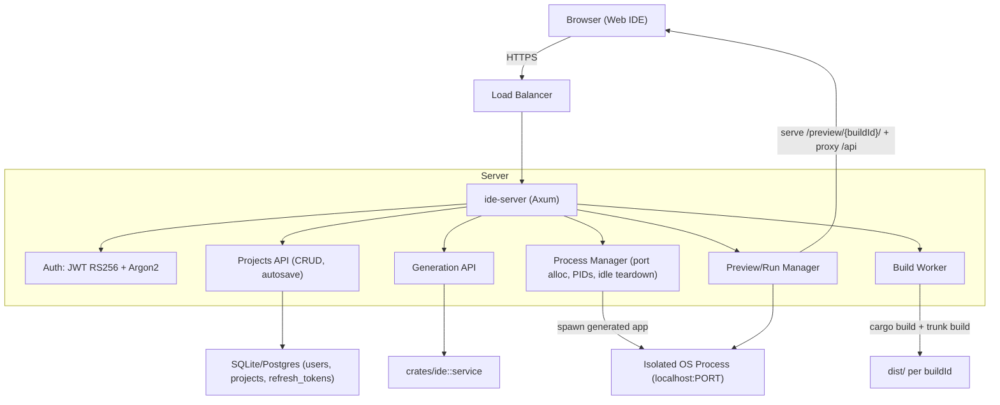

### 10.3 Auth Flow (JWT RS256 + HttpOnly Cookies)

```mermaid
sequenceDiagram
    participant B as Browser
    participant S as ide-server
    participant DB as IDE DB
    B->>S: POST /api/v1/auth/register (email, password)
    S->>DB: create user (Argon2id hash)
    S-->>B: 201; set HttpOnly access/refresh cookies + CSRF token
    B->>S: POST /api/v1/auth/login
    S->>DB: verify hash, revoke old refresh (optional)
    S-->>B: 200 + HttpOnly cookies (15m access, 7d refresh)
    B->>S: GET /api/v1/projects (with cookies + CSRF header)
    S->>S: validate JWT + CSRF
    S->>DB: scope by user_id
    S-->>B: 200 list
    B->>S: POST /api/v1/auth/refresh (cookie refresh)
    S->>DB: validate refresh token (rotation, jti)
    S-->>B: rotate cookies
    B->>S: POST /api/v1/auth/logout
    S->>DB: revoke refresh token
    S-->>B: clear cookies
```

### 10.4 Hosted Preview/Run Flow

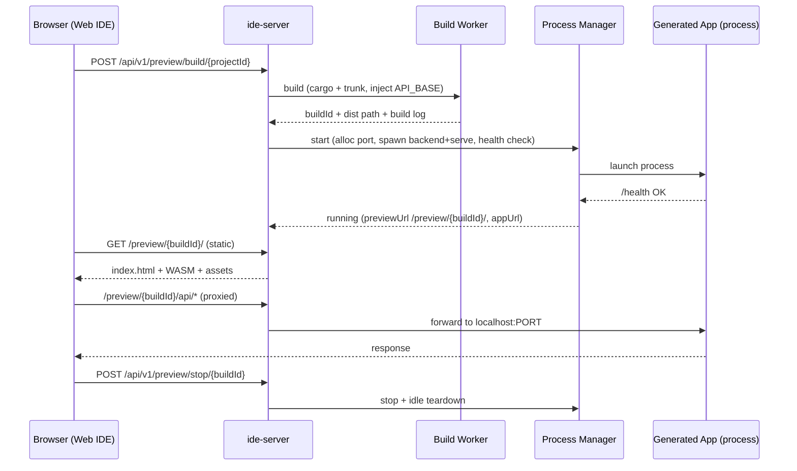

---

## 11. Security Architecture

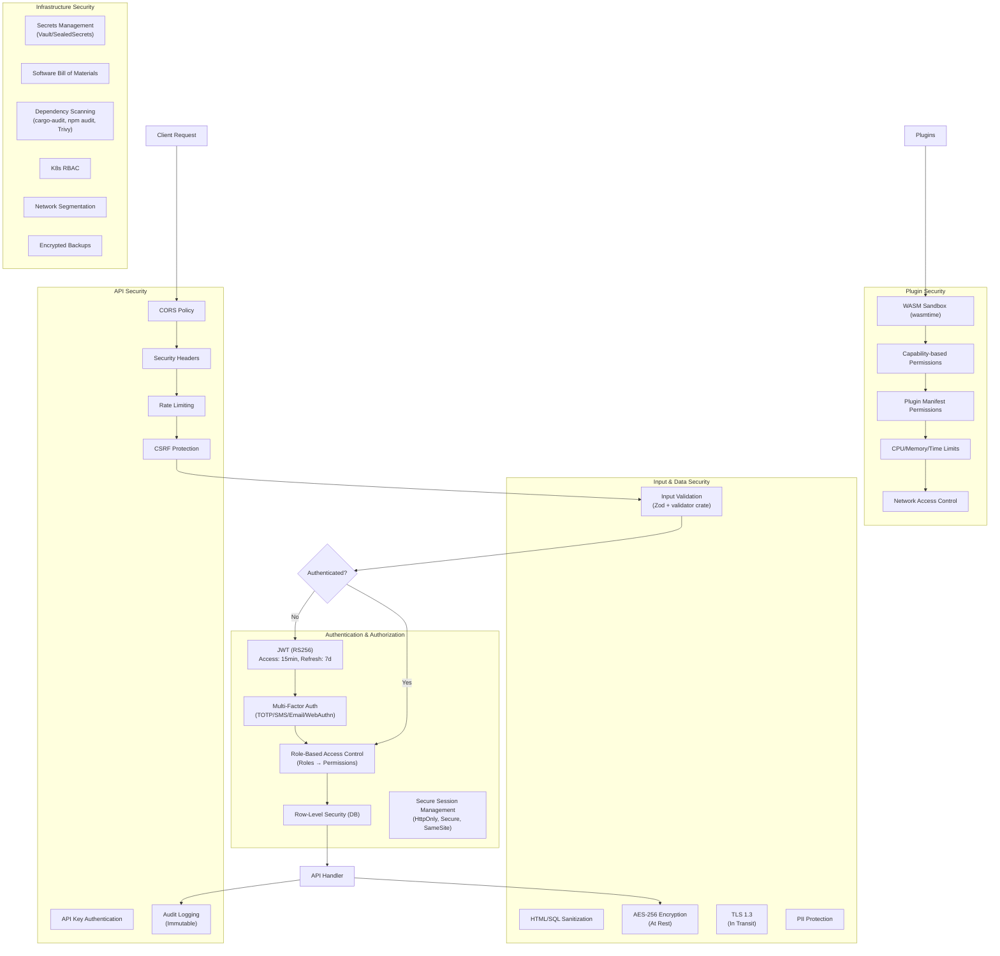

---

## 11. Technology Stack Diagram

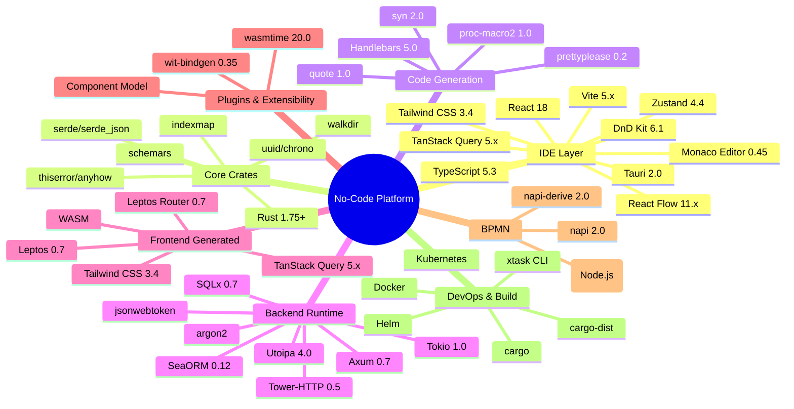

---

## 12. Request Flow (Complete User Journey)

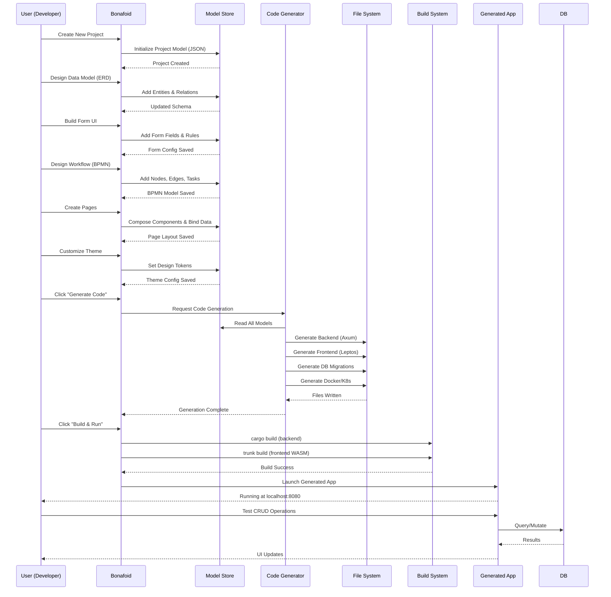

---

**Document Control**

| Version | Date | Author | Changes |
|---------|------|--------|---------|
| 1.0 | 2026-10-15 | System Architect | Initial Draft - Complete system architecture diagrams for Bonafoid platform |
| 1.1 | 2026-10-16 | Engineering | Add Web IDE platform split, server/auth/preview/run diagrams, hosted preview architecture |