# System Architecture Diagrams

## No-Code Visual Application Development Platform

**Version:** 1.2  
**Date:** October 2026  
**Status:** Living document — amended after Phase 6 (crate graph, codegen
template paths and BPMN execution model reconciled with the tree)  

---

## 1. High-Level System Architecture

```mermaid
graph TB
    subgraph "User Layer"
        CitizenDev["👤 Citizen Developer"]
        PowerUser["🔧 Power User"]
        ProDev["👨‍💻 Professional Developer"]
        Admin["🛡️ Platform Admin"]
    end

    subgraph "IDE Application (Desktop)"
        subgraph "Tauri Shell"
            TauriCore["Tauri 2.0 Runtime"]
            WebView["System WebView (WebKit/Chromium)]"]
        end
        
        subgraph "React Frontend (TypeScript)"
            Routing["React Router"]
            StateMgmt["Zustand Store"]
            UIComponents["UI Component Library (Tailwind CSS)"]
            Builders["Visual Builders"]
            Theme["Theme System"]
        end
    end

    subgraph "Core Workspace (Rust Crates)"
        Model["nocode-model<br/>(Domain Models)"]
        Codegen["nocode-codegen<br/>(Code Generation Engine)"]
        Plugins["nocode-plugins<br/>(WASM Plugin Host)"]
        BPMN["nocode-bpmn<br/>(BPMN Engine + NAPI Bridge)"]
        Ide["nocode-ide<br/>(IDE Core Logic)"]
        IdeServer["nocode-ide-server<br/>(Axum API + Preview Subsystem)"]
    end

    subgraph "Generation Pipeline"
        Handlebars["Handlebars Templates"]
        Templates["Code Templates<br/>(Axum, Leptos, SQL, Docker, K8s)"]
        XtTask["xtask CLI Tool"]
    end

    subgraph "Generated Application"
        subgraph "Backend (Rust)"
            AxumServer["Axum 0.7 Server"]
            SQLx["SQLx + SeaORM ORM"]
            Auth["Authentication (JWT)"]
            WorkflowEngine["BPMN Workflow Engine"]
            API["REST API (OpenAPI/Swagger)"]
        end
        
        subgraph "Frontend (WASM)"
            LeptosApp["Leptos 0.7 SPA"]
            TanStackQuery["TanStack Query 5"]
            TailwindGen["Tailwind CSS 3.4"]
            PWA["PWA + Service Worker"]
        end
        
        subgraph "Database"
            PG["PostgreSQL 14+"]
            MySQL["MySQL 8+"]
            SQLite["SQLite"]
        end
    end

    subgraph "External Systems"
        PluginFiles["Plugin manifests + .wasm files<br/>(local install only — no registry)"]
        Storage["S3/GCS/Azure Blob"]
        Email["SMTP/SendGrid/Mailgun/SES"]
        DockerHub["Container Registry"]
        K8s["Kubernetes Cluster"]
    end

    %% User to IDE
    CitizenDev -->|Drag & Drop| Builders
    PowerUser -->|Configure| Builders
    ProDev -->|Extend| Plugins
    Admin -->|Manage| Ide

    %% IDE Structure
    TauriCore --> WebView
    WebView --> UIComponents
    UIComponents --> Builders
    Builders --> Routing
    Builders --> StateMgmt
    StateMgmt --> Model
    StateMgmt --> Ide
    StateMgmt --> Plugins
    StateMgmt --> Codegen
    StateMgmt --> BPMN

    %% Core Crates Relationships
    Ide --> Model
    Codegen --> Model
    Codegen --> Handlebars
    Codegen --> Templates
    Plugins --> Model
    BPMN --> Model
    IdeServer --> Model
    IdeServer --> Codegen
    IdeServer --> Plugins
    IdeServer --> AxumServer

    %% Code Generation
    Codegen -->|Generates| AxumServer
    Codegen -->|Generates| LeptosApp
    Codegen -->|Generates| SQLx
    Codegen -->|Generates| DockerHub
    Codegen -->|Generates| K8s

    %% Generated App
    AxumServer --> SQLx
    AxumServer --> Auth
    AxumServer --> WorkflowEngine
    SQLx --> PG
    SQLx --> MySQL
    SQLx --> SQLite
    LeptosApp --> API
    LeptosApp --> PWA
    API --> AxumServer
    WorkflowEngine --> BPMN
    Auth --> Email
    AxumServer --> Storage

    %% Plugins — installed from a manifest the user supplies; there is no
    %% registry to fetch from.
    Plugins --> PluginFiles
    Plugins --> WasmHost["WASM Host (wasmtime 20.0)"]

    %% XtTask
    XtTask --> Codegen
    XtTask --> Model
```

---

## 2. System Context Diagram

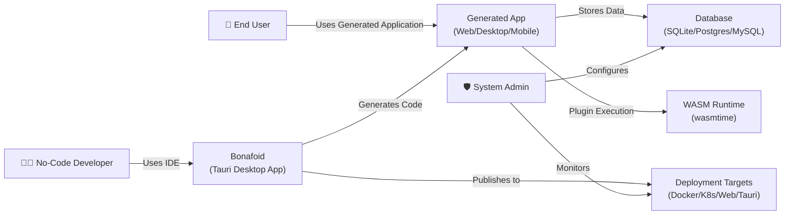

---

## 3. IDE Architecture (Frontend + Tauri)

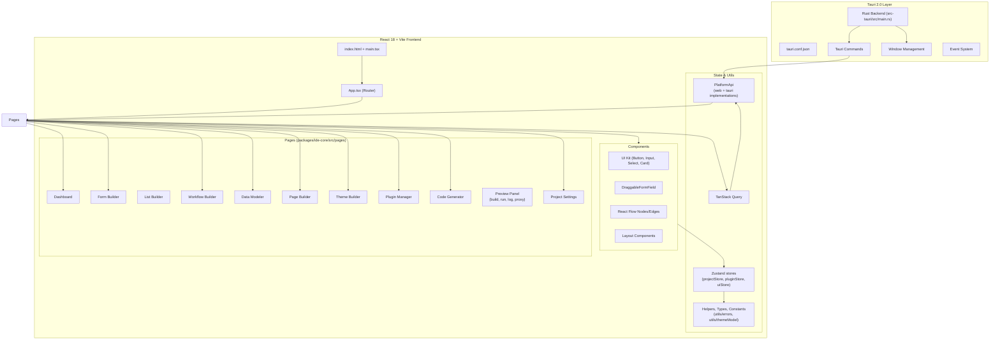

---

## 4. Core Crates Dependency Diagram

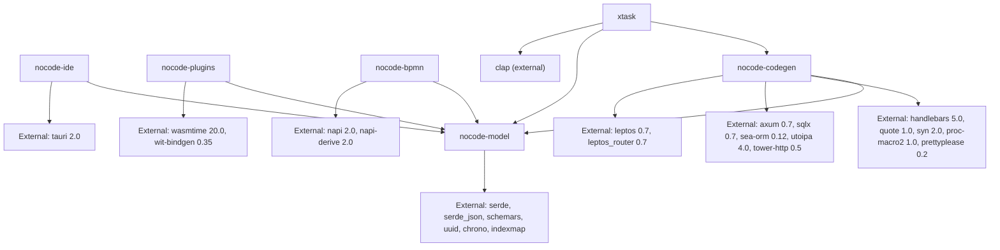

---

## 5. Code Generation Flow

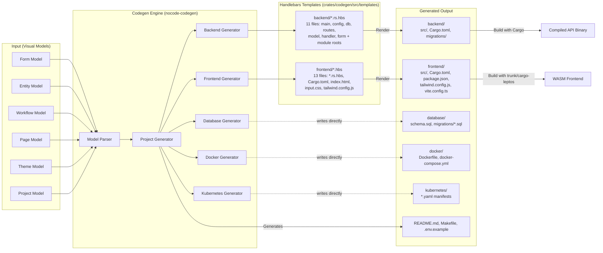

---

## 6. BPMN Workflow Architecture

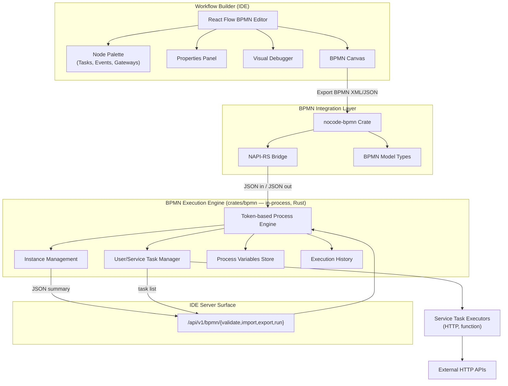

---

## 7. Plugin System Architecture

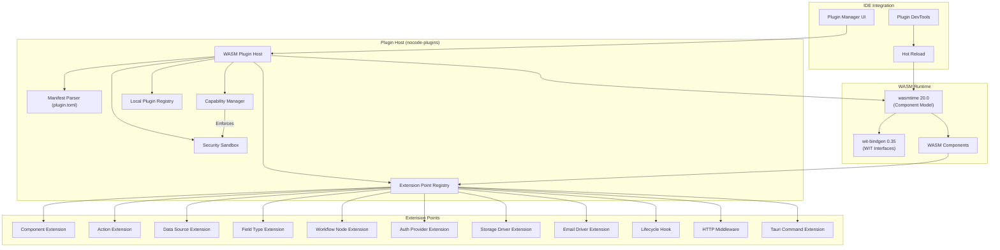

---

## 8. Data Model Architecture

```mermaid
erDiagram
    PROJECT ||--o{ FORM : contains
    PROJECT ||--o{ ENTITY : contains
    PROJECT ||--o{ WORKFLOW : contains
    PROJECT ||--o{ PAGE : contains
    PROJECT ||--o{ THEME : contains
    PROJECT ||--o{ ENVIRONMENT : has
    PROJECT ||--o{ PLUGIN_CONFIG : configures
    
    FORM ||--o{ FORM_FIELD : has
    FORM ||--o{ FORM_SUBMISSION : receives
    
    ENTITY ||--o{ ENTITY_FIELD : has
    ENTITY ||--o{ RELATIONSHIP : relates
    RELATIONSHIP }|--|| ENTITY : targets
    
    WORKFLOW ||--o{ WORKFLOW_NODE : contains
    WORKFLOW ||--o{ WORKFLOW_EDGE : contains
    WORKFLOW ||--|| WORKFLOW_SETTINGS : has
    WORKFLOW_NODE ||--|| WORKFLOW_NODE_TYPE : of_type
    WORKFLOW_NODE ||--o{ WORKFLOW_EDGE : source_target
    
    PAGE ||--o{ PAGE_COMPONENT : has
    PAGE_COMPONENT ||--|| COMPONENT_TYPE : of_type
    PAGE_COMPONENT ||--o{ DATA_BINDING : has
    PAGE_COMPONENT ||--o{ COMPONENT_EVENT : has
    
    THEME ||--|| DESIGN_TOKENS : defines
    THEME ||--|| COMPONENT_THEMING : defines
    THEME ||--|| DARK_MODE_CONFIG : defines
    
    WORKFLOW_INSTANCE ||--|| WORKFLOW : instance_of
    WORKFLOW_INSTANCE ||--o{ TASK_INSTANCE : has
    WORKFLOW_INSTANCE ||--o{ VARIABLE : holds
    WORKFLOW_INSTANCE ||--o{ HISTORIC_ACTIVITY : tracks
    
    USER ||--o{ SESSION : has
    USER ||--o{ ROLE : assigned
    ROLE ||--o{ PERMISSION : grants
```

---

## 9. Deployment Architecture (Multi-Target)

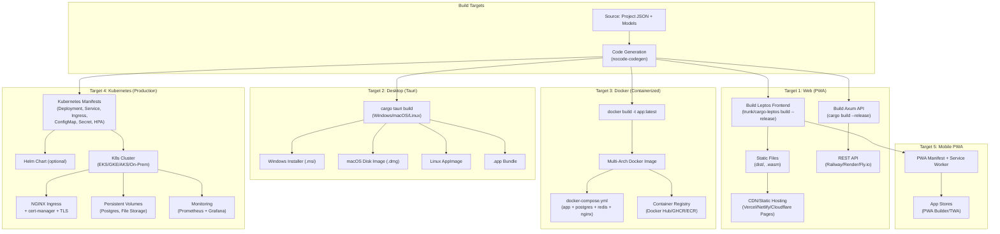

---

## 10. Web IDE Architecture

### 10.1 Platform Split (Desktop vs Web)

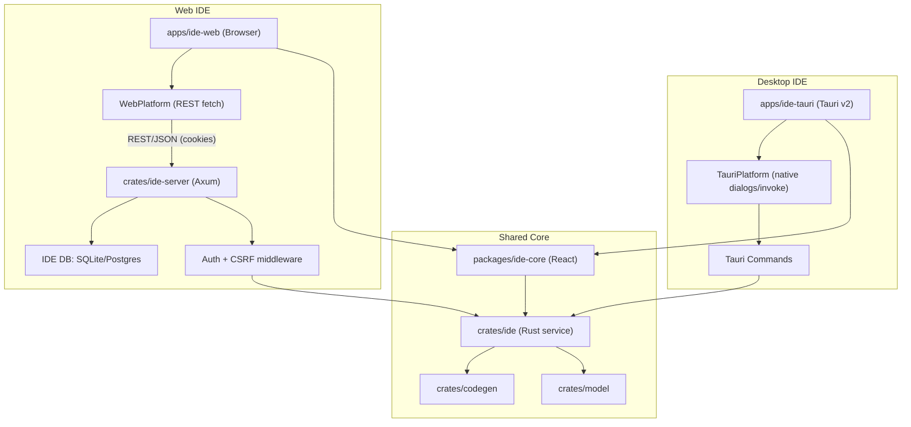

### 10.2 Web IDE High-Level

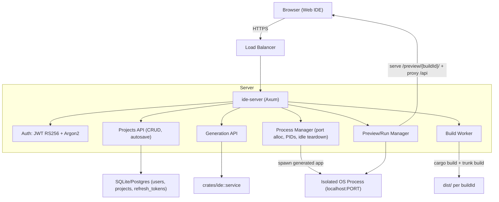

### 10.3 Auth Flow (JWT RS256 + HttpOnly Cookies)

```mermaid
sequenceDiagram
    participant B as Browser
    participant S as ide-server
    participant DB as IDE DB
    B->>S: POST /api/v1/auth/register (email, password)
    S->>DB: create user (Argon2id hash)
    S-->>B: 201; set HttpOnly access/refresh cookies + CSRF token
    B->>S: POST /api/v1/auth/login
    S->>DB: verify hash, revoke old refresh (optional)
    S-->>B: 200 + HttpOnly cookies (15m access, 7d refresh)
    B->>S: GET /api/v1/projects (with cookies + CSRF header)
    S->>S: validate JWT + CSRF
    S->>DB: scope by user_id
    S-->>B: 200 list
    B->>S: POST /api/v1/auth/refresh (cookie refresh)
    S->>DB: validate refresh token (rotation, jti)
    S-->>B: rotate cookies
    B->>S: POST /api/v1/auth/logout
    S->>DB: revoke refresh token
    S-->>B: clear cookies
```

### 10.4 Hosted Preview/Run Flow

Building and running are two separate steps: a build is cheap to keep, a
running process is not, so the IDE starts a process only when someone asks for
one.

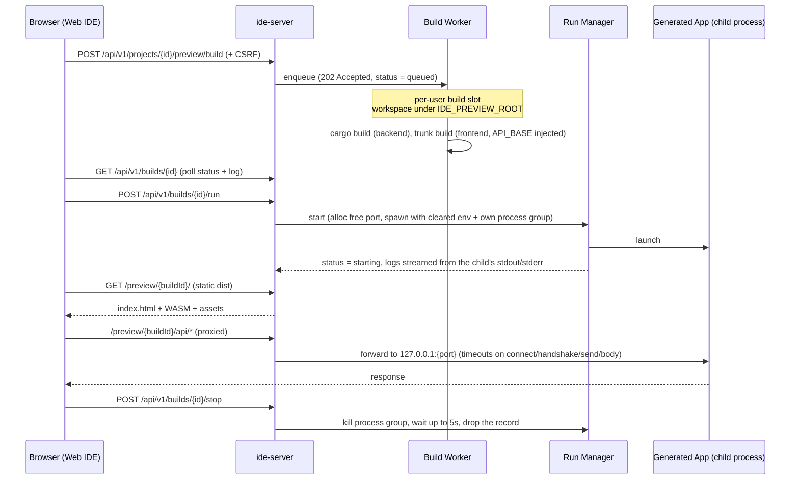

### 10.5 Preview Hardening

The preview subsystem runs code the platform did not write, on the same host as
the IDE server, so the boundaries are explicit:

| Boundary | Implementation |
|---------|----------------|
| Who may build/run/serve | Every preview route is owner-scoped; a build record carries `user_id` and is invisible to anyone else |
| Resource quotas | `IDE_PREVIEW_PARALLEL` builds and `IDE_PREVIEW_MAX_RUNS` running processes, counted **per user**, so one account cannot starve the host |
| Cargo target isolation | One target directory per user (`IDE_PREVIEW_ROOT/.cargo-target/<user>`), so two users' builds cannot overwrite each other's binary |
| Path safety | Build ids must parse as UUIDs; `manager::is_within` checks lexical containment under the preview root before any `remove_dir_all` |
| Process lifetime | Child in its own process group (`setpgid` / `CREATE_NEW_PROCESS_GROUP`); `stop` kills the group and waits, reporting failure if the process survives |
| Child environment | `env_clear` plus an allowlist, so `DATABASE_URL`, `JWT_KEYS_DIR` and friends never reach generated code |
| Proxy credentials | The request hop drops `Authorization`, `Cookie`, `X-CSRF-Token`, `Origin`, `Referer`; the response hop drops `Set-Cookie` |
| Proxy limits | 8 MiB request body (`413 Payload Too Large`), and connect/handshake/send/body timeouts (`504 Gateway Timeout`) with the upstream connection aborted |
| Output capture | The child's stdout/stderr are piped into its run record (last 500 lines, flushed every 250 ms) instead of the server's log |
| Crash detection | The reaper refreshes active runs before reaping, so a preview that died frees its quota slot instead of holding it forever |

---

## 11. Security Architecture

> This diagram is the **target** security model, not a description of the
> current tree. Shipped today: JWT (RS256) with HttpOnly cookies, CSRF
> double-submit, owner-scoped authorization on every route, request validation
> on names and preview ids, the WASM plugin sandbox with manifest permissions,
> and the preview boundaries in §10.5. Not shipped: MFA, RBAC roles, RLS,
> rate limiting, AES-256 at rest, audit logging, secrets management. See the
> SRS §1.5 for the requirement-by-requirement status.

```mermaid
graph TD
    subgraph "Authentication & Authorization"
        JWT["JWT (RS256)<br/>Access: 15min, Refresh: 7d"]
        MFA["Multi-Factor Auth<br/>(TOTP/SMS/Email/WebAuthn)"]
        RBAC["Role-Based Access Control<br/>(Roles → Permissions)"]
        RLS["Row-Level Security (DB)"]
        Session["Secure Session Management<br/>(HttpOnly, Secure, SameSite)"]
    end
    
    subgraph "Input & Data Security"
        Validation["Input Validation<br/>(Zod + validator crate)"]
        Sanitization["HTML/SQL Sanitization"]
        Encryption["AES-256 Encryption<br/>(At Rest)"]
        TLS["TLS 1.3<br/>(In Transit)"]
        PII["PII Protection"]
    end
    
    subgraph "Plugin Security"
        Sandbox["WASM Sandbox (wasmtime)"]
        Capabilities["Capability-based Permissions"]
        ManifestPerm["Plugin Manifest Permissions"]
        ResourceLimits["CPU/Memory/Time Limits"]
        NetworkPolicy["Network Access Control"]
    end
    
    subgraph "API Security"
        CORS["CORS Policy"]
        RateLimit["Rate Limiting"]
        CSRF["CSRF Protection"]
        APIKeys["API Key Authentication"]
        AuditLog["Audit Logging<br/>(Immutable)"]
        Helmet["Security Headers"]
    end
    
    subgraph "Infrastructure Security"
        Secrets["Secrets Management<br/>(Vault/SealedSecrets)"]
        SBOM["Software Bill of Materials"]
        Scanning["Dependency Scanning<br/>(cargo-audit, npm audit, Trivy)"]
        RBAC_K8s["K8s RBAC"]
        NetworkSeg["Network Segmentation"]
        Backup["Encrypted Backups"]
    end
    
    Client["Client Request"] --> CORS
    CORS --> Helmet
    Helmet --> RateLimit
    RateLimit --> CSRF
    CSRF --> Validation
    Validation --> AuthCheck{"Authenticated?"}
    AuthCheck -->|Yes| RBAC
    AuthCheck -->|No| JWT
    JWT --> MFA
    MFA --> RBAC
    RBAC --> RLS
    RLS --> API["API Handler"]
    API --> AuditLog
    API --> Encryption
    
    Plugins --> Sandbox
    Sandbox --> Capabilities
    Capabilities --> ManifestPerm
    ManifestPerm --> ResourceLimits
    ResourceLimits --> NetworkPolicy
```

---

## 12. Technology Stack Diagram

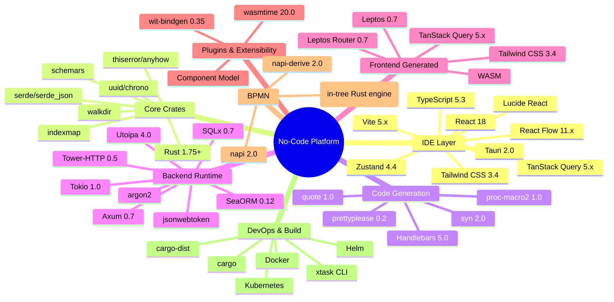

---

## 13. Request Flow (Complete User Journey)

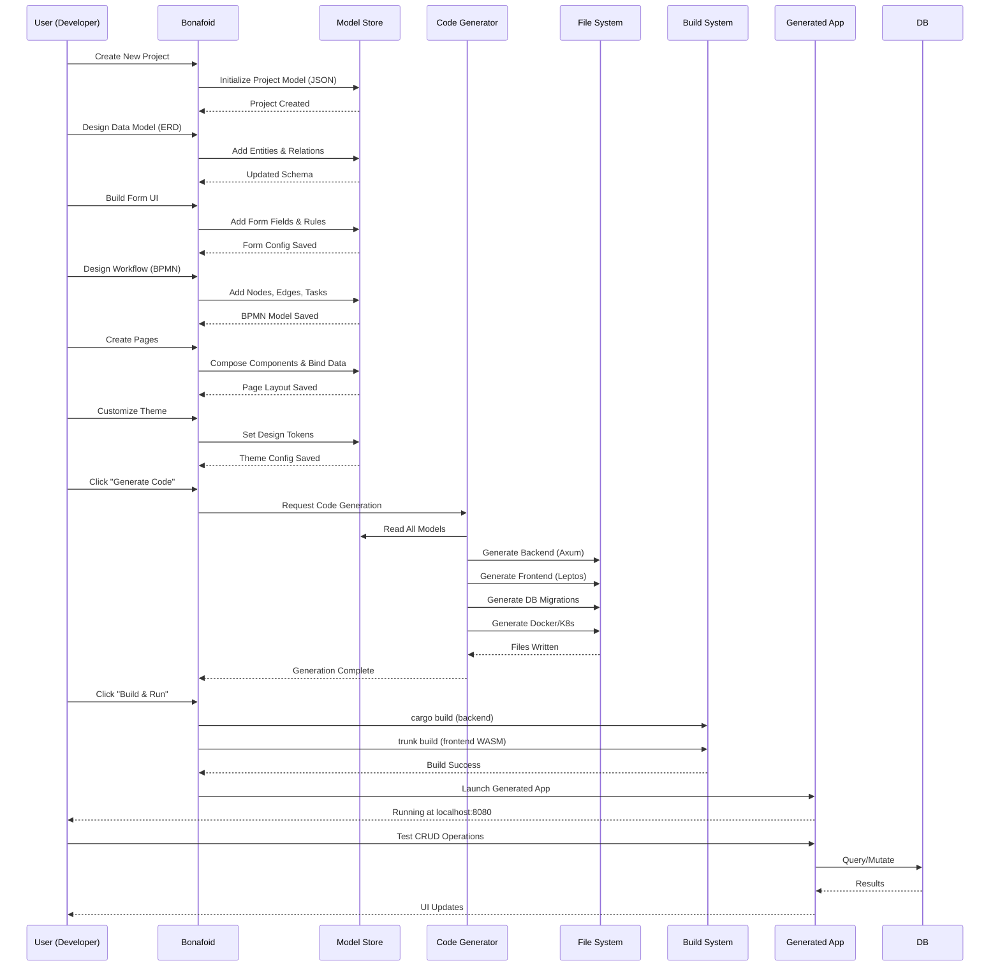

---

**Document Control**

| Version | Date | Author | Changes |
|---------|------|--------|---------|
| 1.0 | 2026-10-15 | System Architect | Initial Draft - Complete system architecture diagrams for Bonafoid platform |
| 1.1 | 2026-10-16 | Engineering | Add Web IDE platform split, server/auth/preview/run diagrams, hosted preview architecture |
| 1.2 | 2026-10-29 | Engineering | §10.4 preview sequence redrawn and §10.5 trust boundaries added (Phases 4-5); then the crate graph, codegen template paths, builder list and BPMN execution model reconciled with the tree — `nocode-runtime` and `apps/generated-app` removed, `nocode-ide-server` added, no external bpmn-server |