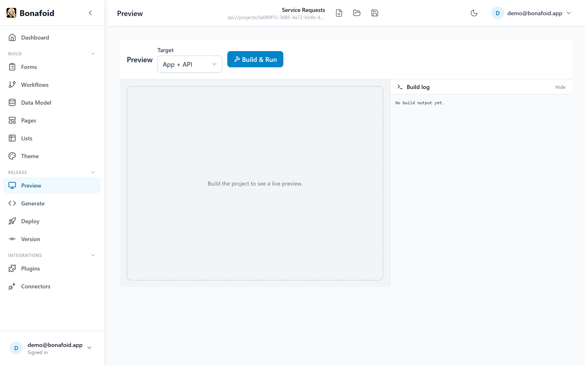

# Bonafoid — Self-Service Troubleshooting Guide

**For:** Non-technical users. Find the message or symptom you see, then follow the steps in order.
**Companion documents:** [End-User Manual](user-manual.md) · [FAQ](faq.md).

> **Before you start — three habits that fix most problems**
> 1. **Refresh the page** and try again. Bonafoid saves your work automatically, so a refresh rarely loses anything.
> 2. **Check the message in the bottom-right corner.** It usually says what failed and what to do next.
> 3. **Make a copy first.** On the **Projects** screen, use **Duplicate** on the project before trying fixes.

---

## Quick index

| Message or symptom | Go to |
|---|---|
| Invalid email or password | [Sign-in problems](#sign-in-problems) |
| Password must be at least 8 characters / Passwords do not match | [Sign-in problems](#sign-in-problems) |
| email already registered | [Sign-in problems](#sign-in-problems) |
| I cannot sign in at all / the page will not load | [Cannot reach Bonafoid](#cannot-reach-bonafoid) |
| That file is not a valid project | [Project and file problems](#project-and-file-problems) |
| Could not load / open / create / delete / duplicate the project | [Project and file problems](#project-and-file-problems) |
| project name is required / too long | [Project and file problems](#project-and-file-problems) |
| Unsaved changes / Autosave failed | [Saving problems](#saving-problems) |
| Invalid JSON / Variables must be a JSON object | [Builder problems](#builder-problems) |
| Validation failed / Run failed / Import failed / Export failed | [Workflow problems](#workflow-problems) |
| Hosted preview unavailable | [Preview says "Hosted preview unavailable"](#preview-says-hosted-preview-unavailable) |
| cargo missing / trunk missing | [Preview says "Hosted preview unavailable"](#preview-says-hosted-preview-unavailable) |
| Build stuck, Failed, or Cancelled | [Preview build fails or gets stuck](#preview-build-fails-or-gets-stuck) |
| Generation status shows Failed / ERROR: No project loaded | [Code generation problems](#code-generation-problems) |
| The plugin could not be installed | [Plugin problems](#plugin-problems) |
| Plugins need the IDE server | [Plugin problems](#plugin-problems) |
| Deployments are not available on this host / Pushed — CI pending | [Deployment and integration problems](#deployment-and-integration-problems) |
| A screen says "unavailable on this host" | [Deployment and integration problems](#deployment-and-integration-problems) |
| Something went wrong | [General last resort](#general-last-resort) |

---

## Cannot reach Bonafoid

**Symptoms:** The browser shows "can't reach this page", a blank screen, or a connection error.

**What to do**

1. Check the address. On a local install it is usually `http://127.0.0.1:8081` — a plain `http://`, not `https://`.
2. Check that Bonafoid is running. If it is a service someone else runs, contact them. If you started it yourself, the server must be left running in its terminal window.
3. Try a different browser, or an private/incognito window, to rule out a browser extension.
4. If you are on the same machine as the server and it still fails, check with your administrator whether the server is bound to loopback only. For container setups the server must be configured to accept connections from outside the container.

> If the page loads but shows **Loading…** forever, refresh once, then clear your browser cache for this site and sign in again.

---

## Sign-in problems

### "Invalid email or password"

1. Confirm you are using the email you registered with.
2. Check for typos, stray spaces and Caps Lock.
3. Make sure you are on **Sign in**, not **Create your account**.
4. If you recently registered, wait a moment and try again.
5. Still failing? Ask your administrator to check whether your account is active. A disabled account cannot sign in.

### "Password must be at least 8 characters." / "Passwords do not match."

- Your password needs **at least 8 characters**.
- The **Password** and **Confirm password** boxes must contain exactly the same text.
- These checks happen in your browser before anything is sent, so fix them and try again.

### "email already registered"

That email already has an account. Use **Sign in** instead of creating another one. If you cannot sign in, see the note about forgotten passwords below.

### I forgot my password

There is no **forgot password** link because Bonafoid does not send emails. Ask the person who runs your Bonafoid server to help you regain access.

### "authentication required"

Your session has expired. Sign in again. This is normal after a long period away.

---

## Project and file problems

### "No projects yet. Create your first one above."

Type a name into **New project name** and select **Create**. Nothing is wrong.

### "That file is not a valid project"

You tried to import a file that is not a Bonafoid project export.

1. Make sure the file ends in `.json`.
2. Use a file created by **Export JSON** on the **Projects** screen.
3. Do not open or edit the exported file in a text editor before importing it.
4. If you are moving between versions of Bonafoid, ask your administrator; an older file may need converting.

### "Could not load projects." / "Could not open the project."

1. Refresh the page and try again — this is often a brief connection problem.
2. Confirm you are still signed in (your email appears in the user menu).
3. Check your internet connection.
4. If only one project fails to open, that project may be damaged. Open another project to confirm, then ask your administrator to investigate that one.

### "Could not create the project." / "Could not delete the project." / "Could not duplicate it."

1. Try again once.
2. Check that you are signed in and connected.
3. If creating failed, check the name: it must not be empty, must be 120 characters or fewer, and must not contain control characters (unusual invisible characters, often pasted from elsewhere). Type the name fresh rather than pasting it.
4. If the problem repeats, contact your administrator.

### "project name is required" / "project name must be at most 120 characters"

The name you entered is empty or too long. Use a short, plain name such as `Customer Portal`. Bonafoid derives the project's address-friendly **slug** from this name.

### I deleted the wrong project

If you exported it with **Export JSON** beforehand, use **Import project** to restore it (this creates a new copy). Otherwise ask your administrator whether a server-side backup exists.

---

## Saving problems

### A `*` appears next to the project name

You have unsaved changes. Wait about two seconds for autosave, or select **Save project** in the header. The `*` disappears when the save completes.

### "This project has not been saved yet" / "until then your edits only exist in this tab"

This project has no saved location yet. Select **Save project** in the header and choose where to save it. Do this before closing the browser.

### "Autosave failed"

1. Do **not** close the tab yet.
2. Check your connection, then select **Save project**.
3. If that also fails, copy your recent work somewhere safe (for example, note down the fields you added), then refresh and check whether it reappeared.
4. If the failure repeats, tell your administrator, including the exact message and the time it happened.

### "This project has unsaved changes. Leave without saving them?"

You are about to lose recent edits.

- Choose **Cancel** to stay, then **Save project** and try leaving again.
- Choose **OK** only if you are happy to discard the unsaved edits.

This prompt appears when closing the tab, going to **Projects**, signing out or opening another project.

---

## Builder problems

### "Invalid JSON" or "Invalid JSON object"

A few advanced panels — **Node type (JSON)**, **Node config (JSON)**, **Component config (JSON)**, **Props (JSON)** and **Run variables (JSON object)** — expect text in a strict structured format.

1. If you did not mean to change these panels, restore what was there before (an empty box is often fine).
2. If you pasted something, check for missing commas, quotes or brackets. A common mistake is using curly quotation marks instead of straight ones.
3. **Run variables** must be a JSON *object* — that is, text wrapped in `{` and `}`, such as `{"approved": true}`. A value on its own is not enough.
4. Undo your last edit to the panel and try again.

### "Select a field to edit its properties" / "Select a node or a flow on the canvas."

Nothing is selected. Click the item you want to edit first — a field on the form canvas, or a node or connecting line on the workflow canvas.

### "No fields added yet" / "Add components from the palette on the right"

Your canvas is empty. Add something from the panel on the left (**Field Types** in Forms) or the **Palette** on the right (**Pages**).

### A page component shows no data

1. Select the component and look at **Data bindings** in the inspector.
2. Add a **Data source** and **Path** that point to your data, and map them to the right **Prop**.
3. If the component needs a form, connect the form in the inspector.
4. Remember that components marked **bind** need a binding to display live data.

### My changes do not appear in the generated app

1. Save your changes and check that the `*` has gone.
2. Rebuild the preview (**Rebuild**) or **Generate Code** again — generation uses a snapshot of your project at the time you run it.
3. Confirm the relevant theme is set to **Set active**.
4. Remember: workflows are not executed by the generated app in this version, so workflow changes will not show there.

---

## Workflow problems

### "Validation failed: …" / "Invalid: N issue(s)."

Your process drawing has a problem. Common causes:

- No **Start** event, or more than one.
- No **End** event.
- A step that is not connected to the next step.
- A decision (**gateway**) whose outgoing paths have no conditions. Select the connecting line and set a **Condition**, for example `${approved == true}`.

Fix the issue and select **Validate** again.

### "Run failed: …" / "Variables must be a JSON object."

The test run could not start.

1. If a step needs input, add it to **Run variables (JSON object)** as an object, for example `{"amount": 120}`.
2. Make sure the diagram validates first.
3. Try **Run** to step through and find which step fails, then **Run to end** once it works.

### "Import failed: …" / "Import produced an unusable workflow."

The BPMN file could not be understood.

1. Open the file in a text editor and confirm it contains BPMN 2.0 XML (a `<definitions ...>` element near the top).
2. Give the process a **Process name** in the import dialog.
3. Some advanced elements (for example timers and boundary events) are not supported and may be skipped with a warning. Try a simpler file, such as one of the sample `.bpmn` files, to confirm import works.
4. Import creates a **new** process every time; it will not overwrite your existing one.

### "This host cannot run workflows."

You are using the desktop IDE. Use the web IDE to validate and run workflows.

---

## Preview says "Hosted preview unavailable"

**Meaning:** This server cannot build applications because the build tools are missing.

**What to do**

1. Look at the toolchain line on the Preview screen. It says **cargo ok** or **cargo missing**, and **trunk ok** or **trunk missing (cargo install trunk)**.
2. If tools are missing, use **Generate** instead to download the source files and build them on a machine that has the tools.
3. Ask your administrator to install the missing tools, or to use the preview-enabled server image (the standard image deliberately leaves the compiler out to stay small).
4. If the tools are present but Preview still fails, see [Preview build fails or gets stuck](#preview-build-fails-or-gets-stuck).

> This is a server setup issue, not a problem with your project.

---

## Preview build fails or gets stuck

**Symptoms:** Status stays on **Queued**, **Generating code**, **Building backend** or **Building frontend**; or it shows **Cancelled** / **Failed**.

*Figure 23 — The **Preview** screen. The **Build log** panel on the right is where a failing build explains itself.*

**What to do**

1. Open the **Build log** on the right and read the last lines — they usually name the cause.
2. Select **Cancel**, then **Rebuild**. A build has a time limit and is cancelled automatically if it runs too long.
3. Check that you are not already running too many previews. Each user has a limited number of concurrent builds and running apps; stop one (**Stop app**) before starting another.
4. A preview with no traffic is stopped automatically after a period of inactivity. Start it again with **Build & Run** and **Start app**.
5. If the log mentions a database other than SQLite, switch the project's **Database** setting back to **SQLite**.
6. If it still fails, contact your administrator with the last few lines of the **Build log**.

---

## Code generation problems

### Status shows "Failed", or the log shows "ERROR: …"

1. Open the **Generation Log** and read the last lines.
2. Confirm a project is open — **ERROR: No project loaded** means you have not opened a project yet. Go to **Projects** and **Open** one.
3. Check **Output Directory**: it must be a location you are allowed to write to.
4. Select **Generate Code** again. In the web IDE, check your downloads folder for the `.zip`.

### The generated `.zip` did not download

1. Check your browser's downloads folder and any "blocked downloads" warning.
2. Allow downloads from this site in your browser settings.
3. Try again — make sure the generation status reaches **Ready** first.

### I do not know how to run the generated files

The **Running it** card on the **Generate** screen shows the commands. Running a generated app needs a computer with the Rust tools installed, so ask a technical colleague or your administrator for help. If you only want to try the app, use **Preview** instead.

---

## Plugin problems

### "The plugin could not be installed"

1. Confirm you selected **both** files: the **Manifest (plugin.json)** and the **Module (.wasm)**.
2. Confirm the manifest is a valid JSON file from the plugin's author — do not edit it yourself.
3. Check that you are not installing the same plugin id twice.
4. If the plugin needs permissions you are not comfortable with, do not install it. Permissions are listed on the plugin card.
5. Select **Refresh** and try again. If it still fails, contact the plugin's author or your administrator.

### "Plugins need the IDE server"

You are using the desktop IDE, which has no plugin sandbox. Use the web IDE.

### "No plugin matches …"

Your search text in **Search installed plugins** matches nothing. Clear the search box.

### I installed a plugin and want to turn it off

Find it in **Installed plugins**, select **Disable** (or **Uninstall** to remove it entirely). Use **Enable** to switch it back on.

---

## Deployment and integration problems

### "Deployments are not available on this host"

The server has not been configured with the deployment credential store. Ask your administrator to enable it; you cannot fix this from the editor.

### "Pushed, not deployed. CI has not reported a successful run for this commit yet"

Publishing takes two steps: your code is pushed, then an automated build runs elsewhere.

1. Select **Refresh history** after a few minutes.
2. When the automated build succeeds, the status becomes **Deployed**. A push alone is never a deployment.
3. If it shows **CI failed**, check with your administrator using the linked build history.

### "Use a plain absolute http:// or https:// URL without credentials or query."

The **Public API base URL** you entered is not valid. It must:

- start with `http://` or `https://`,
- include a host (and port if needed), such as `https://api.example.com`,
- contain no username/password and no `?query` part.

### "Could not verify GitHub / Docker Hub"

Check the owner, repository and branch names, and that the access token is current and has permission to write to the repository. Tokens are stored encrypted and are never shown again after saving — if in doubt, save a fresh one.

### A screen says something is "unavailable on this host"

Several advanced screens need server configuration: **Deploy**, **Plugins**, **Connectors** and hosted **Preview**. The desktop IDE also lacks accounts and a project list. This means the *server* is not set up for it, not that your project is broken. Ask your administrator.

---

## General last resort

### "Something went wrong"

This is the generic error message when Bonafoid cannot describe the problem more precisely.

1. Note down exactly what you were doing and the time.
2. Refresh the page and try once more, after saving if possible.
3. Check the bottom-right messages for a more specific line.
4. If it repeats, contact your administrator with: the message text, the screen you were on (for example **Forms** or **Generate**), your browser and version, and the steps that led to it. The more specific you are, the faster it can be fixed.

### Still need help?

- Re-read the relevant section of the [End-User Manual](user-manual.md).
- Check the [FAQ](faq.md) for "why does it work this way" questions.
- Contact your administrator. Include the exact on-screen message and the steps you took.
