# Bonafoid End-User Manual

**For:** New and non-technical users (citizen developers) who want to build an application without writing code.
**Applies to:** The Bonafoid web IDE (the supported way to use Bonafoid).
**Companion documents:** [FAQ](faq.md) and [Self-Service Troubleshooting Guide](troubleshooting.md).

---

## Document Control

| Version | Date | Changes |
|---|---|---|
| 1.0 | 2026-11-24 | First end-user manual, written from the shipped web IDE interface |
| 1.1 | 2026-11-24 | Added 22 screenshots taken from the running web IDE |

---

## Table of Contents

1. [What is Bonafoid?](#1-what-is-bonafoid)
2. [Before you begin](#2-before-you-begin)
3. [Getting into Bonafoid (sign up and sign in)](#3-getting-into-bonafoid-sign-up-and-sign-in)
4. [Finding your way around](#4-finding-your-way-around)
5. [Tutorial: build your first app](#5-tutorial-build-your-first-app)
6. [Feature walkthroughs](#6-feature-walkthroughs)
   - [6.1 Forms](#61-forms)
   - [6.2 Workflows](#62-workflows)
   - [6.3 Data Model](#63-data-model)
   - [6.4 Lists](#64-lists)
   - [6.5 Pages](#65-pages)
   - [6.6 Theme](#66-theme)
   - [6.7 Preview](#67-preview)
   - [6.8 Generate](#68-generate)
   - [6.9 Project Settings](#69-project-settings)
   - [6.10 Plugins](#610-plugins)
   - [6.11 Deployment, versioning and team features](#611-deployment-versioning-and-team-features)
7. [Saving, autosave and leaving safely](#7-saving-autosave-and-leaving-safely)
8. [Using Bonafoid without a mouse](#8-using-bonafoid-without-a-mouse)
9. [Plain-language glossary](#9-plain-language-glossary)
10. [What Bonafoid does not do yet](#10-what-bonafoid-does-not-do-yet)

---

## 1. What is Bonafoid?

Bonafoid lets you build a working web application by **describing it visually instead of writing code**. You draw your data, your forms and your screens in the browser. Bonafoid then produces a complete, runnable application from what you drew — a backend (the part that stores and serves data), a frontend (the part people see and click), a database setup, and deployment files.

Think of it like this:

- **You** decide *what* the app should do — what information it keeps, what forms people fill in, what screens they see.
- **Bonafoid** writes *the code* that makes it happen.

A few words you will see:

- **Project** — your application. Everything you build lives inside one project.
- **Model / builder** — an editor for one part of your app (forms, workflows, data, pages, theme).
- **Generate** — the step where Bonafoid turns your visual design into real application files.
- **Preview** — run your generated app inside Bonafoid to try it before you ship it.
- **Deploy** — publish the generated app so other people can use it.

You do not need to know a programming language to follow this manual. Where a technical term is unavoidable, it is explained in the [glossary](#9-plain-language-glossary).

> **About the screenshots:** every picture in this manual is a real Bonafoid screen, taken from a sample project called **Service Requests**. The names in the pictures (such as *Service Requests* or *Submit a request*) will be different from the names you type in the tutorial — the screens and buttons are the same.

---

## 2. Before you begin

This section covers what you need in order to use Bonafoid and which of the two versions to open.

### What you need

| Requirement | Details |
|---|---|
| A web browser | Chrome 100+, Firefox 100+, Safari 15+ or Edge 100+ |
| An internet connection or a local server | Bonafoid runs at a web address. If someone set it up for you, ask them for the address. On a local install it is usually `http://127.0.0.1:8081` |
| An email address | Used to create your account |

### Two versions of Bonafoid

There are two ways to open Bonafoid:

- **Web IDE** (in your browser) — the supported version, and the one this manual describes. It stores your projects on the server, lets you sign in from anywhere, and can run previews and plugins for you.
- **Desktop IDE** (a Windows/Mac/Linux app) — the same editing screens, but it works only on your computer. It has no sign-in, no project list, no hosted preview and no plugins. If a screen needs the server, the desktop app will say so instead of showing you controls that do nothing.

> **Tip:** Unless someone specifically asked you to use the desktop app, use the web IDE.

### Who can see your work

Projects are **private to your account**. Other users cannot see or open your projects, and you cannot see theirs. Each project gets a short, readable address name called a **slug** (for example `customer-portal`), which is unique for your account.

---

## 3. Getting into Bonafoid (sign up and sign in)

Everything begins with an account. Create one the first time, then sign in whenever you come back.

### 3.1 Create your account (first time only)

1. Open the Bonafoid address in your browser. You will land on the **Sign in** screen.
2. Under **No account? Create one**, select **Create one**.
3. On the **Create your account** screen, fill in:
   - **Email** — the address you want to use.
   - **Password** — at least 8 characters.
   - **Confirm password** — type the same password again.
4. Select **Create account**.

If the two passwords do not match, or the password is shorter than 8 characters, Bonafoid tells you before you leave the page. If the email is already in use, a message appears on the screen.

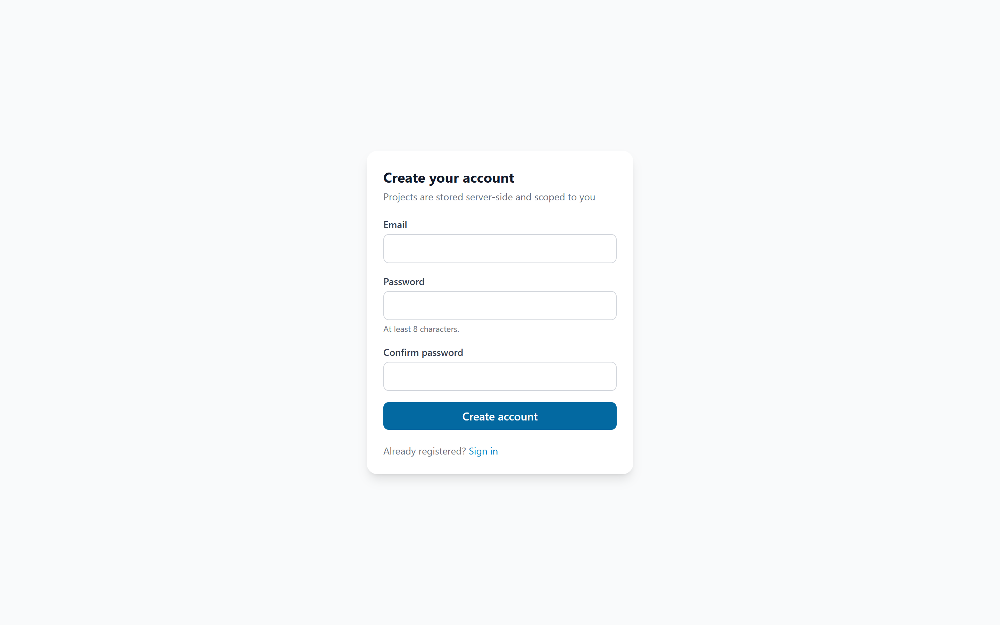

*Figure 1 — The **Create your account** screen. Enter your email, choose a password of at least 8 characters, and type it again.*

> **Important — there is no "forgot password" link.** Bonafoid does not send emails, so a password reset link cannot be delivered. Keep your password somewhere safe. If you lose it, ask the person who runs your Bonafoid server for help.

### 3.2 Sign in (returning users)

1. Open the Bonafoid address.
2. Enter your **Email** and **Password**.
3. Select **Sign in**. The button shows **Working…** while it connects.

If the details are wrong, you will see **Invalid email or password**. Check your typing and try again.

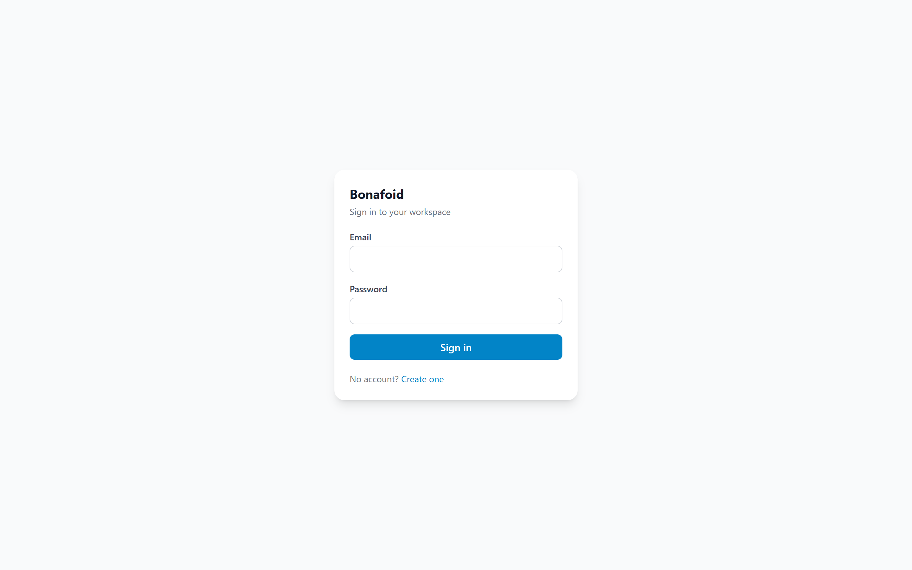

*Figure 2 — The **Sign in** screen. Enter the email and password you registered with, then select **Sign in**.*

> **Why no "remember me"?** Your session is already kept safely in a long-lived browser cookie, so there is no need for a checkbox.

---

## 4. Finding your way around

Once you are signed in, you will see a screen called **Projects**. Open a project (or create one — see the [tutorial](#5-tutorial-build-your-first-app)) and the **editor** appears.

### 4.1 The editor layout

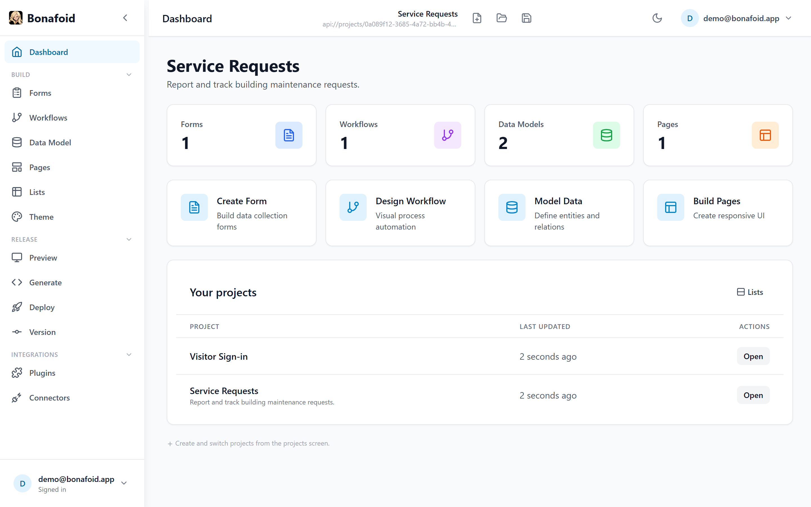

*Figure 3 — The editor as you first see it: the header runs across the top, the sidebar is on the left, and the current screen fills the middle.*

**Top header**

- The **project name**. A `*` appears next to it while you have unsaved changes.
- **New project**, **Open project** and **Save project** buttons (shown as small icons).
- A **theme toggle** (a moon or sun icon) — switches Bonafoid between light and dark appearance. This changes only how the editor looks to you, not your published app.
- Your **user menu** (your initials or email) — opens **Workspaces**, **Billing**, **Admin**, **Settings** and **Logout**.

**Left sidebar** — grouped into three sections:

| Section | What is in it |
|---|---|
| **Dashboard** | Your project overview and the list of your projects |
| **Build** | Forms, Workflows, Data Model, Pages, Lists, Theme |
| **Release** | Preview, Generate, Deploy, Version |
| **Integrations** | Plugins, Connectors |

You can click a section heading (**Build**, **Release**, **Integrations**) to collapse or expand it, and use the collapse button at the bottom to reduce the sidebar to icons. On a narrow screen, a menu button at the top-left opens the sidebar.

**Messages** appear in the bottom-right corner of the screen. They tell you when something worked, when something failed, and what to do next. Messages disappear after a few seconds.

### 4.2 The Projects screen

- Type a name into **New project name** and select **Create** to start a new project.
- **Import project** lets you bring back a project you previously exported as a `.json` file.
- Each project row shows its name, description (or **No description**), when it was last updated, and buttons to **Open**, **Duplicate**, **Export JSON** and **Delete** it.
- **Sign out** is at the top-right.

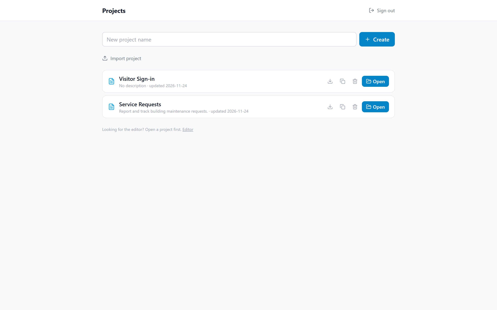

*Figure 4 — The **Projects** screen. Type a name and select **Create**, or select **Open** on a project you already have.*

### 4.3 The Dashboard

The Dashboard is your starting point inside a project. It shows:

- Four counters — **Forms**, **Workflows**, **Data Models** and **Pages** — with the number of each in your project. Click one to go straight to that builder.
- Four shortcuts: **Create Form** ("Build data collection forms"), **Design Workflow** ("Visual process automation"), **Model Data** ("Define entities and relations") and **Build Pages** ("Create responsive UI").
- A **Your projects** card listing your projects with an **Open** button.

---

## 5. Tutorial: build your first app

This walkthrough takes you from a blank account to a working app. We will build a simple **Ticket Requests** app: people submit a request through a form, and you keep a list of all requests.

> Allow around 10–15 minutes. You do not need any coding knowledge.

### Step 1 — Create the project

1. On the **Projects** screen, type `Ticket Requests` into **New project name**.
2. Select **Create**. The editor opens with your new project.

### Step 2 — Describe your data (Data Model)

Every app needs to know what information it stores. We will store one "thing": a ticket request.

1. In the sidebar, under **Build**, select **Data Model**.
2. Select **Add Entity**. An entity is a kind of thing your app keeps track of.
3. Type `TicketRequest` in the **Entity name (PascalCase)** box and select **Create**. (Use one word with capitals — no spaces.)
4. With your new entity selected, add the pieces of information it should hold:
   - Select **Add Field**. Set **Name** to `title`, **Type** to `String`, and tick **Required**.
   - Add another field: **Name** `description`, **Type** `Text`.
   - Add a third: **Name** `status`, **Type** `String`, with **Default** `open`.
5. You will see your fields listed in the **Fields** table with columns for name, type, whether it is the **PK** (primary key — the unique identifier), **Required**, **Unique** and **Default**.

> **No drawing needed:** you edit fields in a table. If you expected to drag boxes onto a canvas, that is not how this version works — the table is the editor.

Bonafoid creates a unique ID field for you automatically. You do not need to add one.

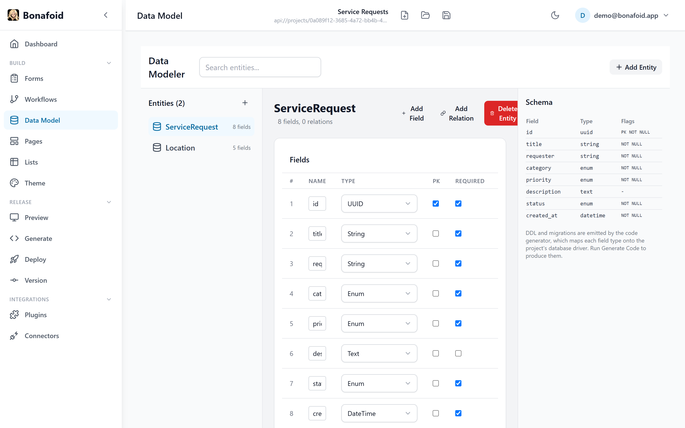

*Figure 5 — An entity in the **Data Model**. Fields are edited in the table; the **Schema** panel on the right summarises them.*

### Step 3 — Build the form people fill in (Forms)

1. In the sidebar, select **Forms**.
2. Select **Create Form**. A form called **Untitled Form** appears.
3. Click the name at the top and rename it to `Request Form`.
4. On the left, under **Field Types**, click a field to add it to the form:
   - **Text Input** — rename it (in the **Field Properties** panel on the right) to **Label** `Title`, **Name** `title`, and tick **Required**.
   - **Text Area** — set **Label** `Description`, **Name** `description`.
5. To edit a field, click it on the canvas, then use the **Field Properties** panel: **Label**, **Name**, **Placeholder**, **Required**, and **Options** (**Add Option**) for dropdown-style fields.
6. Use the **Preview / Edit** toggle at the top to see how the form will look. The preview is display-only — real submissions happen in the generated app, not in the editor.

> Fields can be reordered and duplicated. Drag them, or use the controls on each field.

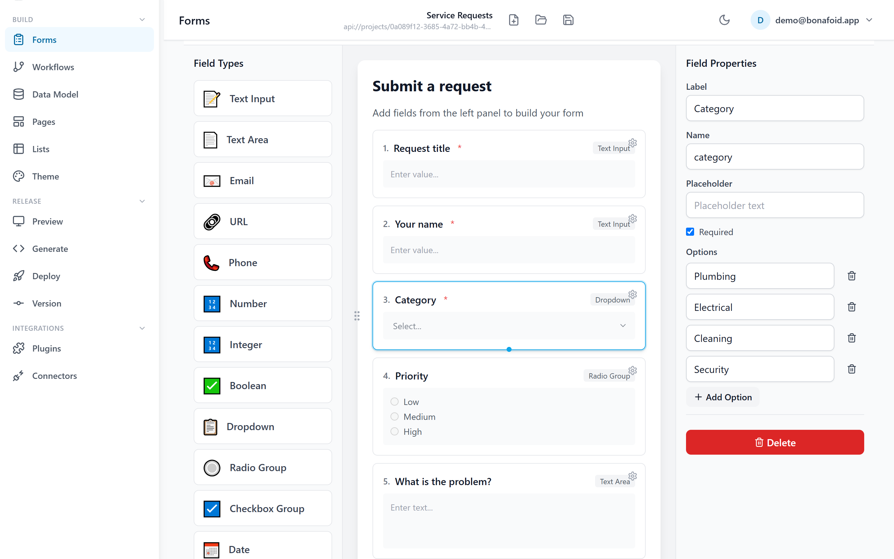

*Figure 6 — The **Forms** builder. Field types are on the left, the form in the middle, and the selected field's settings in **Field Properties** on the right.*

### Step 4 — Create a page that lists requests (Lists)

1. In the sidebar, select **Lists**.
2. Under **Entity**, choose `TicketRequest`.
3. Under **Component kind**, choose **Table**.
4. Select **Generate Page**. Bonafoid creates a data-bound list page for you and shows a preview.

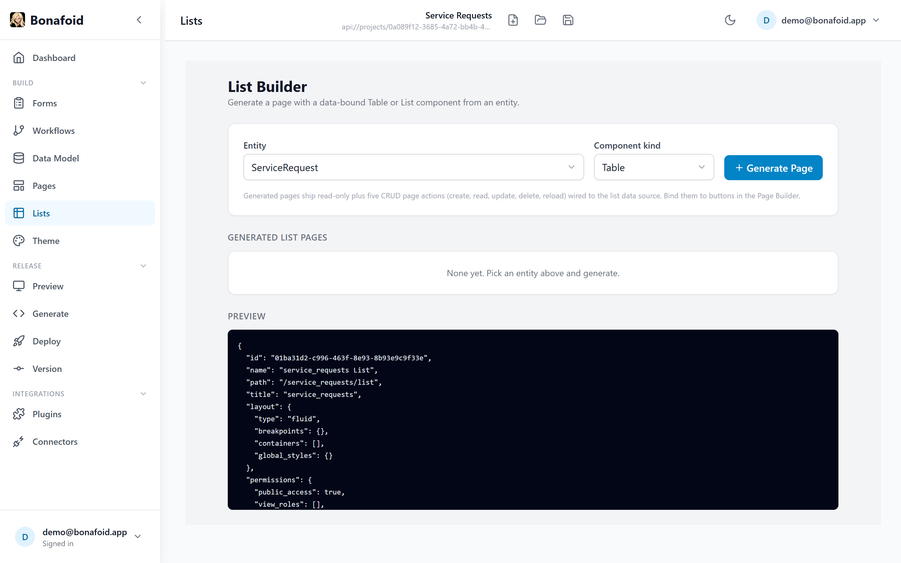

*Figure 7 — The **List Builder**. Choose an **Entity** and a **Component kind**, then select **Generate Page**.*

### Step 5 — Make it yours (Theme, optional)

1. In the sidebar, select **Theme**.
2. Create or open a theme, then choose a colour under the **Colors** tab. Changing a base colour regenerates its shades; click an individual swatch to override one shade.
3. Use the **Live preview** on the right to see buttons, text and cards with your colours.
4. Select **Set active** so your theme is used by the generated app.

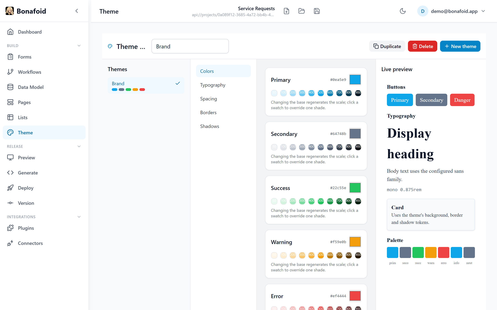

*Figure 8 — The **Theme Builder**. Change a base colour and the **Live preview** on the right updates straight away.*

> In Settings → Frontend you will see the framework is **Leptos (Rust / WASM)** and the bundler is **Trunk**. Both are fixed in this version — that is expected.

### Step 6 — Try it (Preview)

1. In the sidebar, under **Release**, select **Preview**.
2. Choose a **Target** — **App + API** to try the whole thing.
3. Select **Build & Run**. Bonafoid generates the code, builds it on the server and starts it. You will see the steps: **Queued**, **Generating code**, **Building backend**, **Building frontend**, then **Ready**.
4. When it is ready, select **Start app** and look at the **Application preview** panel. Use **Open preview in a new tab** for a bigger view.
5. The **Build log** on the right shows what happened. Use **Stop app** when you are finished.

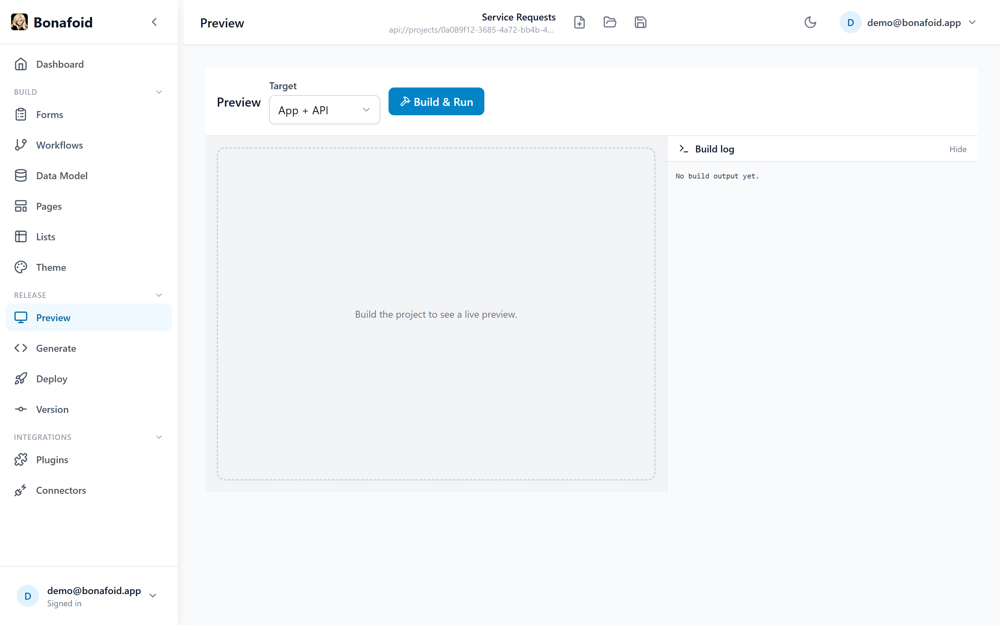

*Figure 9 — **Preview** before your first build. Select **Build and Run** and Bonafoid compiles and starts your app for you.*

> If the server does not have the build tools installed, Preview says **Hosted preview unavailable** and recommends using **Generate** instead. That is not a problem with your project — see the [troubleshooting guide](troubleshooting.md).

### Step 7 — Get the application files (Generate)

1. In the sidebar, under **Release**, select **Generate**.
2. Check **Output Directory** (defaults to `./generated`) and **Database** (leave **SQLite** unless you know you need something else).
3. Select **Generate Code**. The status moves from **Idle** to **Generating…** to **Ready**, and a report shows how many files were written for the backend, frontend and migrations.
4. In the web IDE, your project is downloaded as a `.zip` file named after your project id. Keep this file — it is your working application.

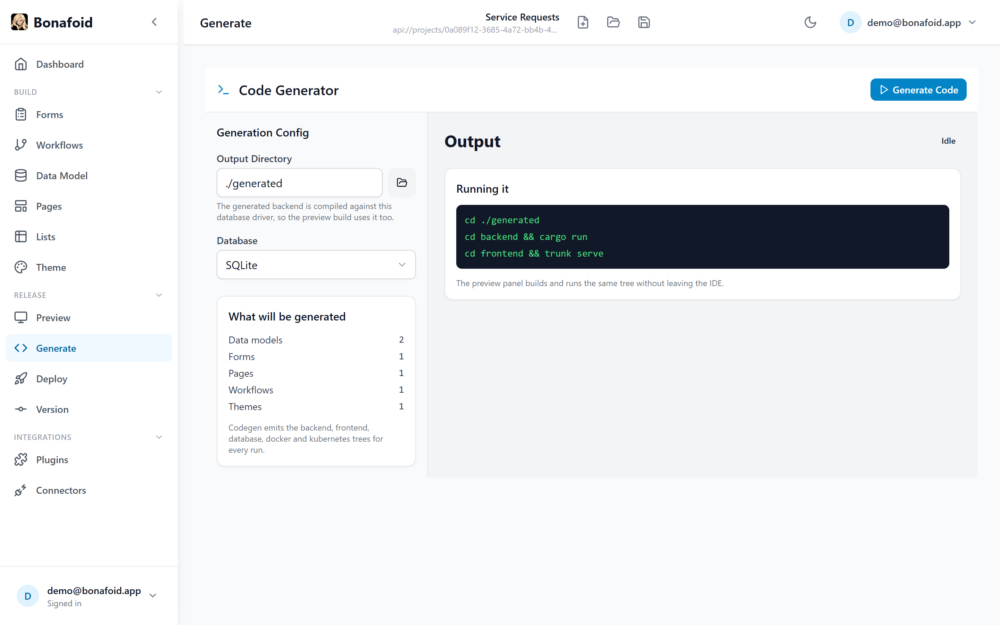

*Figure 10 — **Generate**. The **What will be generated** card counts the data models, forms, pages, workflows and themes in your project.*

### Step 8 — Save your work

Your changes are saved automatically a moment after you stop editing (see [Saving, autosave and leaving safely](#7-saving-autosave-and-leaving-safely)). To be certain, use the **Save project** button in the header.

**Congratulations — you have built your first Bonafoid app.**

---

## 6. Feature walkthroughs

Each section below explains one screen: what it is for, what you will see, and what to do.

### 6.1 Forms

**Where:** Sidebar → **Build** → **Forms**.
**What it does:** Designs the forms your app's users will fill in — contact forms, request forms, surveys, and so on.

**What you will see**

- If there are no forms: **No forms yet** and a **Create Form** button.
- A toolbar with the form's name, a field count (for example **3 fields**), and a **Preview / Edit** toggle.
- **Field Types** on the left — 20 kinds of field, including **Text Input**, **Text Area**, **Email**, **URL**, **Phone**, **Number**, **Boolean**, **Dropdown**, **Radio Group**, **Checkbox Group**, **Date**, **Date & Time**, **Time**, **File Upload**, **Image**, **Signature**, **Rich Text**, **JSON** and **Relation**.
- The form canvas in the middle. When empty: **No fields added yet** — pick a field type from the left.
- **Field Properties** on the right: **Label**, **Name**, **Placeholder**, **Required**, **Options** (with **Add Option**) and **Delete**. If nothing is selected: **Select a field to edit its properties**.

*Figure 11 — The **Forms** builder with the **Category** field selected, so its options appear in **Field Properties**.*

**How to use it**

1. Click a field type on the left to add it.
2. Click a field on the canvas to edit its properties on the right.
3. Drag fields to reorder them; use the duplicate/delete controls to manage them.
4. Toggle **Preview** to check the layout. Bonafoid reminds you: *"Preview only. Submissions are handled by the generated application, not by the IDE."*

**Common question:** *Why doesn't the form submit anything here?* Because the editor only designs the form. When you Generate and run the app, the generated application handles submissions.

---

### 6.2 Workflows

**Where:** Sidebar → **Build** → **Workflows**.
**What it does:** Draws a process — a sequence of steps and decisions — using BPMN 2.0, a standard way of describing business processes.

**What you will see**

- A toolbar: **Validate**, **Run**, **Run to end**, **Import BPMN**, **Export BPMN**, and a box for **Run variables (JSON object)**.
- A **Processes** list on the left, with a **New process** box and **Add** button. Each process has a delete button.
- An **Elements** palette grouped as events, tasks, gateways and composite: **Start**, **End**, **User task**, **Service task**, **Script task**, **Business rule**, **Send message**, **Receive message**, **Manual task**, **Generic task**, **Exclusive gateway**, **Inclusive gateway**, **Parallel gateway**, **Event gateway**, **Sub-process**, **Call activity**.
- A canvas in the middle where you drag elements and connect them by dragging from one point to another.
- A **Properties** panel on the right. With nothing selected: **Select a node or a flow on the canvas.** Select a node to edit **Node name**, **Node type (JSON)** and **Node config (JSON)**. Select a flow to edit its **Label** and **Condition** (for example `${approved == true}`).

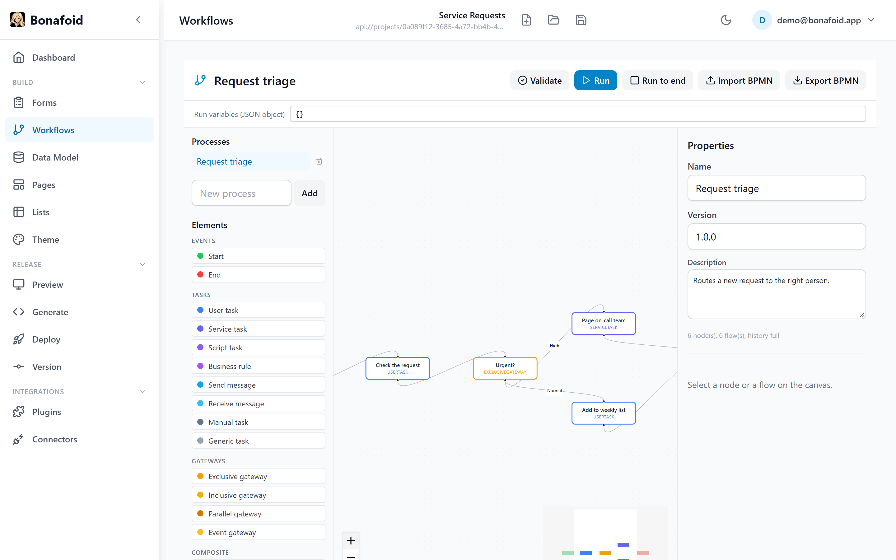

*Figure 12 — A process on the workflow canvas. Select any node to edit it in the **Properties** panel on the right.*

**How to use it**

1. Create or select a process.
2. Drag a **Start** event onto the canvas, then the tasks and decisions you need, then an **End** event.
3. Connect them in order by dragging between the small connection points.
4. Select **Validate** to check the diagram. Bonafoid reports **Valid: N node(s), N flow(s).** or **Invalid: N issue(s).**
5. Select **Run** (step through) or **Run to end** to test it. If a step needs data, put it in **Run variables (JSON object)** first.
6. Use **Import BPMN** to bring in a process from a `.bpmn` file (you must give it a **Process name**), and **Export BPMN** to save a copy. Bonafoid includes sample `.bpmn` files you can try.

> **Know this before you rely on it:** In this version, workflows are a *design and testing artifact*. The IDE can validate and run them, but the generated application does **not** execute workflows at runtime. See [What Bonafoid does not do yet](#10-what-bonafoid-does-not-do-yet).

---

### 6.3 Data Model

**Where:** Sidebar → **Build** → **Data Model**.
**What it does:** Defines the information your app stores — the equivalent of the tables in a spreadsheet or database.

**What you will see**

- A toolbar: **Add Entity** and a **Search entities...** box.
- An **Entities (N)** list on the left. To add one, type a name in the **Entity name (PascalCase)** box and choose **Create** / **Cancel**.
- When nothing is selected: **Select an entity or create a new one**, with a **Create Entity** button.
- With an entity selected: its name, a count (**N fields, N relations**), and buttons **Add Field**, **Add Relation**, **Delete Entity**.
- A **Fields** table with columns **#**, **Name**, **Type**, **PK**, **Required**, **Unique**, **Default** and **Actions**. Available types: **String**, **Text**, **Integer**, **Big Integer**, **Float**, **Decimal**, **Boolean**, **Date**, **DateTime**, **JSON**, **UUID**, **Enum**, **Relation**.
- A **Relations** table with **Name**, **Type**, **Target Entity**, **Target Field** and **Actions**. Relation types: **Belongs To**, **Has One**, **Has Many**, **Many to Many**.
- A **Schema** panel on the right summarizing fields and flags. It notes that *"DDL and migrations are emitted by the code generator… Run Generate Code to produce them."*

*Figure 13 — An entity's fields in the **Data Model**, with its **Schema** summary on the right.*

**How to use it**

1. Create an entity for each kind of thing your app tracks (for example `Customer`, `Order`).
2. Add a field for each piece of information you want to keep.
3. Mark a field **Required** if it must always have a value, and **Unique** if no two records may share it.
4. Add relations to describe how entities connect (for example an Order belongs to a Customer).
5. When you are ready, use **Generate** to create the actual database files.

**Plain-language guide to flags**

| Flag | Meaning |
|---|---|
| **PK** | Primary key — the unique identifier for each record. Bonafoid adds one for you. |
| **Required** | The value cannot be empty. |
| **Unique** | No two records can have the same value. |
| **Default** | The value used if you do not supply one. |

---

### 6.4 Lists

**Where:** Sidebar → **Build** → **Lists**.
**What it does:** Quickly creates a screen that shows records from one entity as a table or a list.

**What you will see**

- The heading **List Builder** and the explanation: *"Generate a page with a data-bound Table or List component from an entity."*
- If you have no entities: **No entities yet — create one in the Data Modeler first.**
- Two dropdowns — **Entity** and **Component kind** (**Table** or **List**) — and a **Generate Page** button.
- A **Generated list pages** section (**None yet. Pick an entity above and generate.**) and a **Preview** of the page JSON.

*Figure 14 — The **List Builder** before any page has been generated. The JSON preview underneath shows exactly what will be created.*

**How to use it**

1. Create your entity in the Data Model first.
2. Pick it under **Entity**, choose **Table** or **List**, then select **Generate Page**.
3. Open **Pages** to refine the generated page — Bonafoid notes that the list itself is read-only until you bind CRUD actions (create, read, update, delete, reload) in the Page Builder.

---

### 6.5 Pages

**Where:** Sidebar → **Build** → **Pages**.
**What it does:** Assembles the screens of your app from ready-made components.

**What you will see**

- The **Page Builder** heading and a **New Page** button. Creating a page asks for a **Page name**.
- A list of your pages. For the selected page you can edit **Name** and **Path** and use **Delete page**.
- Device buttons — **Monitor**, **Tablet**, **Smartphone** — to preview at different widths. An empty page says **Add components from the palette on the right**.
- Each component on the page has controls to move it up/down, duplicate it and delete it.
- An inspector with **Component config (JSON)**, **Props (JSON)**, **Data bindings** (**Data source**, **Path**, **Prop**, **Add binding**) and **Page actions** (**Add**).
- A **Palette** on the right, grouped into categories:
  - **Layout** — Container, Grid, Flex, Card, Tabs, Accordion, Divider
  - **Data** — Table, Detail view, Chart, Stat card, Progress bar, Tree, Transfer, Cascader, Tree select
  - **Basic** — Text / HTML, Image, Avatar, Badge, Tag, Video, Audio, Iframe, Custom
  - **Input** — Button, Button group, Form, Form field, Date picker, Time picker, Color picker, File upload, Rate, Slider, Mention
  - **Feedback** — Alert, Message, Notification, Loading, Skeleton, Spin, QR code
  - **Navigation** — Link, Breadcrumb, Steps, Menu, Anchor, Back to top, Pagination

**Page actions** you can attach include **Navigate**, **Open modal**, **Close modal**, **Submit form**, **Reset form**, **Call API**, **Execute workflow**, **Set state**, **Emit event**, **Download**, **Copy to clipboard** and **Print**.

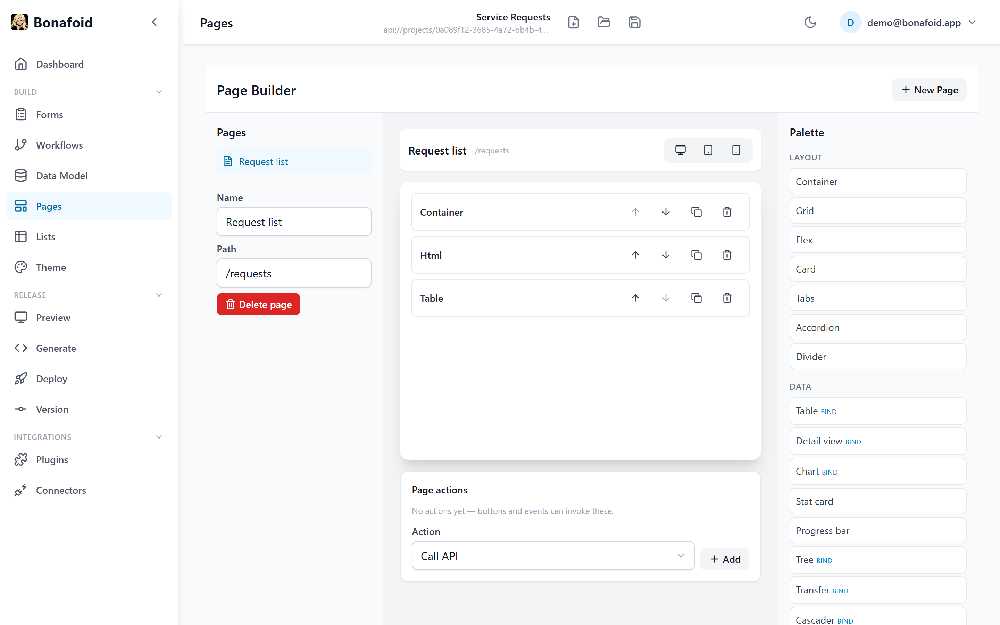

*Figure 15 — The **Page Builder**. Your page's components are listed in the middle and the **Palette** of available components is on the right.*

> Items marked **bind** in the palette need a data binding to work. If a component looks empty in the preview, check its bindings.

---

### 6.6 Theme

**Where:** Sidebar → **Build** → **Theme**.
**What it does:** Controls the colours, fonts and spacing of your generated app.

**What you will see**

- The **Theme Builder** heading, a **Theme name** box and buttons **Set active**, **Duplicate**, **Delete** and **New theme**.
- A **Themes** list. Empty state: **No themes yet. Codegen uses the active theme's tokens.**
- Tabs: **Colors**, **Typography**, **Spacing**, **Borders**, **Shadows**.
- Under **Colors**, colour roles such as **primary**, **secondary**, **success**, **warning**, **error** and **info**, each with shades from 50 to 900. Hint: *"Changing the base regenerates the scale; click a swatch to override one shade."*
- Under **Typography**, font families (**sans**, **serif**, **mono**) and sizes (**xs** through **xxl**). Spacing, borders and shadows are shown as visual editors.
- A **Live preview** on the right showing **Buttons**, **Typography**, **Card** and **Palette**.

*Figure 16 — Colour scales in the **Theme Builder**, with the **Live preview** showing how buttons, headings and cards will look.*

**How to use it:** change a colour, check the live preview, then select **Set active** so your generated app uses it. Only the active theme's tokens are used by code generation.

---

### 6.7 Preview

**Where:** Sidebar → **Release** → **Preview**.
**What it does:** Builds and runs your generated app on the server so you can try it in the editor.

**What you will see**

- A **Target** dropdown: **App + API**, **Backend only** or **Frontend only**.
- Buttons **Build & Run** / **Rebuild**, **Cancel**, **Start app**, **Stop app** and a refresh button.
- Status labels: **Queued**, **Generating code**, **Building backend**, **Building frontend**, **Ready**, **Cancelled**, **Failed**. When running, you will see something like **app :8080**.
- A toolchain line such as **Host toolchain: cargo ok, trunk ok** (or **missing — cargo install trunk**).
- An **Application preview** panel. Messages include **Build the project to see a live preview.** and **The app is built. Start it to see it here.**
- A **Build log** panel with **Hide / Show**, **No build output yet.**, **Earlier builds** and **Open preview in a new tab**.

*Figure 17 — **Preview** waiting for a build. The dashed panel is where your running app appears once it is ready.*

**How to use it:** choose a target, select **Build & Run**, wait for **Ready**, select **Start app**, then try the app in the preview panel. Use **Stop app** when finished, or **Cancel** to abort a build.

> Previews are limited per user and stop automatically after a period of inactivity. If you see **Hosted preview unavailable**, the server lacks the build tools — use **Generate** instead. [Learn more](troubleshooting.md#preview-says-hosted-preview-unavailable).

---

### 6.8 Generate

**Where:** Sidebar → **Release** → **Generate**.
**What it does:** Produces the real application files from your design.

**What you will see**

- A **Generate Code** button (shows **Generating...** while it runs).
- **Generation Config**: **Output Directory** (default `./generated`, with a folder picker) and **Database** (**SQLite**, **PostgreSQL**, **MySQL**, **SQL Server**, **Oracle**).
- A **What will be generated** card with live counts for **Data models**, **Forms**, **Pages**, **Workflows** and **Themes**.
- An output area with a status pill — **Idle**, **Generating...**, **Ready** or **Failed** — and report cards for **Backend Files**, **Frontend Files**, **Migrations** and **Output**.
- A **Running it** card with the commands used to run the app, and a **Generation Log** with a **Clear** button.

*Figure 18 — **Generate** with the output area on the right. After a run it lists the backend files, frontend files and migrations it wrote.*

**How to use it:** set the output directory and database, select **Generate Code**, then review the report and log. In the web IDE, the result is downloaded as a `.zip`.

> Code generation always writes the backend, frontend, database, Docker and Kubernetes files — there are no checkboxes to choose subsets. **SQLite** is the recommended database; other options generate files but are not verified end to end.

---

### 6.9 Project Settings

**Where:** User menu → **Settings** (or the **Settings** item in the sidebar on some layouts).
**What it does:** Sets values that are written into the generated application: project name, database and frontend.

- The page says: *"These values are written into the generated application."* and shows an **Unsaved changes** or **Saved** badge plus a **Save Changes** button.
- **General** tab — **Project Name**, a read-only **Slug**, and **Description**. Renaming also rewrites the slug, which determines the generated code's package name.
- **Database** tab — **Database Driver** and **Connection URL** (for example `sqlite://app.db`). Bonafoid warns: *"Only PostgreSQL and SQLite are validated end to end. Other drivers generate, but previews are not verified against them."* Leave the URL empty to use a throwaway database.
- **Frontend** tab — **Framework: Leptos (Rust / WASM)** and **Bundler: Trunk** (shown but disabled). Both are fixed in this version.

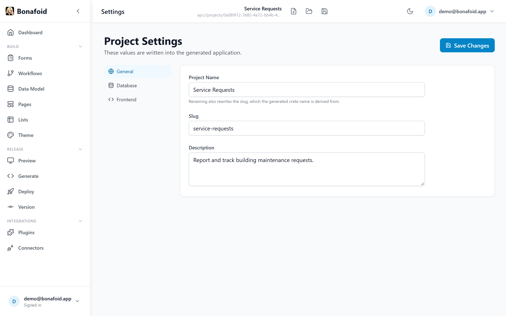

*Figure 19 — **Project Settings**, **General** tab. Select **Save Changes** to write these values into the generated application.*

> Looking for authentication, email or notification settings? They were removed from the screen because changing them had no effect on generated code. See the [FAQ](faq.md#where-did-my-other-settings-tabs-go).

---

### 6.10 Plugins

**Where:** Sidebar → **Integrations** → **Plugins**.
**What it does:** Installs small add-on modules that extend Bonafoid.

- The screen states: *"There is no marketplace: the IDE installs what you give it."*
- **Install a plugin** asks for two files: a **Manifest (plugin.json)** and a **Module (.wasm)**, then **Install**. Plugins run in a **Sandboxed** environment with a limited fuel budget and memory cap.
- **Installed plugins** shows how many are on (**N of N**). Each card shows **Enabled** or **Disabled**, its **Permissions**, and **Enable / Disable** and **Uninstall** buttons.
- You can search with **Search installed plugins** and use **Refresh**.
- Plugins are private to your account.

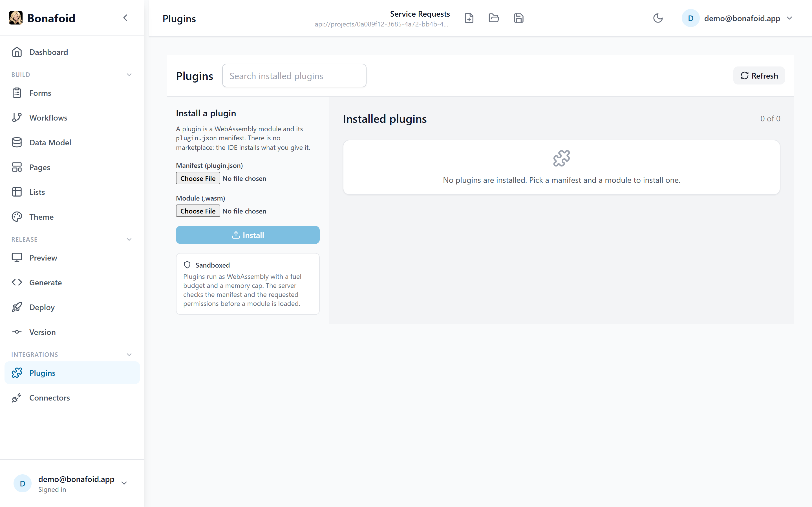

*Figure 20 — The **Plugins** screen. Installing needs two files you already have: a **Manifest (plugin.json)** and a **Module (.wasm)**.*

> There is no plugin store to browse. You must already have the two files. On the desktop IDE this screen says **Plugins need the IDE server**.

---

### 6.11 Deployment, versioning and team features

These are advanced screens. They appear in the editor but are usually set up by a technical administrator.

| Screen | What it is for |
|---|---|
| **Deploy** | Publishes the generated app using GitHub and Docker Hub credentials saved in an encrypted vault. You set an owner, repository and branch, a personal access token, Docker Hub details and a **Public API base URL**, then select **Deploy**. A push is not a deployment — the page reports **Deployed** only after the automated build has succeeded for that exact version. |
| **Version** | Keeps a history of your project: **Branches**, **Commit current project**, **Revision history**, **Diff** (from one revision to another), **Environments**, **Set secret**, **Promote** and **Rollback**. |
| **Workspaces** | For teams — create workspaces, invite members and assign roles, and suspend or activate workspaces. |
| **Billing** | Shows the current subscription, plans, entitlements and invoices. |
| **Administration** | Platform-wide metrics (MRR, ARR, active subscriptions, churn), tenants, users, flags and an audit log. |
| **Connectors** | Stores credentials for outside services and lets you invoke them. Secrets are write-only — once saved, they cannot be read back. |

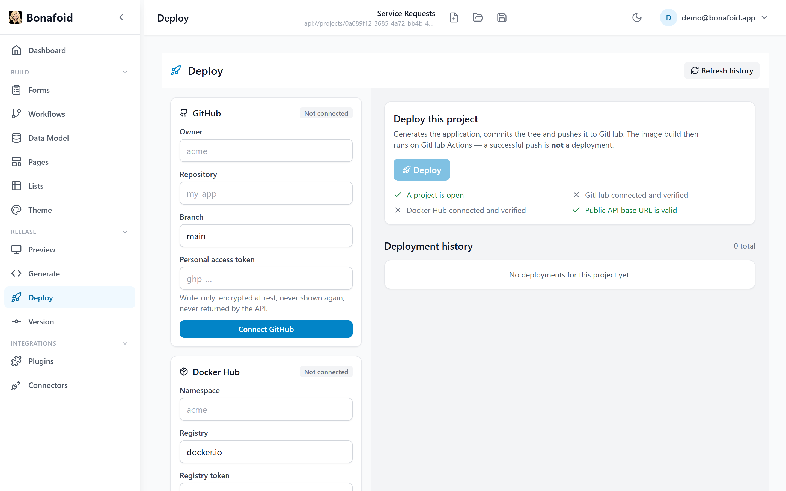

*Figure 21 — The **Deploy** screen. GitHub and Docker Hub must be connected before a deployment can run; the checklist on the right shows what is still missing.*

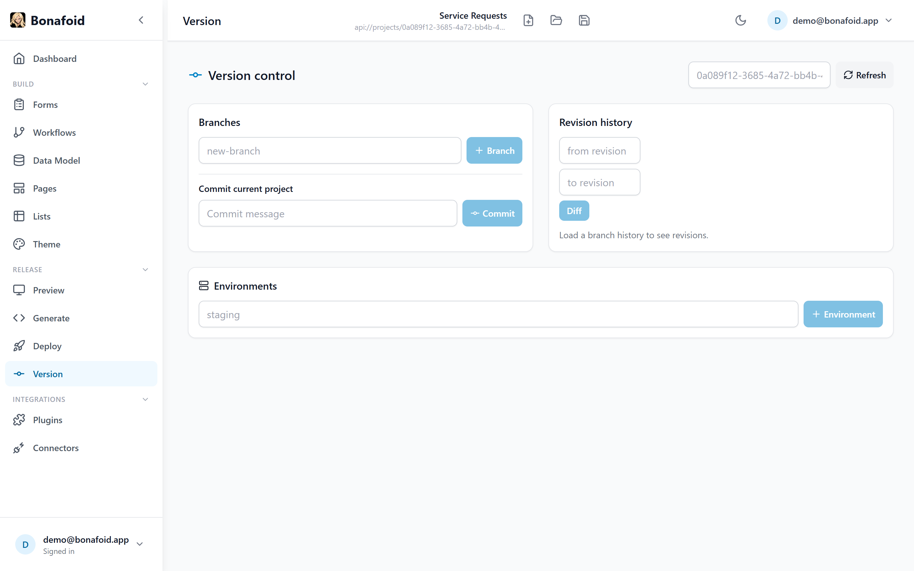

*Figure 22 — The **Version** screen, where branches, revisions, environments and rollbacks are managed.*

> If a screen says **Deployments are not available on this host** or similar, the server has not been configured for that feature. Ask your administrator — it is not a problem with your project.

---

## 7. Saving, autosave and leaving safely

- **Autosave is always on.** About 1.5 seconds after you stop editing, Bonafoid saves your work to the server. A small **Unsaved changes** badge appears while it waits.
- **Use Save when you want certainty.** The **Save project** button in the header saves immediately and bypasses the short wait.
- **If a project has never been saved**, Bonafoid tells you: *"This project has not been saved yet — Use Save (or Save As) to choose where it lives; until then your edits only exist in this tab."*
- **If autosave fails**, a **Autosave failed** message appears. Do not close the tab — try **Save project** and check your connection.
- **Leaving with unsaved work** triggers a confirmation: *"This project has unsaved changes. Leave without saving them?"* It appears when you close the tab, go to the Projects screen, sign out, or open another project. Choose **Cancel** to stay, or **OK** to leave and discard the unsaved edits.

> **Good habit:** wait for the **Unsaved changes** badge to disappear, or press **Save project**, before closing your browser.

---

## 8. Using Bonafoid without a mouse

Bonafoid is designed to be usable with a keyboard:

- Every button, field and canvas item can be reached with **Tab**. Press **Enter** or **Space** to activate a focused item.
- On the workflow canvas and in field lists, use the arrow keys — in particular **↑** and **↓** on a drag handle — to reorder items.
- Inline forms close with **Escape**, and focus returns to the button that opened them.
- Dialogs keep focus inside until you close them.
- Bonafoid checks that text remains readable in both light and dark themes.

---

## 9. Plain-language glossary

| Term | Meaning |
|---|---|
| **App / application** | The thing you are building — a website that stores data and lets people interact with it. |
| **Backend** | The behind-the-scenes part that stores data and answers requests. |
| **Frontend** | The part people see and click in the browser. |
| **Entity** | A kind of thing your app stores, such as a customer or an order (like a table in a spreadsheet). |
| **Field** | One piece of information about an entity, such as an email address. |
| **Form** | A set of inputs people fill in. |
| **Workflow / BPMN** | A drawing of a process with steps and decisions. BPMN 2.0 is the standard file format for these drawings. |
| **Page** | One screen of your app. |
| **Component** | A building block on a page — a button, table, image, and so on. |
| **Binding** | A link that fills a component with live data. |
| **Theme** | The colours, fonts and spacing used by your app. |
| **Token** | A single named design value, such as "primary colour". |
| **Generate / codegen** | Turning your visual design into real application files. |
| **Preview** | Running the generated app inside Bonafoid to try it. |
| **Deploy** | Publishing the app so other people can use it. |
| **Database / DB** | Where your app's information is stored. |
| **SQLite** | A simple database that lives in a single file — the default, and the easiest choice. |
| **Migration** | A file that sets up or changes the database structure. |
| **Docker / Kubernetes** | Ways of packaging and running an application on servers. |
| **Plugin** | An optional add-on module that extends Bonafoid. |
| **Slug** | A short, URL-friendly name for a project, derived from its name. |
| **PK (primary key)** | The unique identifier for each stored record. |
| **CSRF** | A safety check that helps stop other websites from sending commands on your behalf. Happens automatically. |
| **Raw JSON** | A way of writing structured data. A few advanced panels accept it; you can leave them as they are. |

---

## 10. What Bonafoid does not do yet

Knowing these limits up front will save you time. None of them is a mistake on your part.

| Limitation | What it means for you |
|---|---|
| **SQLite is the only fully supported database** | Use **SQLite** unless an administrator tells you otherwise. Other choices in the dropdown generate files but are not verified. |
| **Generated apps do not run workflows** | You can design, validate and test workflows in the IDE, but the published app will not execute them at runtime yet. |
| **No "forgot password"** | There is no email service, so keep your password safe. |
| **No user lockout or rate limiting yet** | Do not expose the server to untrusted users without additional protection. |
| **Concurrent edits: last write wins** | If two people edit the same project at once, the later save overwrites the earlier one. Avoid editing the same project simultaneously. |
| **Many-to-many relations are skipped by the generator** | Use **Has Many** / **Belongs To** instead for now. |
| **No plugin marketplace** | You must supply the plugin files yourself. |
| **Bundler and frontend framework are fixed** | Trunk and Leptos are the only options in this version. |
| **No SQL preview window or drag-and-drop data canvas** | The Data Model screen uses tables, and database files are produced by **Generate**. |

---

### Need more help?

- Start with the [FAQ](faq.md) for quick answers.
- Use the [Self-Service Troubleshooting Guide](troubleshooting.md) if something is not working.
- If you are running your own server, the project [README](../README.md) has setup and configuration details.
